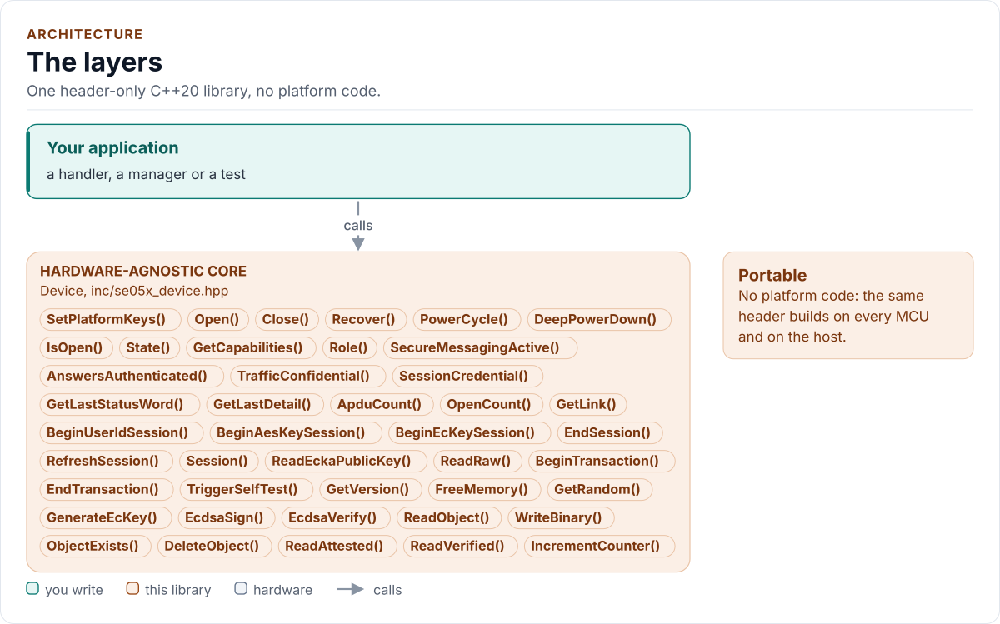

# Architecture

How the driver is built: layers with one owner each, ports at the bottom, and what happens in each when you open the
device.

<!-- generated: datasheet-refs -->
??? abstract "Datasheet sections this page relies on"

    From NXP AN13030 Rev. 2.7:

    - Timeouts and waiting time extensions: 2.10, p. 9
    - APDU throughput limit, SW 0x66A6: 2.12 and 10.16.6, p. 10
    - ECKey session flow and receipt: ECKey session, p. 156
    - T=1 chip reset and deep power-down: 10.16, p. 281

    All of them, with the driver API for each: [Datasheet map](datasheet.md).
<!-- /generated -->

<!-- figure: driver-layers -->
<picture>
  <source media="(prefers-color-scheme: dark)" srcset="diagrams/driver-layers.dark.svg">
  
</picture>
<!-- /figure -->
## Layers

| Layer | Header | Job |
| --- | --- | --- |
| Ports | `se05x_ports.hpp` | Bus, clock, crypto, optional reset and log; CRTP, checked by concepts |
| T=1 link | `se05x_t1.hpp`, `se05x_atr.hpp` | Framing, CRC, WTX, the recovery ladder (resend, resync, interface reset, reselect, chip reset, power cycle) |
| APDU and TLV | `se05x_apdu*.hpp` | Builders and parsers; the status word map |
| Secure channels | `se05x_scp03.hpp`, `se05x_eckey.hpp`, `se05x_gp.hpp` | SCP03, ECKey sessions, GlobalPlatform commands |
| Capability gate | `se05x_gate.hpp`, `se05x_caps.hpp` | Refuses what the chip cannot do before it reaches the bus |
| Objects and policies | `se05x_objects.hpp`, `se05x_policy.hpp` | Typed ids, classes and generation-typed policy bits |
| Device | `se05x_device.hpp` | `Execute<C>` over 105 commands, lifecycle, sessions |
| Facade | `se05x_hrot.hpp` | Slots, key handles, identity, attestation, the APDU budget |

A bad frame is retried by the link; a lost chip climbs the ladder. A reset closes every session, so each rung drops
all session knowledge. The chip's throughput limit (SW 0x66A6) maps to `ThroughputLimited` and ends in a chip reset.

## Test model

The tests do not use the NXP middleware. A chain `T1Target` -> `ScpTarget` -> `ChipModel` implements `ApduHandler`
(`tests/model/model_if.hpp`) and is written from the data sheets and application notes, with knobs for the open
questions ([Ambiguities](ambiguities.md)).
