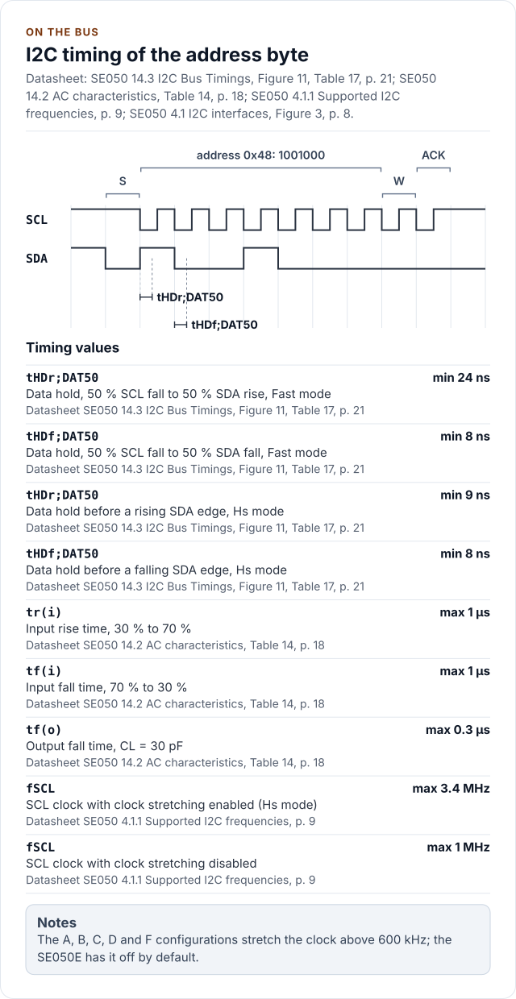
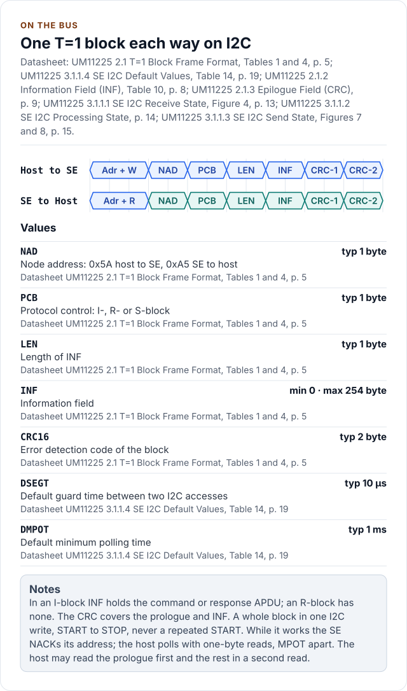

# On the bus

What the SE05x needs from the I2C bus, signal by signal, and how one T=1 block travels over it, with every time,
rate and field size taken from the vendor documents. The connections are on the [Hardware](hardware.md) page and the
block rules, the waits and the recovery on [Transport (T=1)](transport.md); this page is the waveform under them.

## I2C timing

The SE05x is an I2C target at the 7-bit address `0x48` (`kI2cAddress`; SE050 section 4.1, Figure 3). The SE050 and
SE051 data sheets allow 3.4 MHz with clock stretching and 1 MHz without (section 4.1.1); the A, B, C, D and F
configurations of the SE050 stretch the clock above 600 kHz, while the SE050E and the SE051 have stretching off by
default. The driver stays at 400 kHz (`kMaxClockHz`), which holds for every part and setting. The data sheets give
their own data hold times, which replace tHD;DAT of the I2C-bus specification, and the edge times of the pads; every
other interval follows the I2C-bus specification. The SE051 data sheet repeats the SE050 values (Table 16, p. 23);
the SE052 data sheet gives the 3.4 Mbit/s limit (section 9, p. 6) and no I2C timing table.

<!-- figure: i2c-timing -->
<picture>
  <source media="(prefers-color-scheme: dark)" srcset="diagrams/i2c-timing.dark.svg">
  
</picture>
<!-- /figure -->

## One T=1 block

In the NXP flavour (UM11225) a block is NAD, PCB, LEN, up to 254 bytes of INF and a two-byte CRC. The host writes a
whole block in one I2C write with no repeated START; while the chip works it NACKs its address, and the host polls
with one-byte reads at least MPOT apart, then reads the reply in one or two reads. The GlobalPlatform flavour has a
two-byte LEN and other NAD values: both forms, and how the driver picks one, are on
[Transport (T=1)](transport.md#the-block).

<!-- figure: t1-i2c-block -->
<picture>
  <source media="(prefers-color-scheme: dark)" srcset="diagrams/t1-i2c-block.dark.svg">
  
</picture>
<!-- /figure -->

## Several devices

The data sheets describe no address selection: every SE050, SE051 and SE052 answers at `0x48` out of the factory
(SE050 and SE051 section 4.1; SE052 Table 12, p. 18), so two of them cannot share one bus as they ship. Other chips
on the same bus need addresses other than `0x48`, and the driver never scans the bus (errata I2C.2,
[Transport (T=1)](transport.md#i2c-rules)).

## How these figures are made

Each figure is a model in `docs/model/` (`i2c-timing.timing.yml` and `t1-i2c-block.timing.yml`) that cites the data
sheet section and page of every number; `kokeb-docs figures` draws it and the build fails on a number without a
citation. The values table under each figure is also written as `docs/diagrams/<id>.table.html`.
