# Figures

<!-- Written by kokeb-docs figures from docs/diagrams/figures/*.py. Do not edit by hand. -->

Every figure on this site is drawn by a Python module from facts extracted from the code, so it is rebuilt,
not redrawn, when the code changes. CI runs `kokeb-docs figures --check` and fails when a
committed figure no longer matches the code. Each figure below lists the files it is drawn from.

## ECDH key agreement

<!-- figure: agree-call -->
<picture>
  <source media="(prefers-color-scheme: dark)" srcset="agree-call.dark.svg">
  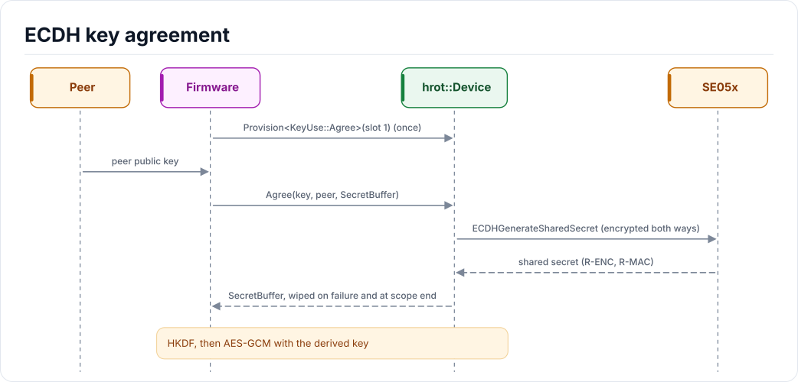
</picture>
<!-- /figure -->

Hardware description: [`docs/model/agree-call.seq.yml`](../model/agree-call.seq.yml)

Drawn from:

- [`docs/model/agree-call.seq.yml`](../model/agree-call.seq.yml)

## An attested read

<!-- figure: attest-call -->
<picture>
  <source media="(prefers-color-scheme: dark)" srcset="attest-call.dark.svg">
  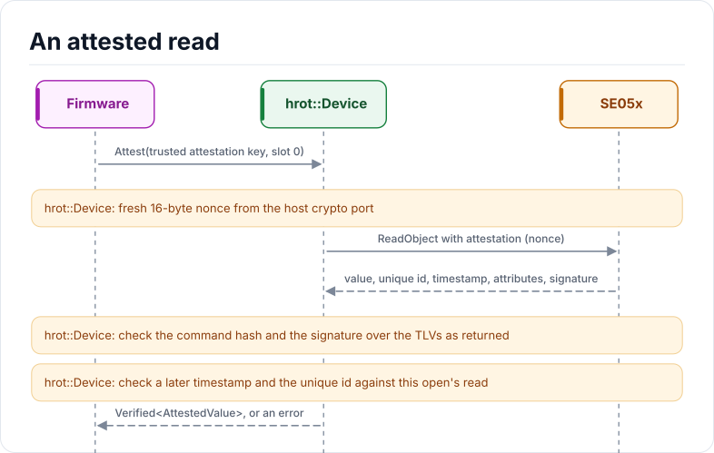
</picture>
<!-- /figure -->

Hardware description: [`docs/model/attest-call.seq.yml`](../model/attest-call.seq.yml)

Drawn from:

- [`docs/model/attest-call.seq.yml`](../model/attest-call.seq.yml)

## Inside the SE05x

<!-- figure: chip-blocks -->
<picture>
  <source media="(prefers-color-scheme: dark)" srcset="chip-blocks.dark.svg">
  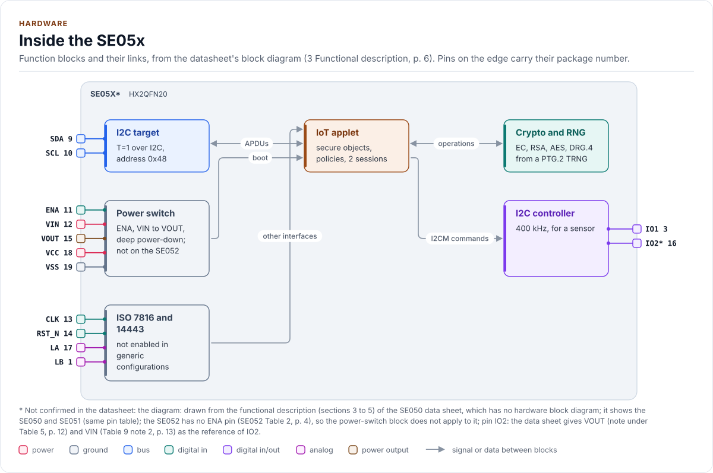
</picture>
<!-- /figure -->

Hardware description: [`docs/hardware.yml`](../hardware.yml)

Drawn from:

- [`docs/hardware.yml`](../hardware.yml)
- [`inc/se05x_ports.hpp`](../../inc/se05x_ports.hpp)

## What the SE05x does

<!-- figure: chip-capabilities -->
<picture>
  <source media="(prefers-color-scheme: dark)" srcset="chip-capabilities.dark.svg">
  
</picture>
<!-- /figure -->

Hardware description: [`docs/hardware.yml`](../hardware.yml)

Drawn from:

- [`docs/hardware.yml`](../hardware.yml)
- [`inc/se05x_ports.hpp`](../../inc/se05x_ports.hpp)

## SE05x: Minimal application, no power cycle (SE050, SE051)

<!-- figure: chip-circuit-minimal -->
<picture>
  <source media="(prefers-color-scheme: dark)" srcset="chip-circuit-minimal.dark.svg">
  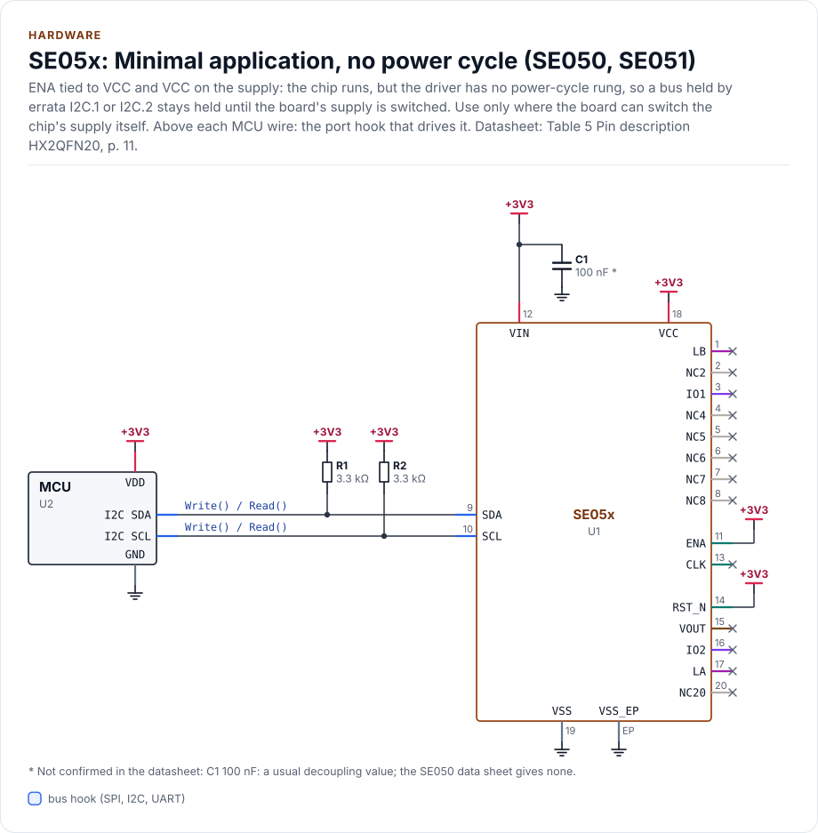
</picture>
<!-- /figure -->

Hardware description: [`docs/hardware.yml`](../hardware.yml)

Drawn from:

- [`docs/hardware.yml`](../hardware.yml)
- [`inc/se05x_ports.hpp`](../../inc/se05x_ports.hpp)

## SE05x: Recommended application (SE050, SE051)

<!-- figure: chip-circuit-typical -->
<picture>
  <source media="(prefers-color-scheme: dark)" srcset="chip-circuit-typical.dark.svg">
  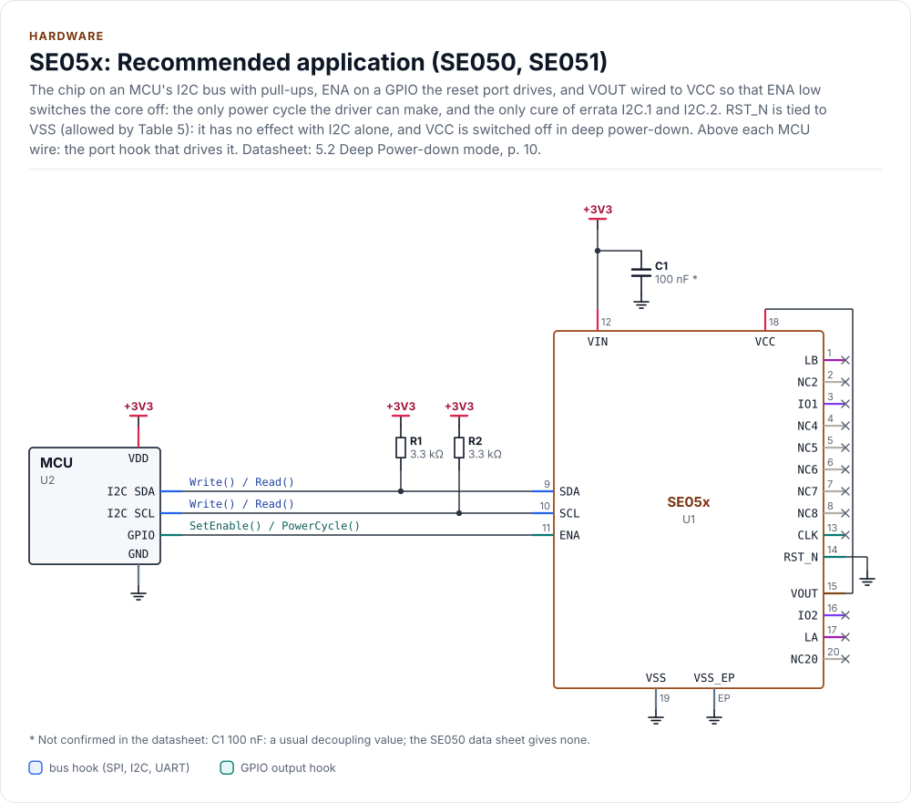
</picture>
<!-- /figure -->

Hardware description: [`docs/hardware.yml`](../hardware.yml)

Drawn from:

- [`docs/hardware.yml`](../hardware.yml)
- [`inc/se05x_ports.hpp`](../../inc/se05x_ports.hpp)

## SE05x: T=1 R-block (acknowledgement)

<!-- figure: chip-frame-t1-rblock -->
<picture>
  <source media="(prefers-color-scheme: dark)" srcset="chip-frame-t1-rblock.dark.svg">
  
</picture>
<!-- /figure -->

Hardware description: [`docs/hardware.yml`](../hardware.yml)

Drawn from:

- [`docs/hardware.yml`](../hardware.yml)
- [`inc/se05x_ports.hpp`](../../inc/se05x_ports.hpp)

## SE05x

<!-- figure: chip-hero -->
<picture>
  <source media="(prefers-color-scheme: dark)" srcset="chip-hero.dark.svg">
  
</picture>
<!-- /figure -->

Hardware description: [`docs/hardware.yml`](../hardware.yml)

Drawn from:

- [`docs/hardware.yml`](../hardware.yml)
- [`inc/se05x_ports.hpp`](../../inc/se05x_ports.hpp)

## SE05x package, HX2QFN20

<!-- figure: chip-outline -->
<picture>
  <source media="(prefers-color-scheme: dark)" srcset="chip-outline.dark.svg">
  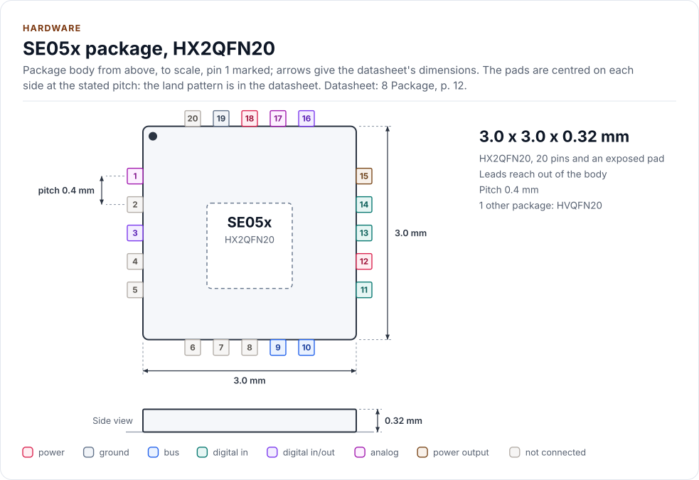
</picture>
<!-- /figure -->

Hardware description: [`docs/hardware.yml`](../hardware.yml)

Drawn from:

- [`docs/hardware.yml`](../hardware.yml)
- [`inc/se05x_ports.hpp`](../../inc/se05x_ports.hpp)

## SE05x pinout, HX2QFN20

<!-- figure: chip-pinout -->
<picture>
  <source media="(prefers-color-scheme: dark)" srcset="chip-pinout.dark.svg">
  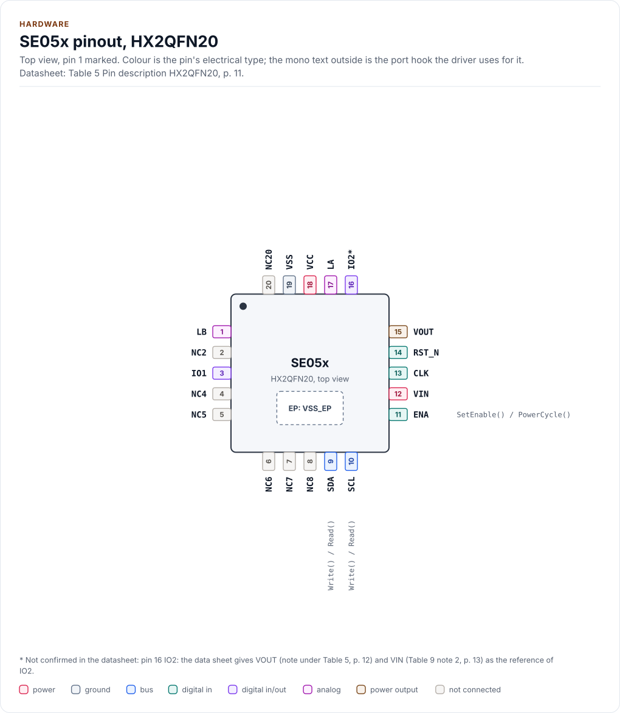
</picture>
<!-- /figure -->

Hardware description: [`docs/hardware.yml`](../hardware.yml)

Drawn from:

- [`docs/hardware.yml`](../hardware.yml)
- [`inc/se05x_ports.hpp`](../../inc/se05x_ports.hpp)

## Wiring: Minimal application, no power cycle (SE050, SE051)

<!-- figure: chip-wiring-minimal -->
<picture>
  <source media="(prefers-color-scheme: dark)" srcset="chip-wiring-minimal.dark.svg">
  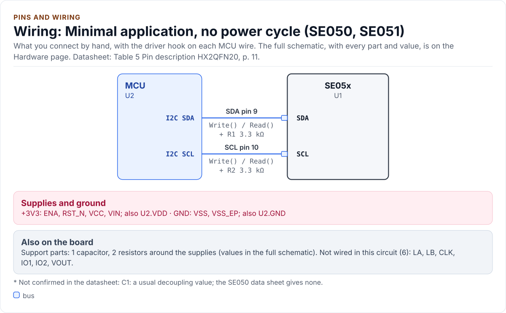
</picture>
<!-- /figure -->

Hardware description: [`docs/hardware.yml`](../hardware.yml)

Drawn from:

- [`docs/hardware.yml`](../hardware.yml)
- [`inc/se05x_ports.hpp`](../../inc/se05x_ports.hpp)

## Wiring: Recommended application (SE050, SE051)

<!-- figure: chip-wiring-typical -->
<picture>
  <source media="(prefers-color-scheme: dark)" srcset="chip-wiring-typical.dark.svg">
  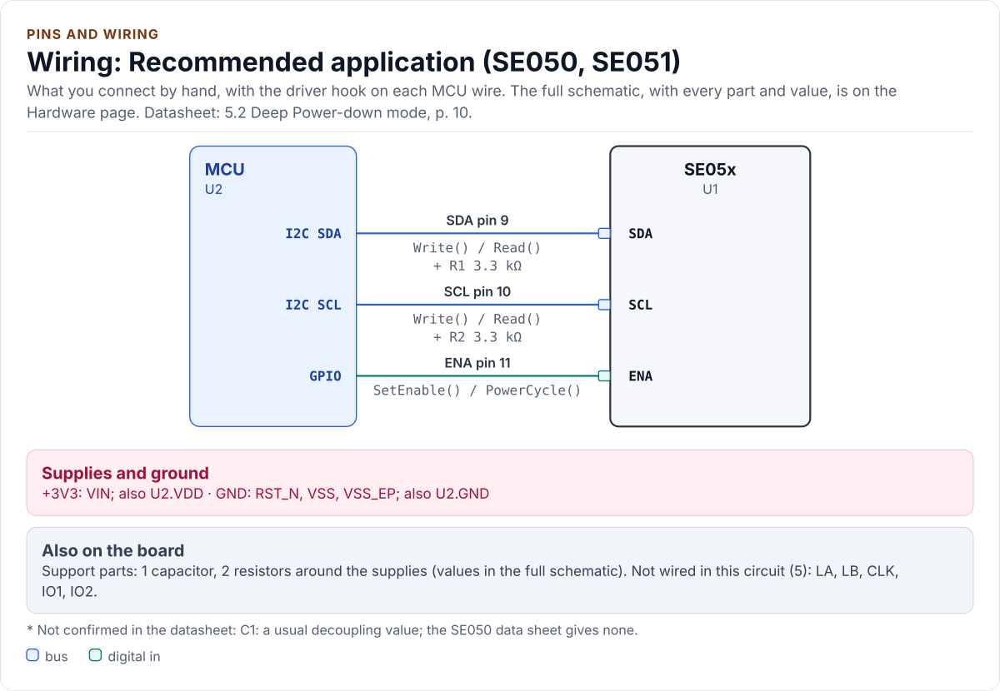
</picture>
<!-- /figure -->

Hardware description: [`docs/hardware.yml`](../hardware.yml)

Drawn from:

- [`docs/hardware.yml`](../hardware.yml)
- [`inc/se05x_ports.hpp`](../../inc/se05x_ports.hpp)

## From a device key to a stored certificate

<!-- figure: csr-flow -->
<picture>
  <source media="(prefers-color-scheme: dark)" srcset="csr-flow.dark.svg">
  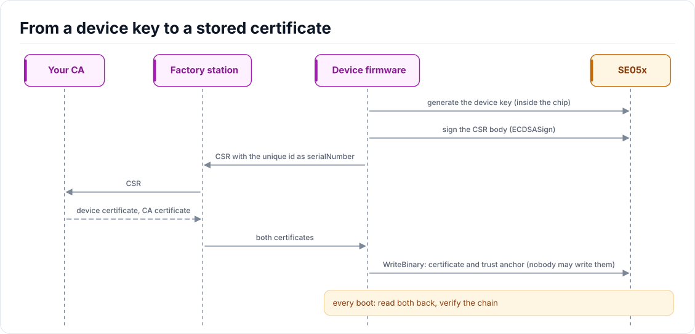
</picture>
<!-- /figure -->

Hardware description: [`docs/model/csr-flow.seq.yml`](../model/csr-flow.seq.yml)

Drawn from:

- [`docs/model/csr-flow.seq.yml`](../model/csr-flow.seq.yml)

## The layers

<!-- figure: driver-layers -->
<picture>
  <source media="(prefers-color-scheme: dark)" srcset="driver-layers.dark.svg">
  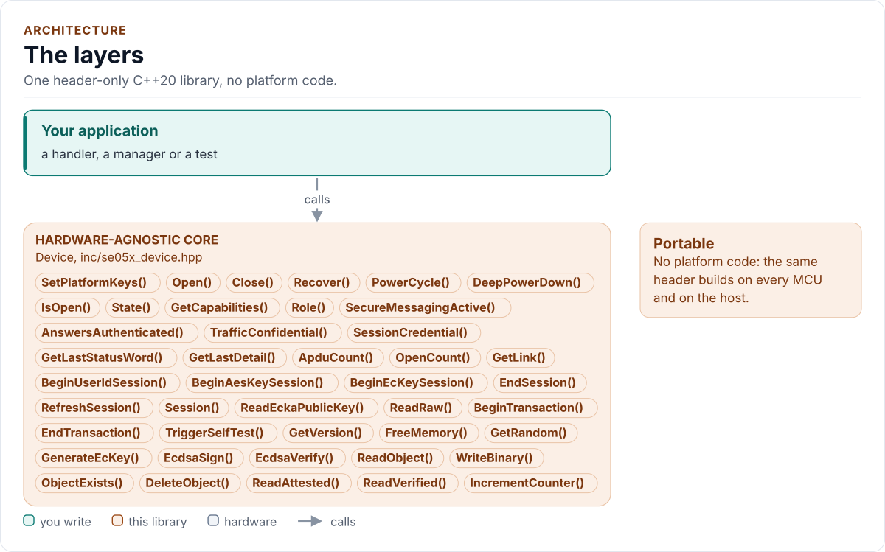
</picture>
<!-- /figure -->

Figure module: [`docs/diagrams/figures/driver-layers.py`](../../docs/diagrams/figures/driver-layers.py)

Drawn from:

- `public calls` in [`inc/se05x_device.hpp`](../../inc/se05x_device.hpp)

## ECKey session: opening it

<!-- figure: eckey-session -->
<picture>
  <source media="(prefers-color-scheme: dark)" srcset="eckey-session.dark.svg">
  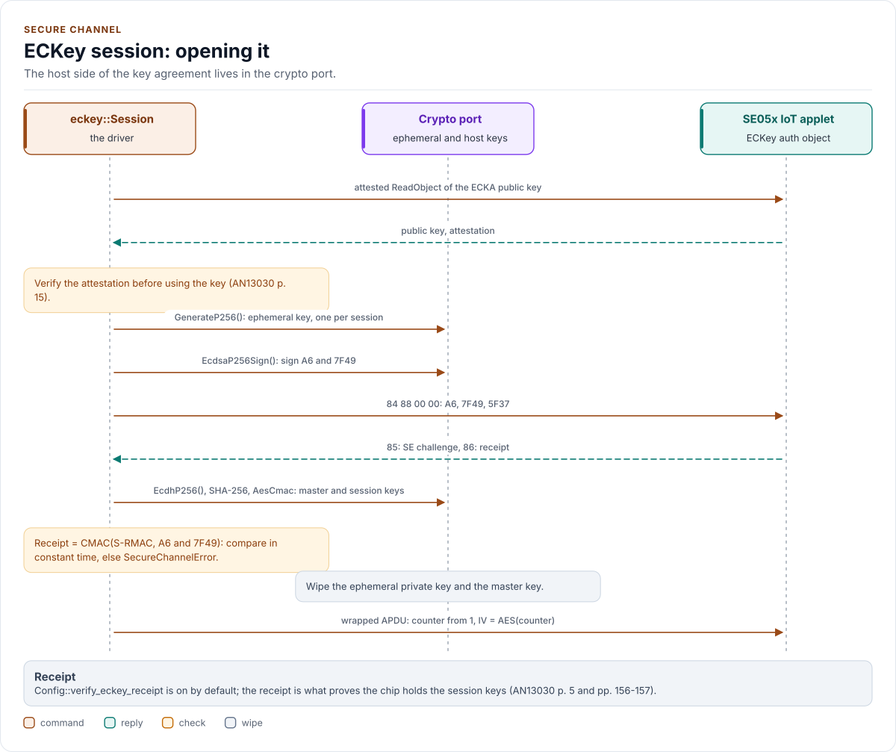
</picture>
<!-- /figure -->

Figure module: [`docs/diagrams/figures/eckey-session.py`](../../docs/diagrams/figures/eckey-session.py)

Drawn from:

- [`inc/se05x_eckey.hpp`](../../inc/se05x_eckey.hpp)

## The first 15 minutes

<!-- figure: first-15-minutes -->
<picture>
  <source media="(prefers-color-scheme: dark)" srcset="first-15-minutes.dark.svg">
  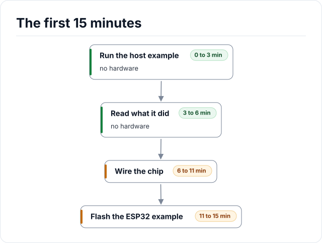
</picture>
<!-- /figure -->

Hardware description: [`docs/model/first-15-minutes.graph.yml`](../model/first-15-minutes.graph.yml)

Drawn from:

- [`docs/model/first-15-minutes.graph.yml`](../model/first-15-minutes.graph.yml)

## I2C timing of the address byte

<!-- figure: i2c-timing -->
<picture>
  <source media="(prefers-color-scheme: dark)" srcset="i2c-timing.dark.svg">
  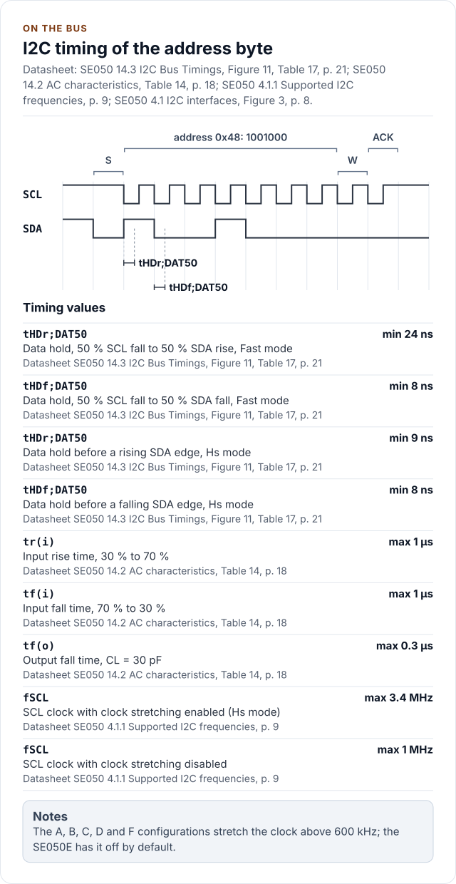
</picture>
<!-- /figure -->

Hardware description: [`docs/model/i2c-timing.timing.yml`](../model/i2c-timing.timing.yml)

Drawn from:

- [`docs/model/i2c-timing.timing.yml`](../model/i2c-timing.timing.yml)

## Irreversible operations: plan, confirm, apply

<!-- figure: irreversible-flow -->
<picture>
  <source media="(prefers-color-scheme: dark)" srcset="irreversible-flow.dark.svg">
  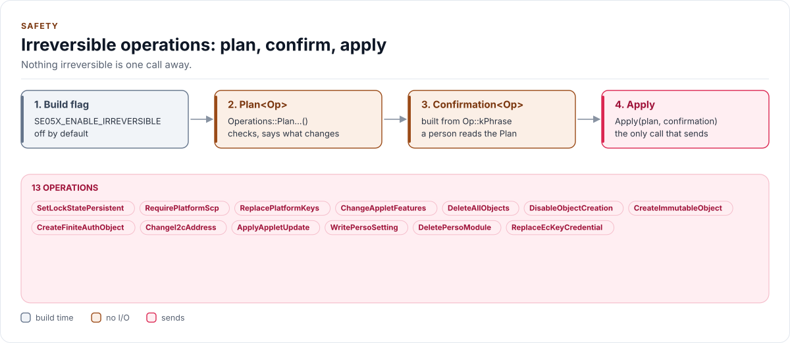
</picture>
<!-- /figure -->

Figure module: [`docs/diagrams/figures/irreversible-flow.py`](../../docs/diagrams/figures/irreversible-flow.py)

Drawn from:

- `operation tags` in [`inc/se05x_confirm.hpp`](../../inc/se05x_confirm.hpp)

## What the chip does for your firmware

<!-- figure: jobs-map -->
<picture>
  <source media="(prefers-color-scheme: dark)" srcset="jobs-map.dark.svg">
  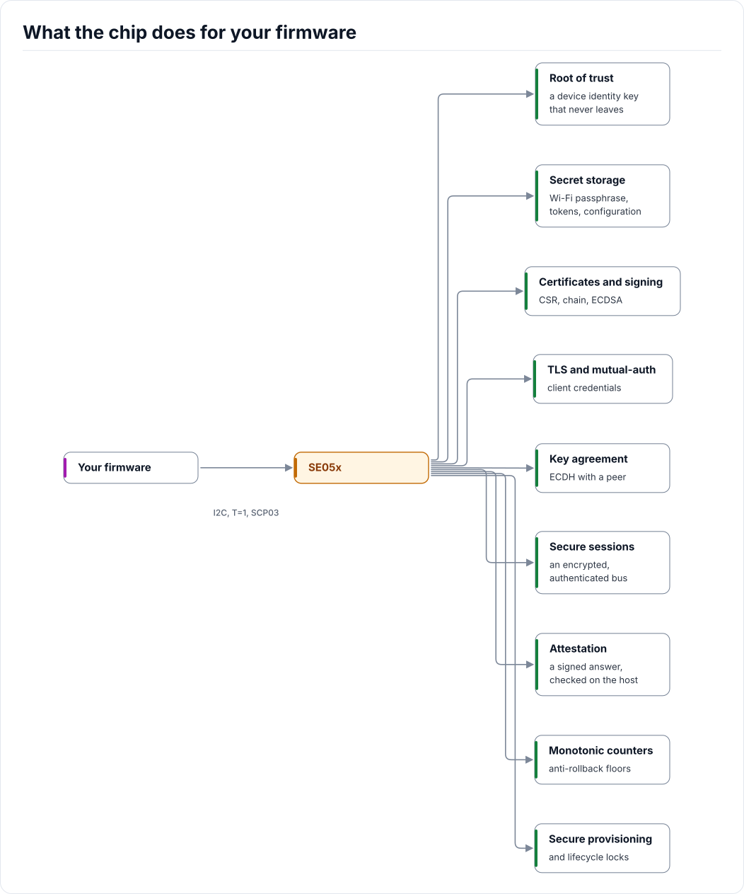
</picture>
<!-- /figure -->

Hardware description: [`docs/model/jobs-map.graph.yml`](../model/jobs-map.graph.yml)

Drawn from:

- [`docs/model/jobs-map.graph.yml`](../model/jobs-map.graph.yml)

## Lifecycle settings and the roles that change them

<!-- figure: lifecycle -->
<picture>
  <source media="(prefers-color-scheme: dark)" srcset="lifecycle.dark.svg">
  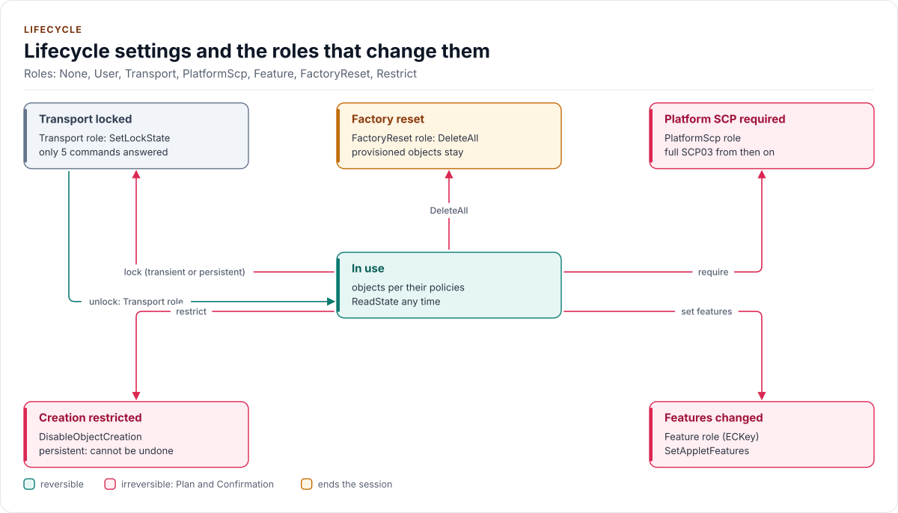
</picture>
<!-- /figure -->

Figure module: [`docs/diagrams/figures/lifecycle.py`](../../docs/diagrams/figures/lifecycle.py)

Drawn from:

- `AuthRole` in [`inc/se05x_lifecycle.hpp`](../../inc/se05x_lifecycle.hpp)
- `RequiredRole` in [`inc/se05x_lifecycle.hpp`](../../inc/se05x_lifecycle.hpp)

## Objects, policies and sessions

<!-- figure: object-policy -->
<picture>
  <source media="(prefers-color-scheme: dark)" srcset="object-policy.dark.svg">
  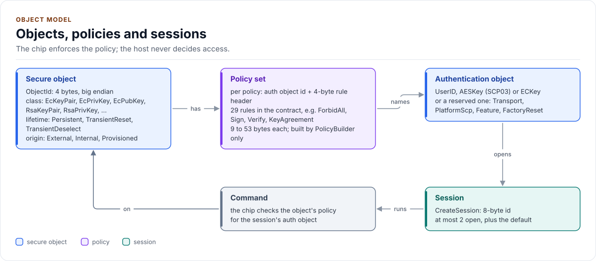
</picture>
<!-- /figure -->

Figure module: [`docs/diagrams/figures/object-policy.py`](../../docs/diagrams/figures/object-policy.py)

Drawn from:

- `ObjectClass, Origin, Lifetime` in [`inc/se05x_ids.hpp`](../../inc/se05x_ids.hpp)
- `Rule` in [`inc/se05x_policy_types.hpp`](../../inc/se05x_policy_types.hpp)

## Device certificates: provision once, verify at boot

<!-- figure: pki-provisioning -->
<picture>
  <source media="(prefers-color-scheme: dark)" srcset="pki-provisioning.dark.svg">
  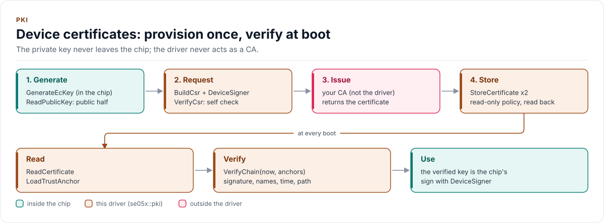
</picture>
<!-- /figure -->

Figure module: [`docs/diagrams/figures/pki-provisioning.py`](../../docs/diagrams/figures/pki-provisioning.py)

Drawn from:

- [`inc/se05x_pki_csr.hpp`](../../inc/se05x_pki_csr.hpp)
- [`inc/se05x_pki_device.hpp`](../../inc/se05x_pki_device.hpp)
- [`inc/se05x_pki_verify.hpp`](../../inc/se05x_pki_verify.hpp)

## The factory provisioning flow

<!-- figure: provisioning-flow -->
<picture>
  <source media="(prefers-color-scheme: dark)" srcset="provisioning-flow.dark.svg">
  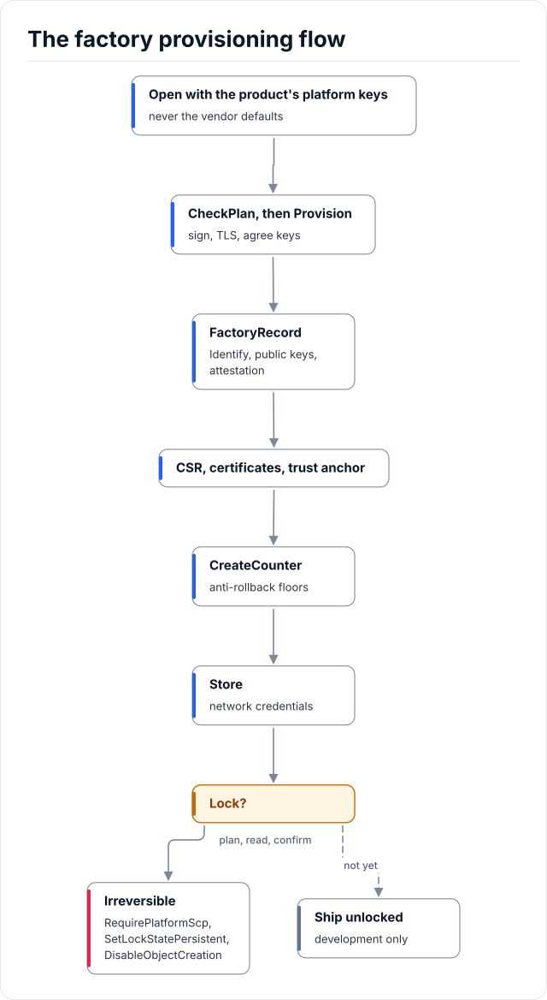
</picture>
<!-- /figure -->

Hardware description: [`docs/model/provisioning-flow.graph.yml`](../model/provisioning-flow.graph.yml)

Drawn from:

- [`docs/model/provisioning-flow.graph.yml`](../model/provisioning-flow.graph.yml)

## The recovery ladder

<!-- figure: recovery-ladder -->
<picture>
  <source media="(prefers-color-scheme: dark)" srcset="recovery-ladder.dark.svg">
  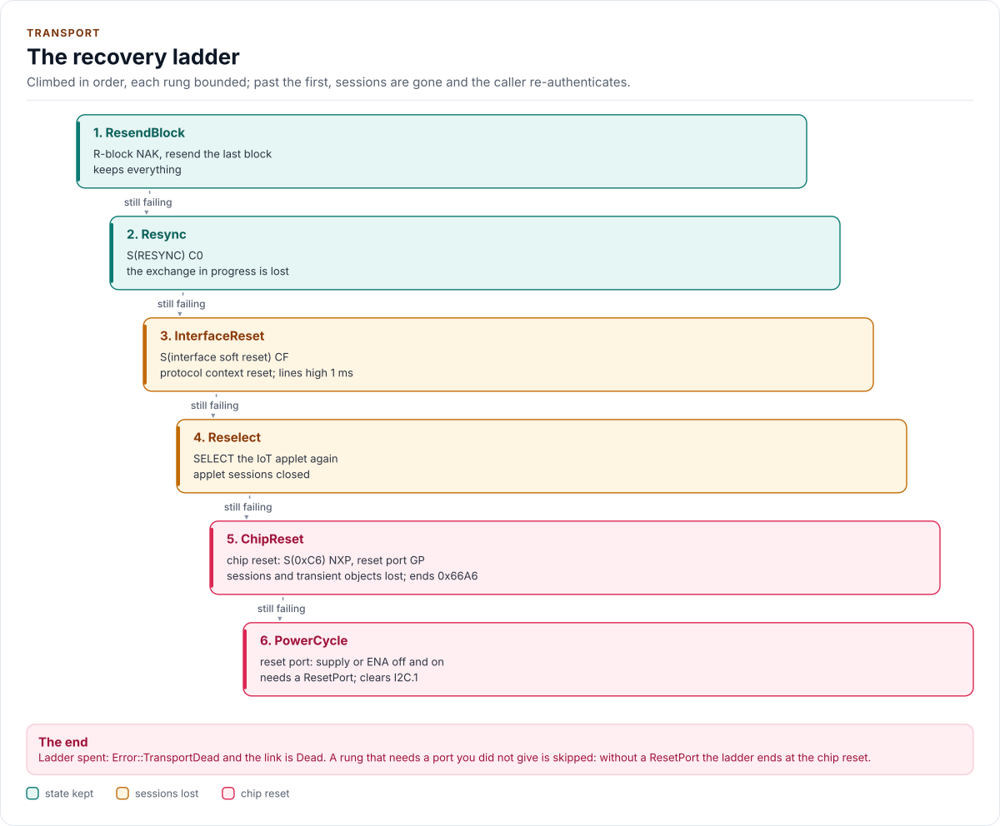
</picture>
<!-- /figure -->

Figure module: [`docs/diagrams/figures/recovery-ladder.py`](../../docs/diagrams/figures/recovery-ladder.py)

Drawn from:

- `Rung` in [`inc/se05x_t1.hpp`](../../inc/se05x_t1.hpp)

## The anti-rollback boot check

<!-- figure: rollback-flow -->
<picture>
  <source media="(prefers-color-scheme: dark)" srcset="rollback-flow.dark.svg">
  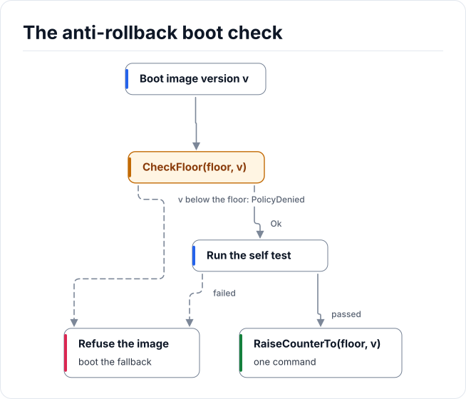
</picture>
<!-- /figure -->

Hardware description: [`docs/model/rollback-flow.graph.yml`](../model/rollback-flow.graph.yml)

Drawn from:

- [`docs/model/rollback-flow.graph.yml`](../model/rollback-flow.graph.yml)

## Opening an SCP03 session

<!-- figure: scp03-open -->
<picture>
  <source media="(prefers-color-scheme: dark)" srcset="scp03-open.dark.svg">
  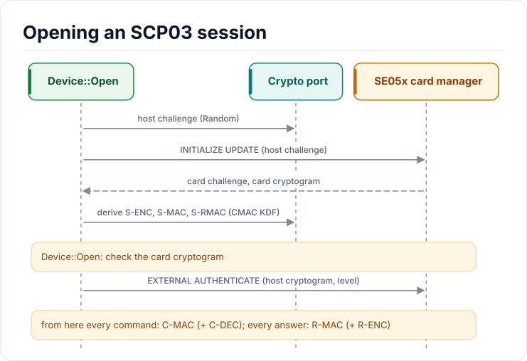
</picture>
<!-- /figure -->

Hardware description: [`docs/model/scp03-open.seq.yml`](../model/scp03-open.seq.yml)

Drawn from:

- [`docs/model/scp03-open.seq.yml`](../model/scp03-open.seq.yml)

## Platform SCP03: opening the channel

<!-- figure: scp03-session -->
<picture>
  <source media="(prefers-color-scheme: dark)" srcset="scp03-session.dark.svg">
  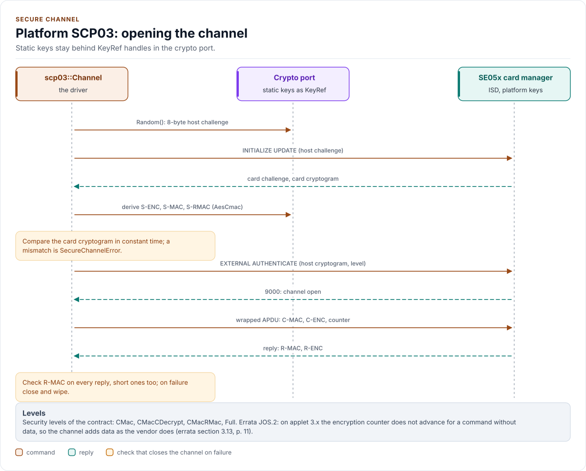
</picture>
<!-- /figure -->

Figure module: [`docs/diagrams/figures/scp03-session.py`](../../docs/diagrams/figures/scp03-session.py)

Drawn from:

- `SecurityLevel` in [`inc/se05x_scp03.hpp`](../../inc/se05x_scp03.hpp)

## SE052 package outline, HVQFN20

<!-- figure: se052-outline -->
<picture>
  <source media="(prefers-color-scheme: dark)" srcset="se052-outline.dark.svg">
  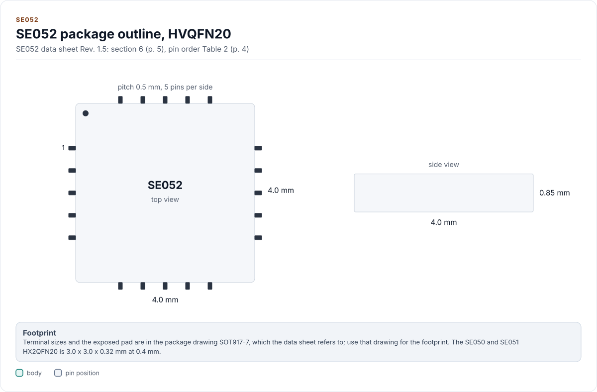
</picture>
<!-- /figure -->

Figure module: [`docs/diagrams/figures/se052-outline.py`](../../docs/diagrams/figures/se052-outline.py)

Drawn from:

- [`docs/diagrams/figures/_se052.py`](../../docs/diagrams/figures/_se052.py)

## SE052 pinout, HVQFN20

<!-- figure: se052-pinout -->
<picture>
  <source media="(prefers-color-scheme: dark)" srcset="se052-pinout.dark.svg">
  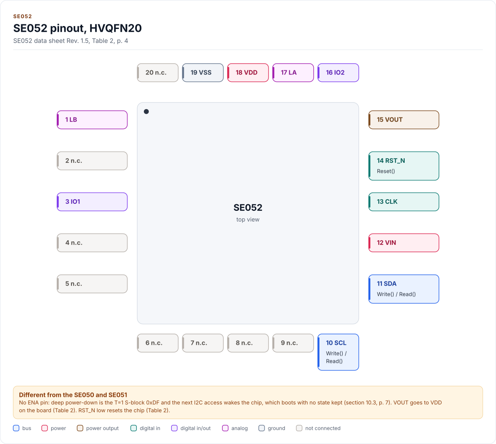
</picture>
<!-- /figure -->

Figure module: [`docs/diagrams/figures/se052-pinout.py`](../../docs/diagrams/figures/se052-pinout.py)

Drawn from:

- [`docs/diagrams/figures/_se052.py`](../../docs/diagrams/figures/_se052.py)

## Wiring the SE052

<!-- figure: se052-wiring -->
<picture>
  <source media="(prefers-color-scheme: dark)" srcset="se052-wiring.dark.svg">
  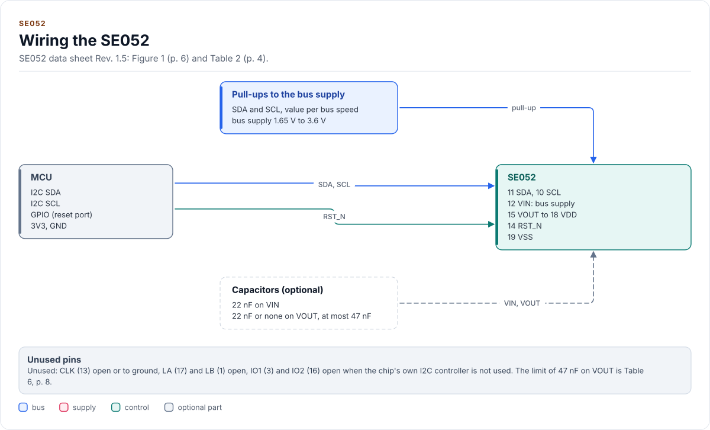
</picture>
<!-- /figure -->

Figure module: [`docs/diagrams/figures/se052-wiring.py`](../../docs/diagrams/figures/se052-wiring.py)

Drawn from:

- [`docs/diagrams/figures/_se052.py`](../../docs/diagrams/figures/_se052.py)

## Provision a signing key, then sign

<!-- figure: sign-call -->
<picture>
  <source media="(prefers-color-scheme: dark)" srcset="sign-call.dark.svg">
  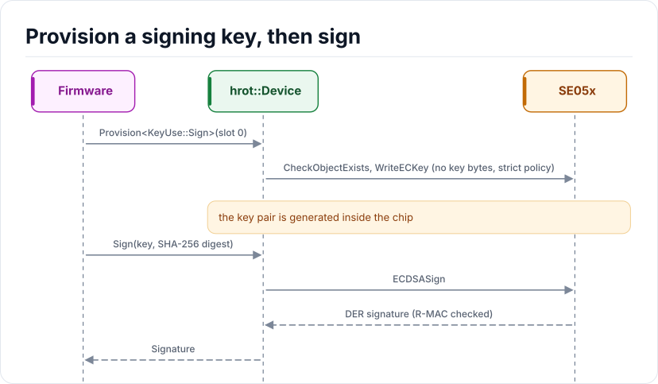
</picture>
<!-- /figure -->

Hardware description: [`docs/model/sign-call.seq.yml`](../model/sign-call.seq.yml)

Drawn from:

- [`docs/model/sign-call.seq.yml`](../model/sign-call.seq.yml)

## Store a secret, load it at every boot

<!-- figure: store-load-call -->
<picture>
  <source media="(prefers-color-scheme: dark)" srcset="store-load-call.dark.svg">
  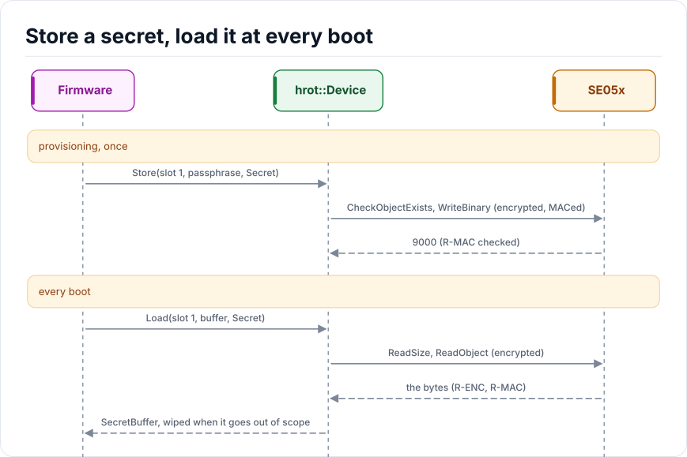
</picture>
<!-- /figure -->

Hardware description: [`docs/model/store-load-call.seq.yml`](../model/store-load-call.seq.yml)

Drawn from:

- [`docs/model/store-load-call.seq.yml`](../model/store-load-call.seq.yml)

## One T=1 block on the bus

<!-- figure: t1-frame -->
<picture>
  <source media="(prefers-color-scheme: dark)" srcset="t1-frame.dark.svg">
  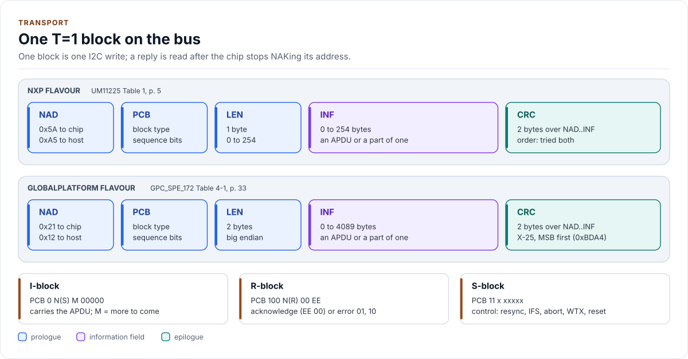
</picture>
<!-- /figure -->

Figure module: [`docs/diagrams/figures/t1-frame.py`](../../docs/diagrams/figures/t1-frame.py)

Drawn from:

- `kUm11225Frame, kGpFrame, kGpExampleCrc` in [`inc/se05x_wire.hpp`](../../inc/se05x_wire.hpp)

## One T=1 block each way on I2C

<!-- figure: t1-i2c-block -->
<picture>
  <source media="(prefers-color-scheme: dark)" srcset="t1-i2c-block.dark.svg">
  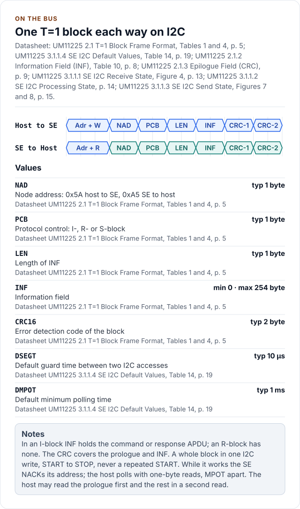
</picture>
<!-- /figure -->

Hardware description: [`docs/model/t1-i2c-block.timing.yml`](../model/t1-i2c-block.timing.yml)

Drawn from:

- [`docs/model/t1-i2c-block.timing.yml`](../model/t1-i2c-block.timing.yml)

## The T=1 link: states and S-blocks

<!-- figure: t1-states -->
<picture>
  <source media="(prefers-color-scheme: dark)" srcset="t1-states.dark.svg">
  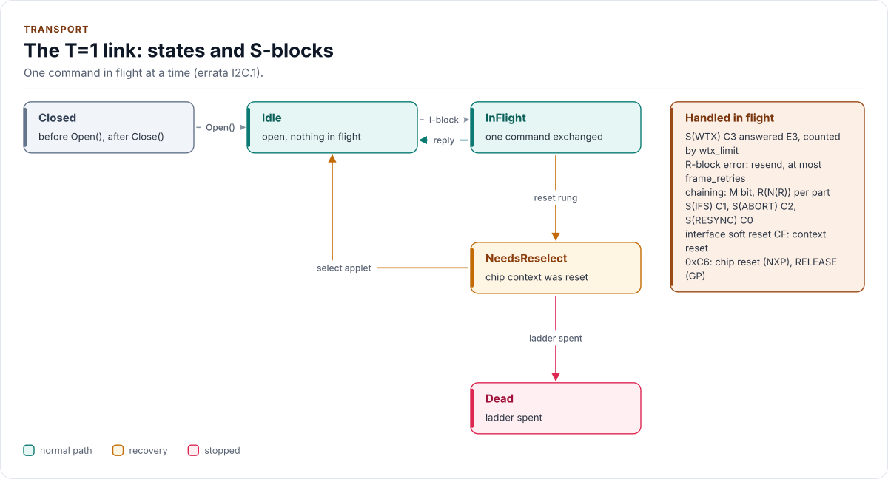
</picture>
<!-- /figure -->

Figure module: [`docs/diagrams/figures/t1-states.py`](../../docs/diagrams/figures/t1-states.py)

Drawn from:

- `LinkState` in [`inc/se05x_t1.hpp`](../../inc/se05x_t1.hpp)
- `S-block codes` in [`inc/se05x_wire.hpp`](../../inc/se05x_wire.hpp)

## A TLS client signature

<!-- figure: tls-sign-call -->
<picture>
  <source media="(prefers-color-scheme: dark)" srcset="tls-sign-call.dark.svg">
  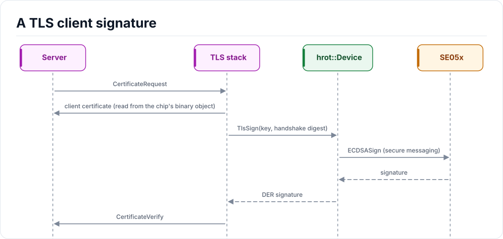
</picture>
<!-- /figure -->

Hardware description: [`docs/model/tls-sign-call.seq.yml`](../model/tls-sign-call.seq.yml)

Drawn from:

- [`docs/model/tls-sign-call.seq.yml`](../model/tls-sign-call.seq.yml)

## Trust boundaries

<!-- figure: trust-boundaries -->
<picture>
  <source media="(prefers-color-scheme: dark)" srcset="trust-boundaries.dark.svg">
  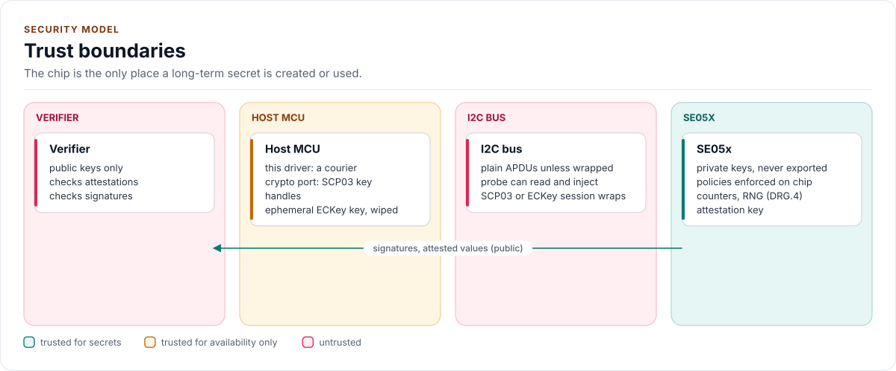
</picture>
<!-- /figure -->

Figure module: [`docs/diagrams/figures/trust-boundaries.py`](../../docs/diagrams/figures/trust-boundaries.py)

Drawn from:

- [`inc/se05x_ports.hpp`](../../inc/se05x_ports.hpp)
- [`inc/se05x_secret.hpp`](../../inc/se05x_secret.hpp)

## Choosing a variant, an applet and an authentication

<!-- figure: variant-decision -->
<picture>
  <source media="(prefers-color-scheme: dark)" srcset="variant-decision.dark.svg">
  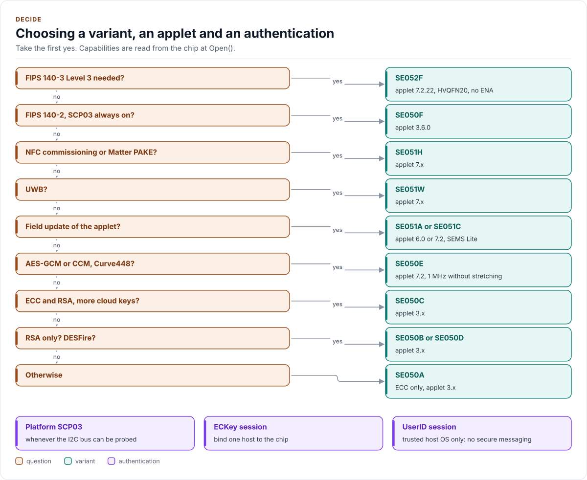
</picture>
<!-- /figure -->

Figure module: [`docs/diagrams/figures/variant-decision.py`](../../docs/diagrams/figures/variant-decision.py)

Drawn from:

- [`inc/se05x_types.hpp`](../../inc/se05x_types.hpp)
- [`inc/se05x_caps.hpp`](../../inc/se05x_caps.hpp)
