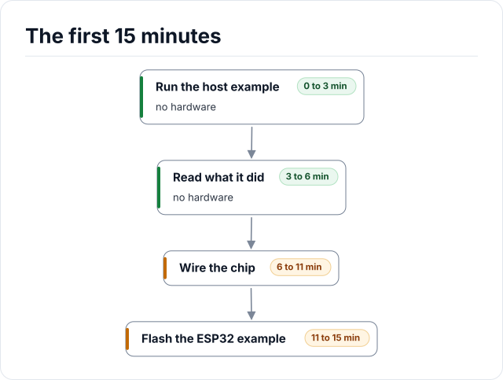

# The first 15 minutes

From nothing to a chip that signs, in four steps. Steps 1 and 2 need no hardware.

<!-- figure: first-15-minutes -->
<picture>
  <source media="(prefers-color-scheme: dark)" srcset="diagrams/first-15-minutes.dark.svg">
  
</picture>
<!-- /figure -->

## 0 to 3 minutes: run the host example

The host example runs every facade job against the simulated chip of the tests: open with platform SCP03, identify,
provision a key, attest it, sign, seal a configuration and check an anti-rollback floor. From the repository root:

```bash
cmake -S examples/host -B build-example
cmake --build build-example
./build-example/se05x_host_example
```

The output, line for line (a CTest checks that this page shows what the example prints):

```text
SE05X driver 0.1.0 on the host, simulated chip
Open with platform SCP03                     Ok
Identify                                     Ok
  applet 7.2.0, OEF id A921
Provision a signing key in slot 0            Ok
Provision slot 0 again                       ObjectExists
Attest the key (verified)                    Ok
Sign a digest                                Ok
Verify the signature on the chip             Ok
Seal a configuration                         Ok
Create the firmware floor at 3               Ok
Boot image version 4                         Ok
Boot image version 2 (a rollback)            PolicyDenied
APDUs sent: 23
Close                                        Ok
Open with nothing on the bus                 Nack
```

## 3 to 6 minutes: read what it did

- `ObjectExists` on the second provision: a facade key slot is never overwritten ([Device identity](tasks/device-identity.md)).
- `PolicyDenied` for version 2: the floor at 3 refuses a rollback ([Anti-rollback](tasks/anti-rollback.md)).
- `APDUs sent: 23`: the budget the SE052F's throughput limit needs (AN13904 p. 28).
- `Nack` with nothing on the bus: a missing chip is an error, never a hang.

[Choose your job](jobs.md) maps every job the chip does to a guide.

## 6 to 11 minutes: wire the chip

| MCU | SE050, SE051 (HX2QFN20) | SE052 (HVQFN20) |
| --- | --- | --- |
| I2C SDA, pull-up | SDA, pin 9 | SDA, pin 11 |
| I2C SCL, pull-up | SCL, pin 10 | SCL, pin 10 |
| GPIO (reset port) | ENA, pin 11 | RST_N, pin 14 |
| 3.3 V | VIN, pin 12; VOUT to VCC | VIN, pin 12; VOUT to VDD |
| GND | VSS, pin 19 | VSS, pin 19 |

Pins from SE050 Table 5 (p. 11), SE051 Table 3 (p. 12) and SE052 Table 2 (p. 4); both lines must be high at power-up
(SE050 section 3.4, p. 8). The figures of each package are on [Where to use it](variants.md#the-chips).

## 11 to 15 minutes: flash the ESP32 example

With ESP-IDF v5.5, an ESP32-C6 and the chip wired to the default pins of `Esp32Se05xPins` (SDA GPIO6, SCL GPIO7,
ENA GPIO11; on an SE052 set `reset_n` to the RST_N GPIO and `enable` to -1):

```bash
cd examples/esp32
git submodule update --init scripts       # the ESP-IDF build scripts
. $IDF_PATH/export.sh                      # ESP-IDF v5.5
./scripts/build_app.sh se05x_hrot_example Release
./scripts/flash_app.sh flash_monitor se05x_hrot_example Release
```

The monitor shows the same jobs against the real chip. Without your platform keys the facade refuses key operations
with `PolicyDenied` and says so: give your keys through the crypto port ([Secure channel](tasks/secure-channel.md)),
never the vendor's default key set in a product.

**Bench step** (not verified on hardware): run the ESP32 example on an SE050E and on an SE052F dev kit and compare
the log with the host transcript above; the identity and the APDU count differ, every status should match.
