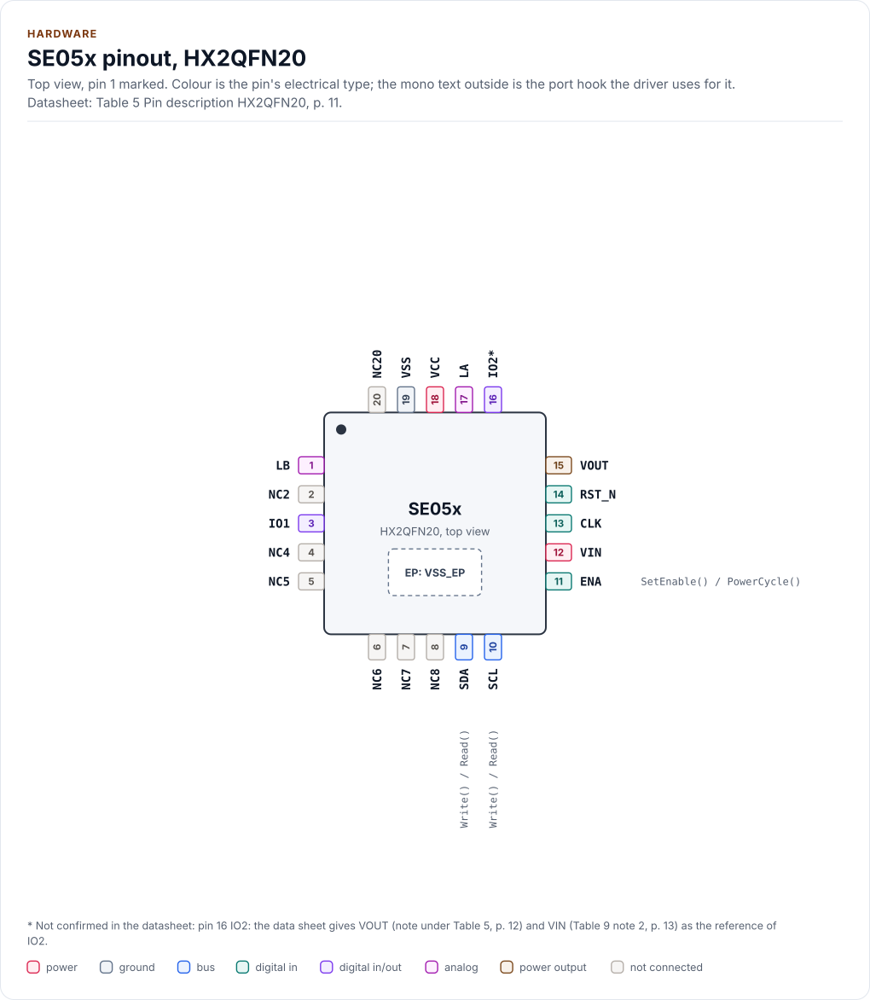
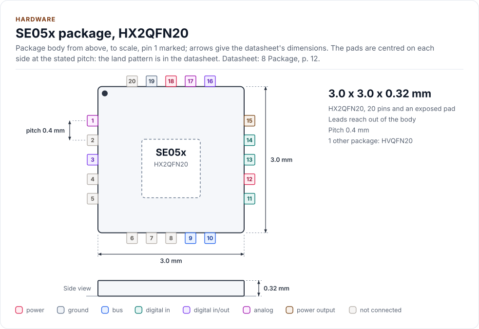
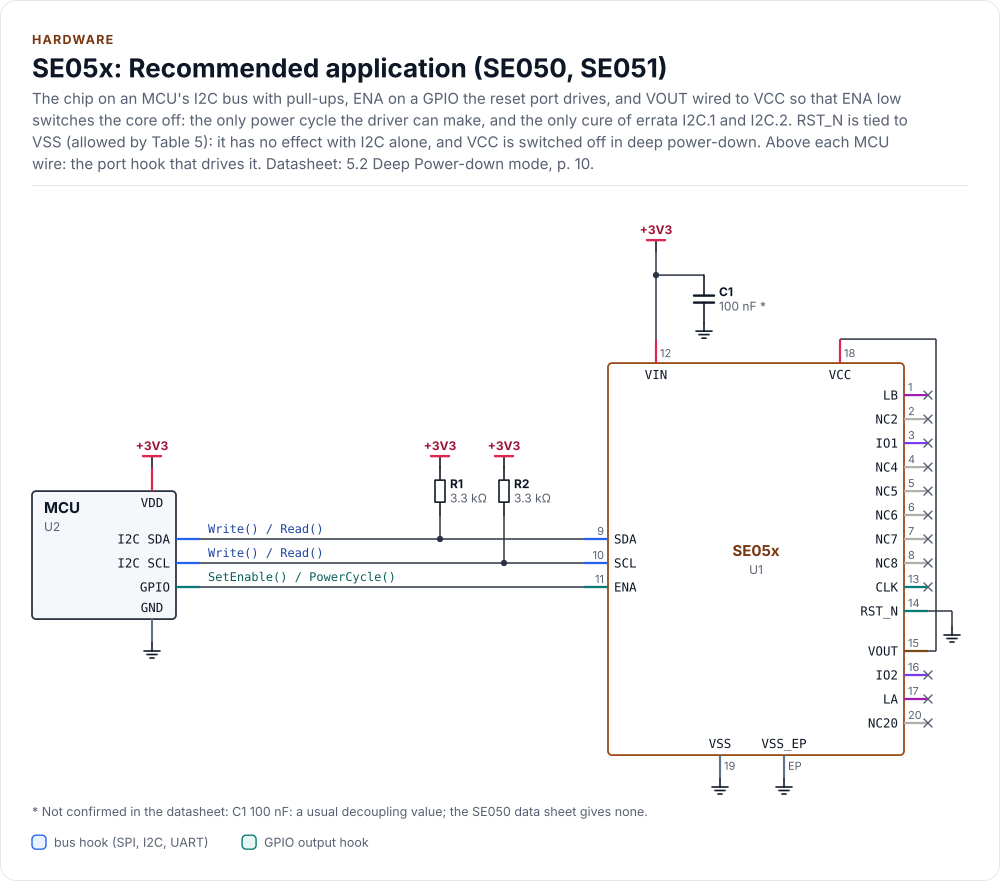

# Hardware

The SE050, SE051 and SE052 pins, bus settings, timing and power, as the driver uses them. The per-chip guides add the
wiring and what differs: [SE050](se050.md), [SE051](se051.md), [SE052](se052.md).

<!-- generated: datasheet-refs -->
??? abstract "Datasheet sections this page relies on"

    - Start-up: the interface is chosen by the line levels at boot: NXP SE050-DATASHEET Rev. 3.8, 3.4 Startup behavior, p. 8
    - I2C target address 0x48: NXP SE050-DATASHEET Rev. 3.8, 4.1 I2C interfaces, Figure 3, p. 8
    - I2C clock and clock stretching per variant: NXP SE050-DATASHEET Rev. 3.8, 4.1.1 Supported I2C frequencies, p. 9
    - RST_N has no effect when only I2C is enabled: NXP SE050-DATASHEET Rev. 3.8, 4.2 ISO7816 and ISO14443 interface, p. 9
    - Power-down and deep power-down modes: NXP SE050-DATASHEET Rev. 3.8, 5 Power-saving modes, p. 9
    - Deep power-down supply: VIN, VOUT to VCC: NXP SE050-DATASHEET Rev. 3.8, 5.2 Deep Power-down mode, p. 10
    - Pin table of the HX2QFN20 package (SE050): NXP SE050-DATASHEET Rev. 3.8, Table 5 Pin description, p. 11
    - Supply range and pin reference voltages: NXP SE050-DATASHEET Rev. 3.8, Table 9 Recommended operating conditions, p. 13
    - ENA low time and glitches: NXP SE050-DATASHEET Rev. 3.8, Table 14 AC characteristics, p. 18
    - Pin table (SE051): NXP SE051 Rev. 2.0, Table 3 Pin description, p. 12
    - Pin table of the HVQFN20 package (SE052): NXP SE052 Rev. 1.5, Table 2 Pin description, p. 4
    - SE052 supplies: VDD 1.62 V to 5.5 V, VIN 1.65 V to 3.6 V: NXP SE052 Rev. 1.5, Table 13 IC supply current, p. 18
    - Development kit jumpers: ENA, reset, pull-ups: NXP AN13539 Rev. 1.2, Table 9 and the jumper tables, p. 15

    All of them, with the driver API for each: [Datasheet map](datasheet.md).
<!-- /generated -->

## Packages

| Chips | Package | Size | Control pins |
| --- | --- | --- | --- |
| SE050, SE051 | HX2QFN20 | 3 x 3 x 0.32 mm, 0.4 mm pitch | ENA (deep power-down); RST_N is the ISO 7816 reset |
| SE052 | HVQFN20 | 4 x 4 x 0.85 mm, 0.5 mm pitch | RST_N (device reset); no ENA; VDD in place of VCC |

The outline code of the SE052 is SOT917-7 in the data sheet and SOT917-6 in AN14028 (ambiguity A2). The HX2QFN20
figures below are drawn from [`docs/hardware.yml`](hardware.yml) and show the SE050 and SE051, though their titles
name the family; the SE052 has its own on [SE052](se052.md).

<!-- figure: chip-pinout -->
<picture>
  <source media="(prefers-color-scheme: dark)" srcset="diagrams/chip-pinout.dark.svg">
  
</picture>
<!-- /figure -->

<!-- figure: chip-outline -->
<picture>
  <source media="(prefers-color-scheme: dark)" srcset="diagrams/chip-outline.dark.svg">
  
</picture>
<!-- /figure -->

## Pins (HX2QFN20)

<!-- generated: chip-pins -->
HX2QFN20, 20 pins and an exposed pad (Table 5 Pin description HX2QFN20, p. 11).

| Pin | Name | Type (domain) | Function | Driver hook | If unused | Datasheet |
| --- | --- | --- | --- | --- | --- | --- |
| 1 | `LB` | analog (VCC) | ISO 14443 antenna connection; not used by this driver | - | Tie to VSS | Table 5 Pin description HX2QFN20, p. 11 |
| 2 | `NC2` | not connected (GND) | Not connected | - | - | Table 5 Pin description HX2QFN20, p. 11 |
| 3 | `IO1` | digital in/out (VCC) | ISO 7816 IO, or SDA of the chip's own I2C controller (I2CM commands); referenced to VCC | - | Leave open (recommended) or tie to VCC | Table 5 Pin description HX2QFN20, p. 11 |
| 4 | `NC4` | not connected (GND) | Not connected | - | - | Table 5 Pin description HX2QFN20, p. 11 |
| 5 | `NC5` | not connected (GND) | Not connected | - | - | Table 5 Pin description HX2QFN20, p. 11 |
| 6 | `NC6` | not connected (GND) | Not connected | - | - | Table 5 Pin description HX2QFN20, p. 11 |
| 7 | `NC7` | not connected (GND) | Not connected | - | - | Table 5 Pin description HX2QFN20, p. 11 |
| 8 | `NC8` | not connected (GND) | Not connected | - | - | Table 5 Pin description HX2QFN20, p. 11 |
| 9 | `SDA` | bus (VIN) | I2C target data, open drain, T=1 frames at address 0x48; needs a pull-up; referenced to VIN | `Write() / Read()` | Leave open | Table 5 Pin description HX2QFN20, p. 11 |
| 10 | `SCL` | bus (VIN) | I2C target clock, open drain; needs a pull-up; referenced to VIN | `Write() / Read()` | Leave open | Table 5 Pin description HX2QFN20, p. 11 |
| 11 | `ENA` | digital in (VIN) | Deep power-down enable: low enters deep power-down (no state retention), high leaves it and the chip boots; tENalt 2 us typical, no minimum printed (the ESP-IDF port holds 10 us); glitches below 0.4 V longer than 30 ns count | `SetEnable() / PowerCycle()` | Tie to VCC | Table 5 Pin description HX2QFN20, p. 11 |
| 12 | `VIN` | power (VIN) | Supply of the I2C pads and the ISO 7816/14443 interfaces, and the logic supply when deep power-down is used; 1.62 V to 3.6 V | - | - | Table 5 Pin description HX2QFN20, p. 11 |
| 13 | `CLK` | digital in (VCC) | ISO 7816 clock input; not used by this driver | - | Leave open (recommended) or tie to VCC | Table 5 Pin description HX2QFN20, p. 11 |
| 14 | `RST_N` | digital in (VCC) | ISO 7816 reset, active low; has no effect when only the I2C interface is enabled (section 4.2), so the driver does not use it | - | Tie to VCC or VSS | Table 5 Pin description HX2QFN20, continued, p. 12 |
| 15 | `VOUT` | power output (VIN) | Switched supply output; connect to VCC on the board when deep power-down is used (up to 25 mA, switch at most 1.1 ohm, Table 14) | - | Leave open | Table 5 Pin description HX2QFN20, continued, p. 12 |
| 16 | `IO2` [^1] | digital in/out (VOUT) | ISO 7816 IO2, or SCL of the chip's own I2C controller (I2CM commands) | - | Leave open (recommended) or tie to VOUT | Table 5 Pin description HX2QFN20, continued, p. 12 |
| 17 | `LA` | analog (VCC) | ISO 14443 antenna connection; not used by this driver | - | Tie to VSS | Table 5 Pin description HX2QFN20, continued, p. 12 |
| 18 | `VCC` | power (VCC) | Logic and ISO 7816/14443 interface supply; connect to VOUT on the board when deep power-down is used, else to the supply | - | - | Table 5 Pin description HX2QFN20, continued, p. 12 |
| 19 | `VSS` | ground | Ground | - | - | Table 5 Pin description HX2QFN20, continued, p. 12 |
| 20 | `NC20` | not connected (GND) | Not connected | - | - | Table 5 Pin description HX2QFN20, continued, p. 12 |
| EP | `VSS_EP` | ground | Centre pad: not connected inside; connecting it to ground is recommended for thermal reasons | - | Tie to GND | Table 5 Pin description HX2QFN20, continued, p. 12 |

[^1]: Not confirmed in the datasheet: pin 16 (IO2): the data sheet gives VOUT (note under Table 5, p. 12) and VIN (Table 9 note 2, p. 13) as the reference of IO2.

Source of this table and of the chip figures: [`docs/hardware.yml`](hardware.yml).
<!-- /generated -->

Two facts the pin table makes easy to miss:

- **RST_N does not reset an I2C-only chip.** It is the ISO 7816 reset and "has no effect" when only I2C is enabled
  (SE050 section 4.2, p. 9; SE051 p. 10). The driver's power cycle uses ENA, with VOUT wired to VCC.
- **The interface is chosen at boot.** The chip takes I2C only when SDA and SCL are both high at power-up (SE050
  section 3.4, p. 8), and changes interface only after a reset.

## Reference circuit

<!-- figure: chip-circuit-typical -->
<picture>
  <source media="(prefers-color-scheme: dark)" srcset="diagrams/chip-circuit-typical.dark.svg">
  
</picture>
<!-- /figure -->

<!-- generated: chip-parts -->
**Recommended application (SE050, SE051)** (figure `chip-circuit-typical`)

| Part | Kind | Value | Connects | Datasheet |
| --- | --- | --- | --- | --- |
| U2 | MCU | - | VDD: +3V3, GND: GND, SDA: SDA, SCL: SCL, ENA: ENA | 5.2, p. 10 |
| C1 | capacitor | 100 nF (not confirmed: a usual decoupling value; the SE050 data sheet gives none) | +3V3, GND | Table 9 Recommended operating conditions, p. 13 |
| R1 | resistor | 3.3 kΩ | +3V3, SDA | Table 9 and the jumper tables (J37, J38), p. 15 |
| R2 | resistor | 3.3 kΩ | +3V3, SCL | Table 9 and the jumper tables (J37, J38), p. 15 |

**Minimal application, no power cycle (SE050, SE051)** (figure `chip-circuit-minimal`)

| Part | Kind | Value | Connects | Datasheet |
| --- | --- | --- | --- | --- |
| U2 | MCU | - | VDD: +3V3, GND: GND, SDA: SDA, SCL: SCL | Table 5 Pin description HX2QFN20, p. 11 |
| C1 | capacitor | 100 nF (not confirmed: a usual decoupling value; the SE050 data sheet gives none) | +3V3, GND | Table 9 Recommended operating conditions, p. 13 |
| R1 | resistor | 3.3 kΩ | +3V3, SDA | Table 9 and the jumper tables (J37, J38), p. 15 |
| R2 | resistor | 3.3 kΩ | +3V3, SCL | Table 9 and the jumper tables (J37, J38), p. 15 |

Export a circuit for a schematic or PCB tool: `kokeb-docs hardware --kicad-netlist OUT.net --circuit typical`.
<!-- /generated -->

## Bus settings

| Setting | Value |
| --- | --- |
| Address | 7-bit `0x48` (`kI2cAddress`; SE050 section 4.1, p. 8) |
| Clock | Up to 400 kHz in this driver (`kMaxClockHz`); the chip allows 1 MHz without and 3.4 MHz with clock stretching (SE050 section 4.1.1, p. 9) |
| Write | One block is one write: START, address + W, bytes, STOP; no zero-length write |
| Read | Separate transaction; a Nack means busy; no repeated start (`kRepeatedStart` is false) |

## Supplies

| Chip | Supply | Range | Source |
| --- | --- | --- | --- |
| SE050, SE051 | VIN, VCC | 1.62 V to 3.6 V | SE050 Table 9, p. 13 |
| SE052 | VIN | 1.65 V to 3.6 V | SE052 Table 13, p. 18 |
| SE052 | VDD | 1.62 V to 5.5 V in three classes | SE052 Table 13, p. 18 |

## Timing

| Parameter | Value | Source | Driver |
| --- | --- | --- | --- |
| Wait after power-on | 5 ms NXP flavour, 25 ms GP flavour | UM11225 p. 19, GPC_SPE_172 p. 31 | `Config::boot_wait_ms` |
| Guard time between accesses | 10 us default, from the ATR | UM11225 p. 19 | `t1::Link` |
| Minimum polling time | 1 ms default, from the ATR | UM11225 p. 19 | `t1::Link` |
| ENA low to enter deep power-down (tENalt) | 2 us typical; no minimum printed, the ESP-IDF port holds 10 us | SE050 Table 14, p. 18 | `ResetInterface::PowerCycle()` |
| SE052 RST_N pulse | at least 40 us | SE052 Table 14, p. 20 | `ResetInterface::Reset()` |
| Quiet limit | about 20 s; up to 40 WTX at session open | AN13030 p. 9 | `Config::wtx_limit` |
| WTX host timeout | at least 4 s | AN13904 p. 27 | `wire::kMinWtxHostTimeoutMs` |

## Reference documents

The data sheets and application notes are listed below with their revision and SHA-256. Every page cites the sections
it relies on.

<!-- generated: datasheet-card -->
| Document | Revision | Get it |
| --- | --- | --- |
| Datasheet: SE050 Plug & Trust Secure Element product data sheet (doc 504938) (NXP SE050-DATASHEET) | Rev. 3.8, revision date 2023-10-18 | [vendor page](https://www.nxp.com/docs/en/data-sheet/SE050-DATASHEET.pdf) |
| Datasheet: SE051 Plug & Trust Secure Element product data sheet (doc 577320) (NXP SE051) | Rev. 2.0, revision date 2024-07-08 | [vendor page](https://www.nxp.com/docs/en/data-sheet/SE051.pdf) |
| Datasheet: SE052 EdgeLock family product data sheet (doc 789115) (NXP SE052) | Rev. 1.5, revision date 2024-06-03 | [vendor page](https://www.nxp.com/docs/en/data-sheet/SE052.pdf) |
| Errata (datasheet set): SE050 Errata sheet (doc 640310) (NXP SE050_Erratasheet) | Rev. 1.0, revision date 2020-10-14 | [vendor page](https://www.nxp.com/docs/en/errata/SE050_Erratasheet.pdf) |
| User manual (datasheet set): UM11225 NXP SE05x T=1 Over I2C Specification (NXP UM11225) | Rev. 1.2, revision date 2020-12-10 | [vendor page](https://www.nxp.com/webapp/Download?colCode=UM11225) |
| Specification (datasheet set): GPC_SPE_172 APDU Transport over SPI / I2C, public release (GlobalPlatform GPC_SPE_172) | v1.0, 2020-01 | [vendor page](https://globalplatform.org/specs-library/apdu-transport-over-spi-i2c-v1-0-gpc_spe_172) |
| Application note (datasheet set): AN12543 SE05x IoT applet APDU Specification (applet 7.x) (NXP AN12543) | Rev. 4.5, revision date 2024-03-27 | [vendor page](https://www.nxp.com/docs/en/application-note/AN12543.pdf) |
| Application note (datasheet set): AN12413 SE050A/B/C/D/F APDU Specification (applet 3.x) (NXP AN12413) | Rev. 2.12, revision date 2021-03-24 | [vendor page](https://www.nxp.com/docs/en/application-note/AN12413.pdf) |
| Application note (datasheet set): AN12436 SE050 configurations (NXP AN12436) | Rev. 2.4, revision date 2024-07-08 | [vendor page](https://www.nxp.com/docs/en/application-note/AN12436.pdf) |
| Application note (datasheet set): AN12973 SE051 configurations (NXP AN12973) | Rev. 2.0, revision date 2024-07-08 | [vendor page](https://www.nxp.com/) |
| Application note (datasheet set): AN14277 SE052 Configuration Details (NXP AN14277) | Rev. 1.0, revision date 2024-03-25 | [vendor page](https://www.nxp.com/docs/en/application-note/AN14277.pdf) |
| Application note (datasheet set): AN13014 Moving from SE050 to SE050E or SE051 (NXP AN13014) | Rev. 1.2, revision date 2022-04-11 | [vendor page](https://www.nxp.com/docs/en/application-note/AN13014.pdf) |
| Application note (datasheet set): AN14028 Moving from SE050F to SE052F (NXP AN14028) | Rev. 1.0, revision date 2024-04-02 | [vendor page](https://www.nxp.com/docs/en/application-note/AN14028.pdf) |
| Application note (datasheet set): AN12514 SE050 User Guidelines (NXP AN12514) | Rev. 1.4, revision date 2021-11-21 | [vendor page](https://www.nxp.com/) |
| Application note (datasheet set): AN13483 SE050E User Guidelines (NXP AN13483) | Rev. 1.2, revision date 2022-08-22 | [vendor page](https://www.nxp.com/) |
| Application note (datasheet set): AN13904 SE052F User Guidelines (NXP AN13904) | Rev. 1.0, revision date 2024-03-27 | [vendor page](https://www.nxp.com/) |
| Application note (datasheet set): AN13254 Secure attestation with EdgeLock SE05x (NXP AN13254) | Rev. 1.1, revision date 2023-07-26 | [vendor page](https://www.nxp.com/docs/en/application-note/AN13254.pdf) |
| Application note (datasheet set): AN12907 Secure update of EdgeLock SE051 IoT applet (SEMS Lite) (NXP AN12907) | Rev. 1.2, revision date 2023-11-23 | [vendor page](https://www.nxp.com/) |
| Application note (datasheet set): AN13015 How to use EdgeLock SE051 PERSO applet (NXP AN13015) | Rev. 1.4, revision date 2026-01-09 | [vendor page](https://www.nxp.com/) |
| Application note (datasheet set): AN13030 Plug & Trust MW Documentation (a user guide; not a T=1 or APDU specification) (NXP AN13030) | Rev. 2.7, revision date 2026-07-09 | [vendor page](https://www.nxp.com/) |
| Application note (datasheet set): AN13539 OM-SE05xARD hardware overview (NXP AN13539) | Rev. 1.2, revision date 2022-11-08 | [vendor page](https://www.nxp.com/) |
| Application note (datasheet set): AN12448 Plug & Trust MW porting guidelines (NXP AN12448) | Rev. 1.1, revision date 2020-12-07 | [vendor page](https://www.nxp.com/docs/en/application-note/AN12448.pdf) |
| Application note (datasheet set): AN12662 Binding a host device to SE05x (NXP AN12662) | Rev. 1.1, revision date 2020-12-07 | [vendor page](https://www.nxp.com/docs/en/application-note/AN12662.pdf) |
| Application note (datasheet set): AN13013 Get started with SE05x support package (NXP AN13013) | Rev. 1.5, revision date 2024-07-25 | [vendor page](https://www.nxp.com/docs/en/application-note/AN13013.pdf) |
| Application note (datasheet set): AN12396 EdgeLock SE05x quick start guide with FRDM-K64F (NXP AN12396) | Rev. 3.3, revision date 2022-08-04 | [vendor page](https://www.nxp.com/) |
| Application note (datasheet set): AN12450 SE05x quick start guide with i.MX RT1060 and RT1170 (NXP AN12450) | Rev. 4.2, revision date 2022-08-04 | [vendor page](https://www.nxp.com/) |
| Application note (datasheet set): AN13027 SE05x quick start guide with i.MX 8M (NXP AN13027) | Rev. 1.3, revision date 2022-09-12 | [vendor page](https://www.nxp.com/) |
| Application note (datasheet set): AN12570 SE05x quick start with Raspberry Pi (NXP AN12570) | Rev. 1.5, revision date 2022-08-03 | [vendor page](https://www.nxp.com/docs/en/application-note/AN12570.pdf) |
| Application note (datasheet set): AN12398 SE05x quick start with Visual Studio (NXP AN12398) | Rev. 2.5, revision date 2022-09-12 | [vendor page](https://www.nxp.com/docs/en/application-note/AN12398.pdf) |
| Application note (datasheet set): AN12399 SE05x device-to-device authentication (NXP AN12399) | Rev. 1.3, revision date 2022-03-28 | [vendor page](https://www.nxp.com/docs/en/application-note/AN12399.pdf) |
| Application note (datasheet set): AN12449 Sensor data protection with SE05x (NXP AN12449) | Rev. 1.3, 2021-07 | [vendor page](https://www.nxp.com/docs/en/application-note/AN12449.pdf) |
| Application note (datasheet set): AN12663 SE05x TPM-like functionality (NXP AN12663) | Rev. 1.0, revision date 2021-04-13 | [vendor page](https://www.nxp.com/docs/en/application-note/AN12663.pdf) |
| Application note (datasheet set): AN13086 SE05x to enhance MCU boot sequence security (NXP AN13086) | Rev. 1.0, revision date 2021-04-13 | [vendor page](https://www.nxp.com/docs/en/application-note/AN13086.pdf) |
| Application note (datasheet set): AN12404 SE05x secure connection to AWS IoT Core (NXP AN12404) | Rev. 1.6, revision date 2021-01-15 | [vendor page](https://www.nxp.com/docs/en/application-note/AN12404.pdf) |
| Application note (datasheet set): AN12400 SE05x secure connection to OEM cloud (NXP AN12400) | Rev. 1.3, revision date 2020-12-07 | [vendor page](https://www.nxp.com/docs/en/application-note/AN12400.pdf) |
| Application note (datasheet set): AN12402 EdgeLock SE05x for secure connection to Azure IoT Hub (NXP AN12402) | Rev. 2.1, revision date 2020-12-07 | [vendor page](https://www.nxp.com/) |
| Application note (datasheet set): AN12569 SE05x secure access control in IIoT (NXP AN12569) | Rev. 1.2, revision date 2020-12-07 | [vendor page](https://www.nxp.com/docs/en/application-note/AN12569.pdf) |
| Application note (datasheet set): AN12660 Ease ISA/IEC 62443 compliance with SE05x (NXP AN12660) | Rev. 1.1, revision date 2020-12-07 | [vendor page](https://www.nxp.com/docs/en/application-note/AN12660.pdf) |
| Application note (datasheet set): AN12661 EdgeLock SE05x for Wi-Fi credential protection (NXP AN12661) | Rev. 1.2, revision date 2020-12-07 | [vendor page](https://www.nxp.com/) |
| Application note (datasheet set): AN12664 EdgeLock SE05x for NFC late-stage configuration (NXP AN12664) | Rev. 1.1, revision date 2020-12-07 | [vendor page](https://www.nxp.com/) |
| Application note (datasheet set): AN12665 EdgeLock SE05x for Blockchain ID (NXP AN12665) | Rev. 1.1, revision date 2022-08-22 | [vendor page](https://www.nxp.com/) |
| Application note (datasheet set): AN13445 Matter with SE05x/A5000 (NXP AN13445) | Rev. 1.1, revision date 2023-02-10 | [vendor page](https://www.nxp.com/docs/en/application-note/AN13445.pdf) |
| Application note (datasheet set): AN13645 Smart and secure EV charging with NXP secure solutions (NXP AN13645) | Rev. 1.0, revision date 2022-11-28 | [vendor page](https://www.nxp.com/) |
| Application note (datasheet set): AN13742 Secure smart metering with NXP secure solutions (NXP AN13742) | Rev. 1.0, revision date 2024-06-07 | [vendor page](https://www.nxp.com/) |
| Application note (datasheet set): AN14252 Secure medical IoT application with NXP secure devices (NXP AN14252) | Rev. 2.1, revision date 2025-12-19 | [vendor page](https://www.nxp.com/) |
| Application note (datasheet set): AN14671 Ease CRA compliance with EdgeLock discrete portfolio (NXP AN14671) | Rev. 1.0, revision date 2025-10-13 | [vendor page](https://www.nxp.com/) |
| Fact sheet (datasheet set): SE051 fact sheet (NXP FS-SE051) | n/a, n/a | [vendor page](https://www.nxp.com/docs/en/fact-sheet/FS-SE051.pdf) |
| Fact sheet (datasheet set): SE051H fact sheet (Matter, NFC) (NXP SE051HFS) | n/a, n/a | [vendor page](https://www.nxp.com/docs/en/fact-sheet/SE051HFS.pdf) |
| Fact sheet (datasheet set): SE051W block diagram page (UWB) (NXP SE051W-block-diagram) | n/a, revision date 2026-02-18 | [vendor page](https://www.nxp.com/assets/block-diagram/en/SE051W.pdf) |
| Fact sheet (datasheet set): SE052F fact sheet (NXP ELSE052FFSA4) | n/a, n/a | [vendor page](https://www.nxp.com/docs/en/fact-sheet/ELSE052FFSA4.pdf) |
| Source (test oracle only; not a datasheet): Plug and Trust middleware, mini package (NXP plug-and-trust) | v04.08.02, commit 7102413e0457d3dfa4fc4be686ca8ec50bd9f5e2, revision date 2026-09-24 | [vendor page](https://github.com/NXP/plug-and-trust) |

Written against these revisions; the SHA-256 of each file is in [`docs/datasheets.yml`](datasheets.yml). Where each part
of the driver is in the datasheet: [Datasheet map](datasheet.md).
<!-- /generated -->
