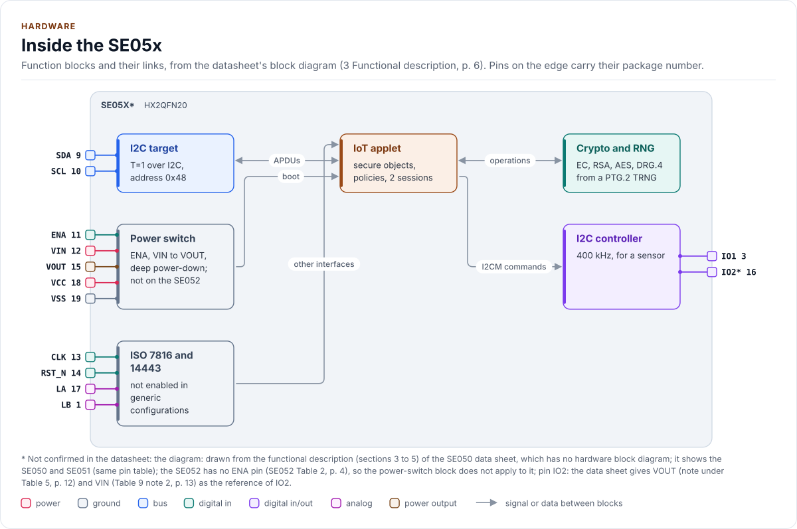
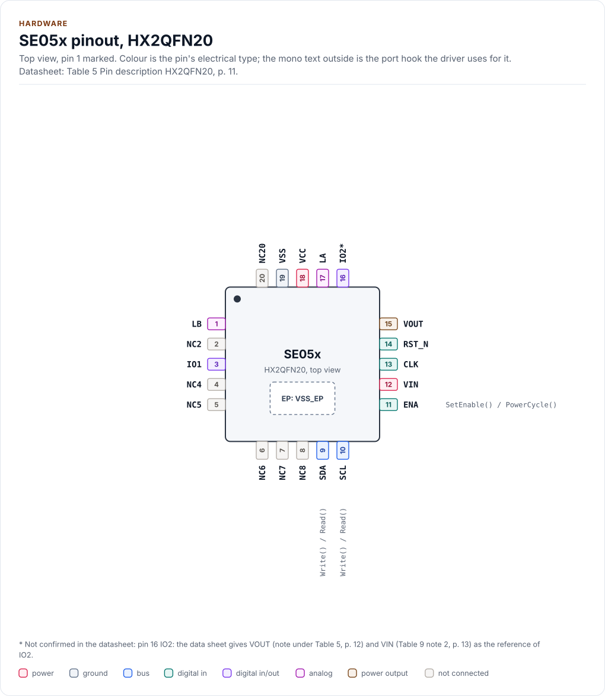
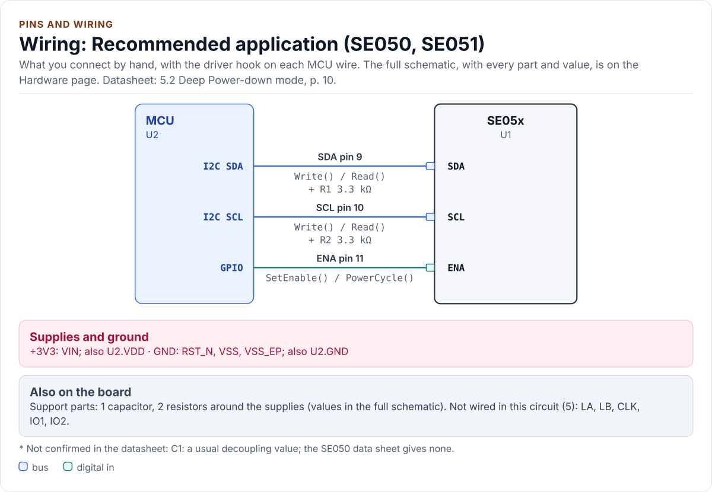
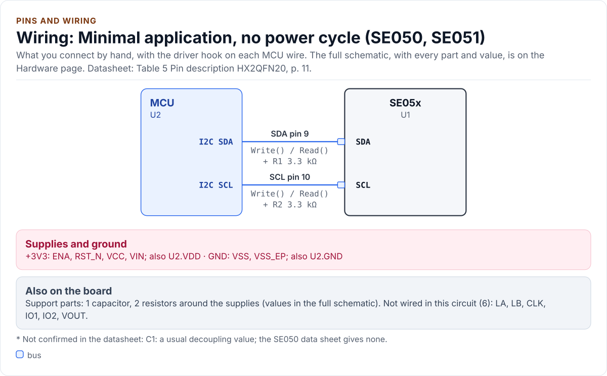
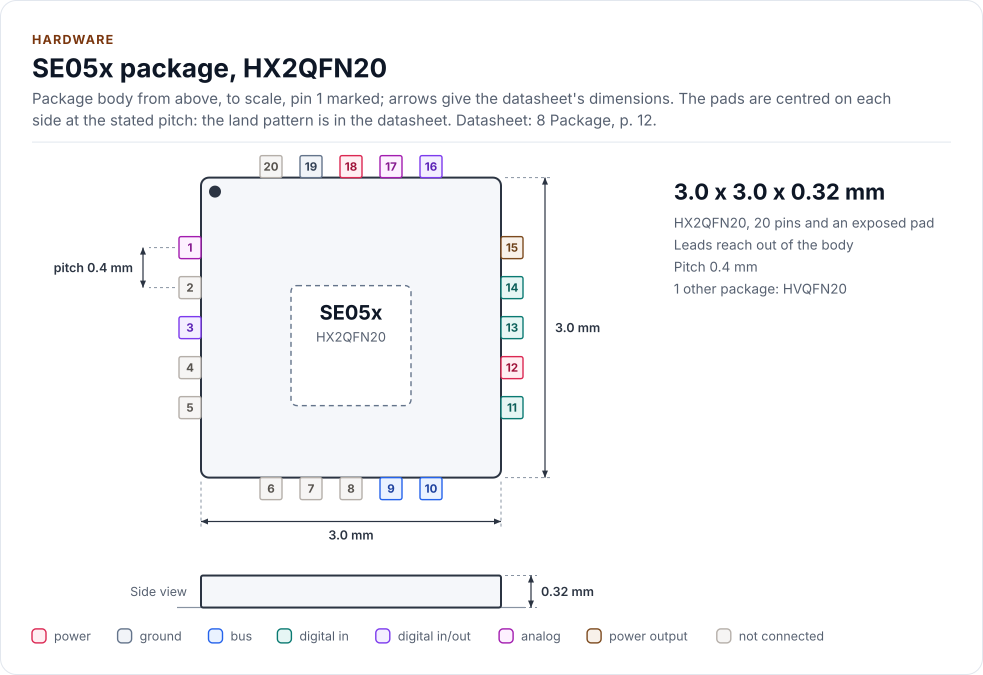

---
hide:
  - navigation
  - toc
---

<div class="kb-hero" markdown>
<span class="kb-kicker">Driver</span>

# SE05X Driver

<p>A C++20 driver and hardware root-of-trust facade for the NXP EdgeLock SE050, SE051 and SE052 secure elements: T=1 over
I2C, SCP03, the IoT applet, typed objects and policies, attestation and guarded irreversible operations, on any MCU.</p>

[Choose your job](jobs.md){ .md-button .md-button--primary }
[The first 15 minutes](first-15-minutes.md){ .md-button }
[API guide](api-guide.md){ .md-button }
[Source on GitHub](https://github.com/kokeb-labs-drivers/driver-se05x){ .md-button }
</div>

<!-- generated: chip-summary -->
The **SE05x** is a family of secure elements (SE050, SE051, SE052) that hold keys and credentials isolated from the
host, sign, agree keys and attest with them inside the chip, and talk to the host over I2C with T=1 framing and an
encrypted SCP03 channel (SE050 1 Introduction, p. 1).
<!-- /generated -->

The three chips differ in package, applet, memory and certification: [Where to use it](variants.md) helps you choose
and draws the SE052's HVQFN20 package; the figures below show the HX2QFN20 of the SE050 and SE051.

<!-- figure: chip-hero -->
<picture>
  <source media="(prefers-color-scheme: dark)" srcset="diagrams/chip-hero.dark.svg">
  
</picture>
<!-- /figure -->

## What it does

<!-- figure: chip-capabilities -->
<picture>
  <source media="(prefers-color-scheme: dark)" srcset="diagrams/chip-capabilities.dark.svg">
  
</picture>
<!-- /figure -->

## Where it is used

<!-- generated: chip-uses -->
- Secure connection to public and private clouds and edge platforms
- Device-to-device authentication
- Protection of data such as sensor data (SE050 1 Introduction, p. 1)
- Wi-Fi credential protection: a device key for WPA-EAP-TLS (AN12661 2 Wi-Fi credential protection, p. 4)
- Secure commissioning, key storage and credential provisioning
- Ecosystem protection
- Smart industry, smart home, smart cities and smart supply chains (SE050 1.2 SE050 target applications, p. 2)
- Healthcare (SE052) (SE052 1.2 Applications, p. 1)

Uses named by the datasheet (SE050 1.1 SE050 use cases, p. 1).
<!-- /generated -->

## Inside the chip

<!-- figure: chip-blocks -->
<picture>
  <source media="(prefers-color-scheme: dark)" srcset="diagrams/chip-blocks.dark.svg">
  
</picture>
<!-- /figure -->

The block diagram is drawn from the functional description of the SE050 data sheet (sections 3 to 5), which has no
block diagram of its own. It and the pinout and wiring figures below show the SE050 and SE051 in HX2QFN20, though
their titles name the family. The SE052 has no ENA pin (SE052 Table 2, p. 4), so the power-switch block does not
apply to it; [SE052](se052.md) draws its own pins and wiring.

## Pins and wiring

<!-- figure: chip-pinout -->
<picture>
  <source media="(prefers-color-scheme: dark)" srcset="diagrams/chip-pinout.dark.svg">
  
</picture>
<!-- /figure -->

<!-- figure: chip-wiring-typical -->
<picture>
  <source media="(prefers-color-scheme: dark)" srcset="diagrams/chip-wiring-typical.dark.svg">
  
</picture>
<!-- /figure -->

<!-- figure: chip-wiring-minimal -->
<picture>
  <source media="(prefers-color-scheme: dark)" srcset="diagrams/chip-wiring-minimal.dark.svg">
  
</picture>
<!-- /figure -->

<!-- figure: chip-outline -->
<picture>
  <source media="(prefers-color-scheme: dark)" srcset="diagrams/chip-outline.dark.svg">
  
</picture>
<!-- /figure -->

<!-- figure: chip-frame-t1-rblock -->
<picture>
  <source media="(prefers-color-scheme: dark)" srcset="diagrams/chip-frame-t1-rblock.dark.svg">
  
</picture>
<!-- /figure -->

<div class="kb-chip" markdown>
<div class="kb-chip__head">
<span class="kb-chip__kicker">Secure element</span>
<span class="kb-chip__name">SE050, SE051, SE052</span>
<span class="kb-chip__vendor">NXP EdgeLock</span>
</div>

Function
:   Key storage and use that never leaves the chip (SE050 1 Introduction, p. 1): sign and ECDH (AN12543 4.10, p. 101),
    attestation (AN12543 3.2.7.2, p. 19), counters (AN12543 3.2.1.7, p. 7), secure storage (AN12543 4.7.1.4, p. 84)

Interface
:   I2C target at 7-bit address `0x48` (SE050 4.1, Figure 3, p. 8; SE052 Table 12, p. 18), T=1 framing in two
    flavours (UM11225 Tables 1, 3 and 4, p. 5; GPC_SPE_172 I2C physical layer, p. 23), GlobalPlatform SCP03 and ECKey
    sessions (AN12543 3.5, p. 27)

Packages
:   HX2QFN20 (SE050, SE051; SE050 8 Package, p. 12), HVQFN20 (SE052; SE052 6 Package, p. 5)

Control
:   ENA on the SE050 and SE051 (SE050 5.2 Deep Power-down mode, p. 10), RST_N on the SE052 (SE052 Table 2, p. 4)

Supply
:   VIN 1.62 V to 3.6 V on the SE050 and SE051 (SE050 Table 9, p. 13); on the SE052 VIN 1.65 V to 3.6 V and VDD
    1.62 V to 5.5 V (SE052 Table 13, p. 18)
</div>

Every pin, the reference circuits, the bus settings, the timing and the power: [Hardware](hardware.md).

## Quick start

Wire the chip as above, write the port for your MCU ([Porting](porting.md)), then:

<!-- generated: quickstart-code -->
```cpp
using BoardPorts = se05x::Ports<MyBus, MyClock, se05x::ReferenceCrypto>;

se05x::Error RandomBytes(MyBus& bus, MyClock& clock, se05x::ReferenceCrypto& crypto,
                         se05x::MutableByteSpan out) noexcept {
  const BoardPorts ports(bus, clock, crypto);
  se05x::Device<BoardPorts> device(ports, se05x::Config{});
  if (const auto opened = device.Open(); !opened.ok()) {
    return opened.error; // for example DeviceIdMismatch: nothing answered like an SE05x
  }
  const auto random = device.GetRandom(out);
  static_cast<void>(device.Close());
  return random.error;
}
```
<!-- /generated -->

Every step, with the port and what to check when it does not work: [Quickstart](quickstart.md).

## Driver coverage

<!-- generated: chip-coverage -->
| Capability | What the chip does | Driver API | Registers | Status | Datasheet |
| --- | --- | --- | --- | --- | --- |
| [Key generation](tasks/provisioning.md) | Generates EC key pairs inside the chip under a policy; the private key never leaves it (the facade needs applet 7.x; Device also serves 3.x (AN12413 4.7.1.1, p. 58)) | `Provision`, `GenerateEcKey`, `Execute` | `WriteECKey` (`WriteEcKey`), `WriteSymmKey` | Supported | AN12543 4.7.1.1 WriteECKey, p. 80 |
| [Signatures and key agreement](getting-started.md#sign-and-verify) | ECDSA signatures and verification and ECDH shared secrets with keys held in the chip | `Sign`, `TlsSign`, `VerifySignature`, `Agree`, `EcdsaSign`, `EcdsaVerify` | `ECDSASign` (`EcdsaSign`), `ECDSAVerify` (`EcdsaVerify`), `ECDHGenerateSharedSecret` (`EcdhGenerateSharedSecret`) | Supported | AN12543 4.10 Crypto operations EC, p. 101 |
| [Attestation](tasks/attestation.md) | Proves a key or a value comes from this chip: a signed, fresh read with the chip's unique ID (the facade needs applet 7.x; Device also serves 3.x (AN12413 3.2.7.2, p. 13)) | `Attest`, `ReadAttested` | `ReadObject with attestation` (`ReadObjectAttested`) | Supported | AN12543 3.2.7.2 Reading with attestation, p. 19 |
| [Secure storage](tasks/secret-storage.md) | Binary objects for secrets such as a Wi-Fi passphrase or a token, read only as their policy allows (the facade needs applet 7.x; Device also serves 3.x (AN12413 4.7.1.4, p. 61)) | `Store`, `Load`, `WriteBinary`, `ReadObject` | `WriteBinary`, `ReadObject` | Supported | AN12543 4.7.1.4 WriteBinary, p. 84 |
| [Certificates and CSR](pki.md) | Stores and reads certificates, builds a certificate request for a chip key and checks a chain (requests and chains in the optional PKI layer) | `StoreCertificate`, `LoadCertificate`, `BuildCsr`, `VerifyChain` | `WriteBinary`, `ReadObject` | Supported | AN12543 4.7.1.4 WriteBinary, p. 84 |
| [Monotonic counters](tasks/anti-rollback.md) | Counters that only count up, for an anti-rollback floor on the firmware version (the facade needs applet 7.x; Device also serves 3.x (AN12413 3.2.1.7, p. 8)) | `CreateCounter`, `RaiseCounterTo`, `CheckFloor`, `IncrementCounter` | `WriteCounter` | Supported | AN12543 3.2.1.7 Counter, p. 7 |
| [Secure channels](secure-channels.md) | Platform SCP03 encrypts the bus; AESKey, ECKey and UserID sessions authenticate the caller (ECKey sessions behind a build flag) | `Open`, `BeginAesKeySession`, `BeginEcKeySession`, `BeginUserIdSession`, `EndSession` | `CreateSession`, `SCPInitializeUpdate` (`ScpInitializeUpdate`), `VerifySessionUserID` (`VerifySessionUserId`) | Supported | AN12543 3.5 Secure Channel Protocols, p. 27 |
| [Lifecycle and locks](irreversible.md) | Transport lock, a platform SCP03 requirement and factory reset: one-way changes to the chip (compiled out by default; each needs a plan and a typed confirmation) | `ExecuteIrreversible`, `Operations` | `SetLockState`, `SetPlatformSCPRequest` (`SetPlatformScpRequest`), `DeleteAll` | Guarded | AN12543 3.8 Lifecycle management, p. 42 |
| [Contactless and ISO 7816](limitations.md) | The ISO 14443 antenna and ISO 7816 interfaces; the host cannot reach them over I2C | - | - | Not covered | SE050 4.2 ISO7816 and ISO14443 interface, p. 9 |

**Supported**: the driver covers it and a host test checks it; **Guarded**: covered, behind an explicit acknowledgement
because a wrong value can do harm; **Not covered**: the chip has it and the driver leaves it alone.

From [`docs/hardware.yml`](hardware.yml); `kokeb-docs hardware --check` confirms that every API name is in
`inc/se05x_hrot.hpp`, `inc/se05x_device.hpp`, `inc/se05x_pki_csr.hpp`, `inc/se05x_pki_verify.hpp`,
`inc/se05x_pki_device.hpp`, `inc/se05x_irreversible.hpp` and every register (the header constant in brackets, where the
header spells it otherwise) in `inc/se05x_commands.hpp`.
<!-- /generated -->

The driver has no platform code. You give it small port classes (a bus and a clock, optionally reset and a hardware
crypto engine); it does the framing, the secure channel, the checks and the recovery.

## What it does for you

<div class="grid cards" markdown>

-   :material-key-plus: **[Provision](getting-started.md#provision-a-device-key)**

    Keys generated inside the chip, under a strict policy, in one call.

-   :material-certificate-outline: **[Attest](getting-started.md#attest-a-key-or-a-value)**

    Prove a key or a value came from this chip; fresh, verified, typed.

-   :material-draw-pen: **[Sign and verify](getting-started.md#sign-and-verify)**

    ECDSA, and EdDSA except on the SE052F in FIPS mode ([variants](variants.md)), with keys that never leave the chip.

-   :material-handshake-outline: **[ECDH](getting-started.md#agree-a-key-ecdh)**

    Key agreement with the secret kept on the chip.

-   :material-key-arrow-right: **[Key import](getting-started.md#import-a-key)**

    Wrapped import under a key-encryption key; no plain key on the host.

-   :material-lock-outline: **[Secure channels](secure-channels.md)**

    Platform SCP03, AESKey and ECKey sessions; no half-open channel.

-   :material-safe-square-outline: **[Secure storage](getting-started.md#store-data)**

    Binary objects whose policy decides who reads them.

-   :material-file-certificate-outline: **[Certificates](getting-started.md#read-and-store-certificates)**

    Read the provisioned certificates, store your own.

-   :material-counter: **[Counters](getting-started.md#monotonic-counters)**

    Monotonic counters and anti-rollback floors.

-   :material-lock-alert-outline: **[Lifecycle and lock](lifecycle.md)**

    Transport lock, SCP requirement, factory reset; irreversible steps guarded.

-   :material-shield-half-full: **[Security model](security-model.md)**

    What the chip protects, what it does not, and the trust boundaries.

-   :material-chip: **[Choose a variant](variants.md)**

    SE050, SE051 or SE052, which applet and which authentication.

</div>

## What you get

- **Layers with one job each.** Link, APDU, secure channel, capability gate, objects, device, facade. See
  [Architecture](architecture.md).
- **Errors you can act on.** Every call returns `Result<T>` with an `Error` and the chip's status word. See the
  [API guide](api-guide.md#handle-errors).
- **A gate before the bus.** A command the chip lacks never reaches it. See [Contract](contract.md).
- **No foot-guns.** Irreversible operations are separate types behind named confirmations, compiled out by default.
  See [Safety rules](safety.md).
- **Honest about doubt.** Every open question has a knob. See [Ambiguities](ambiguities.md).
- **No heap, no exceptions, no RTTI.** See [Contract](contract.md#memory).
- **Tested without hardware.** The tests run the driver against an independent model of the chip. See
  [Testing and CI](testing.md).

## Datasheet

<!-- generated: datasheet-card -->
| Document | Revision | Get it |
| --- | --- | --- |
| Datasheet: SE050 Plug & Trust Secure Element product data sheet (doc 504938) (NXP SE050-DATASHEET) | Rev. 3.8, revision date 2023-10-18 | [vendor page](https://www.nxp.com/docs/en/data-sheet/SE050-DATASHEET.pdf) |
| Datasheet: SE051 Plug & Trust Secure Element product data sheet (doc 577320) (NXP SE051) | Rev. 2.0, revision date 2024-07-08 | [vendor page](https://www.nxp.com/docs/en/data-sheet/SE051.pdf) |
| Datasheet: SE052 EdgeLock family product data sheet (doc 789115) (NXP SE052) | Rev. 1.5, revision date 2024-06-03 | [vendor page](https://www.nxp.com/docs/en/data-sheet/SE052.pdf) |
| Errata (datasheet set): SE050 Errata sheet (doc 640310) (NXP SE050_Erratasheet) | Rev. 1.0, revision date 2020-10-14 | [vendor page](https://www.nxp.com/docs/en/errata/SE050_Erratasheet.pdf) |
| User manual (datasheet set): UM11225 NXP SE05x T=1 Over I2C Specification (NXP UM11225) | Rev. 1.2, revision date 2020-12-10 | [vendor page](https://www.nxp.com/webapp/Download?colCode=UM11225) |
| Specification (datasheet set): GPC_SPE_172 APDU Transport over SPI / I2C, public release (GlobalPlatform GPC_SPE_172) | v1.0, 2020-01 | [vendor page](https://globalplatform.org/specs-library/apdu-transport-over-spi-i2c-v1-0-gpc_spe_172) |
| Application note (datasheet set): AN12543 SE05x IoT applet APDU Specification (applet 7.x) (NXP AN12543) | Rev. 4.5, revision date 2024-03-27 | [vendor page](https://www.nxp.com/docs/en/application-note/AN12543.pdf) |
| Application note (datasheet set): AN12413 SE050A/B/C/D/F APDU Specification (applet 3.x) (NXP AN12413) | Rev. 2.12, revision date 2021-03-24 | [vendor page](https://www.nxp.com/docs/en/application-note/AN12413.pdf) |
| Application note (datasheet set): AN12436 SE050 configurations (NXP AN12436) | Rev. 2.4, revision date 2024-07-08 | [vendor page](https://www.nxp.com/docs/en/application-note/AN12436.pdf) |
| Application note (datasheet set): AN12973 SE051 configurations (NXP AN12973) | Rev. 2.0, revision date 2024-07-08 | [vendor page](https://www.nxp.com/) |
| Application note (datasheet set): AN14277 SE052 Configuration Details (NXP AN14277) | Rev. 1.0, revision date 2024-03-25 | [vendor page](https://www.nxp.com/docs/en/application-note/AN14277.pdf) |
| Application note (datasheet set): AN13014 Moving from SE050 to SE050E or SE051 (NXP AN13014) | Rev. 1.2, revision date 2022-04-11 | [vendor page](https://www.nxp.com/docs/en/application-note/AN13014.pdf) |
| Application note (datasheet set): AN14028 Moving from SE050F to SE052F (NXP AN14028) | Rev. 1.0, revision date 2024-04-02 | [vendor page](https://www.nxp.com/docs/en/application-note/AN14028.pdf) |
| Application note (datasheet set): AN12514 SE050 User Guidelines (NXP AN12514) | Rev. 1.4, revision date 2021-11-21 | [vendor page](https://www.nxp.com/) |
| Application note (datasheet set): AN13483 SE050E User Guidelines (NXP AN13483) | Rev. 1.2, revision date 2022-08-22 | [vendor page](https://www.nxp.com/) |
| Application note (datasheet set): AN13904 SE052F User Guidelines (NXP AN13904) | Rev. 1.0, revision date 2024-03-27 | [vendor page](https://www.nxp.com/) |
| Application note (datasheet set): AN13254 Secure attestation with EdgeLock SE05x (NXP AN13254) | Rev. 1.1, revision date 2023-07-26 | [vendor page](https://www.nxp.com/docs/en/application-note/AN13254.pdf) |
| Application note (datasheet set): AN12907 Secure update of EdgeLock SE051 IoT applet (SEMS Lite) (NXP AN12907) | Rev. 1.2, revision date 2023-11-23 | [vendor page](https://www.nxp.com/) |
| Application note (datasheet set): AN13015 How to use EdgeLock SE051 PERSO applet (NXP AN13015) | Rev. 1.4, revision date 2026-01-09 | [vendor page](https://www.nxp.com/) |
| Application note (datasheet set): AN13030 Plug & Trust MW Documentation (a user guide; not a T=1 or APDU specification) (NXP AN13030) | Rev. 2.7, revision date 2026-07-09 | [vendor page](https://www.nxp.com/) |
| Application note (datasheet set): AN13539 OM-SE05xARD hardware overview (NXP AN13539) | Rev. 1.2, revision date 2022-11-08 | [vendor page](https://www.nxp.com/) |
| Application note (datasheet set): AN12448 Plug & Trust MW porting guidelines (NXP AN12448) | Rev. 1.1, revision date 2020-12-07 | [vendor page](https://www.nxp.com/docs/en/application-note/AN12448.pdf) |
| Application note (datasheet set): AN12662 Binding a host device to SE05x (NXP AN12662) | Rev. 1.1, revision date 2020-12-07 | [vendor page](https://www.nxp.com/docs/en/application-note/AN12662.pdf) |
| Application note (datasheet set): AN13013 Get started with SE05x support package (NXP AN13013) | Rev. 1.5, revision date 2024-07-25 | [vendor page](https://www.nxp.com/docs/en/application-note/AN13013.pdf) |
| Application note (datasheet set): AN12396 EdgeLock SE05x quick start guide with FRDM-K64F (NXP AN12396) | Rev. 3.3, revision date 2022-08-04 | [vendor page](https://www.nxp.com/) |
| Application note (datasheet set): AN12450 SE05x quick start guide with i.MX RT1060 and RT1170 (NXP AN12450) | Rev. 4.2, revision date 2022-08-04 | [vendor page](https://www.nxp.com/) |
| Application note (datasheet set): AN13027 SE05x quick start guide with i.MX 8M (NXP AN13027) | Rev. 1.3, revision date 2022-09-12 | [vendor page](https://www.nxp.com/) |
| Application note (datasheet set): AN12570 SE05x quick start with Raspberry Pi (NXP AN12570) | Rev. 1.5, revision date 2022-08-03 | [vendor page](https://www.nxp.com/docs/en/application-note/AN12570.pdf) |
| Application note (datasheet set): AN12398 SE05x quick start with Visual Studio (NXP AN12398) | Rev. 2.5, revision date 2022-09-12 | [vendor page](https://www.nxp.com/docs/en/application-note/AN12398.pdf) |
| Application note (datasheet set): AN12399 SE05x device-to-device authentication (NXP AN12399) | Rev. 1.3, revision date 2022-03-28 | [vendor page](https://www.nxp.com/docs/en/application-note/AN12399.pdf) |
| Application note (datasheet set): AN12449 Sensor data protection with SE05x (NXP AN12449) | Rev. 1.3, 2021-07 | [vendor page](https://www.nxp.com/docs/en/application-note/AN12449.pdf) |
| Application note (datasheet set): AN12663 SE05x TPM-like functionality (NXP AN12663) | Rev. 1.0, revision date 2021-04-13 | [vendor page](https://www.nxp.com/docs/en/application-note/AN12663.pdf) |
| Application note (datasheet set): AN13086 SE05x to enhance MCU boot sequence security (NXP AN13086) | Rev. 1.0, revision date 2021-04-13 | [vendor page](https://www.nxp.com/docs/en/application-note/AN13086.pdf) |
| Application note (datasheet set): AN12404 SE05x secure connection to AWS IoT Core (NXP AN12404) | Rev. 1.6, revision date 2021-01-15 | [vendor page](https://www.nxp.com/docs/en/application-note/AN12404.pdf) |
| Application note (datasheet set): AN12400 SE05x secure connection to OEM cloud (NXP AN12400) | Rev. 1.3, revision date 2020-12-07 | [vendor page](https://www.nxp.com/docs/en/application-note/AN12400.pdf) |
| Application note (datasheet set): AN12402 EdgeLock SE05x for secure connection to Azure IoT Hub (NXP AN12402) | Rev. 2.1, revision date 2020-12-07 | [vendor page](https://www.nxp.com/) |
| Application note (datasheet set): AN12569 SE05x secure access control in IIoT (NXP AN12569) | Rev. 1.2, revision date 2020-12-07 | [vendor page](https://www.nxp.com/docs/en/application-note/AN12569.pdf) |
| Application note (datasheet set): AN12660 Ease ISA/IEC 62443 compliance with SE05x (NXP AN12660) | Rev. 1.1, revision date 2020-12-07 | [vendor page](https://www.nxp.com/docs/en/application-note/AN12660.pdf) |
| Application note (datasheet set): AN12661 EdgeLock SE05x for Wi-Fi credential protection (NXP AN12661) | Rev. 1.2, revision date 2020-12-07 | [vendor page](https://www.nxp.com/) |
| Application note (datasheet set): AN12664 EdgeLock SE05x for NFC late-stage configuration (NXP AN12664) | Rev. 1.1, revision date 2020-12-07 | [vendor page](https://www.nxp.com/) |
| Application note (datasheet set): AN12665 EdgeLock SE05x for Blockchain ID (NXP AN12665) | Rev. 1.1, revision date 2022-08-22 | [vendor page](https://www.nxp.com/) |
| Application note (datasheet set): AN13445 Matter with SE05x/A5000 (NXP AN13445) | Rev. 1.1, revision date 2023-02-10 | [vendor page](https://www.nxp.com/docs/en/application-note/AN13445.pdf) |
| Application note (datasheet set): AN13645 Smart and secure EV charging with NXP secure solutions (NXP AN13645) | Rev. 1.0, revision date 2022-11-28 | [vendor page](https://www.nxp.com/) |
| Application note (datasheet set): AN13742 Secure smart metering with NXP secure solutions (NXP AN13742) | Rev. 1.0, revision date 2024-06-07 | [vendor page](https://www.nxp.com/) |
| Application note (datasheet set): AN14252 Secure medical IoT application with NXP secure devices (NXP AN14252) | Rev. 2.1, revision date 2025-12-19 | [vendor page](https://www.nxp.com/) |
| Application note (datasheet set): AN14671 Ease CRA compliance with EdgeLock discrete portfolio (NXP AN14671) | Rev. 1.0, revision date 2025-10-13 | [vendor page](https://www.nxp.com/) |
| Fact sheet (datasheet set): SE051 fact sheet (NXP FS-SE051) | n/a, n/a | [vendor page](https://www.nxp.com/docs/en/fact-sheet/FS-SE051.pdf) |
| Fact sheet (datasheet set): SE051H fact sheet (Matter, NFC) (NXP SE051HFS) | n/a, n/a | [vendor page](https://www.nxp.com/docs/en/fact-sheet/SE051HFS.pdf) |
| Fact sheet (datasheet set): SE051W block diagram page (UWB) (NXP SE051W-block-diagram) | n/a, revision date 2026-02-18 | [vendor page](https://www.nxp.com/assets/block-diagram/en/SE051W.pdf) |
| Fact sheet (datasheet set): SE052F fact sheet (NXP ELSE052FFSA4) | n/a, n/a | [vendor page](https://www.nxp.com/docs/en/fact-sheet/ELSE052FFSA4.pdf) |
| Source (test oracle only; not a datasheet): Plug and Trust middleware, mini package (NXP plug-and-trust) | v04.08.02, commit 7102413e0457d3dfa4fc4be686ca8ec50bd9f5e2, revision date 2026-09-24 | [vendor page](https://github.com/NXP/plug-and-trust) |

Written against these revisions; the SHA-256 of each file is in [`docs/datasheets.yml`](datasheets.yml). Where each part
of the driver is in the datasheet: [Datasheet map](datasheet.md).
<!-- /generated -->

## Where to go next

<div class="grid cards" markdown>

-   :material-rocket-launch-outline: **[Quickstart](quickstart.md)**

    ---

    Wire the chip, write the ports, open the device in about 15 lines.

-   :material-chip: **[Hardware](hardware.md)**

    ---

    Pins, bus settings, timing and power; per-chip guides for the SE050, SE051 and SE052.

-   :material-alert-octagon-outline: **[Troubleshooting](troubleshooting.md)**

    ---

    Bus lock-up, the throughput limit, flavour mismatch.

-   :material-file-document-check-outline: **[Contract](contract.md)**

    ---

    What the driver promises, what it needs, threading and errors.

-   :material-code-braces: **[API guide](api-guide.md)**

    ---

    Initialise, configure, measure and handle errors, task by task.

-   :material-swap-horizontal: **[Porting](porting.md)**

    ---

    Implement the port for your MCU.

-   :material-book-open-variant: **[API reference](api-reference.md)**

    ---

    Every class and member, generated from the headers.

</div>
