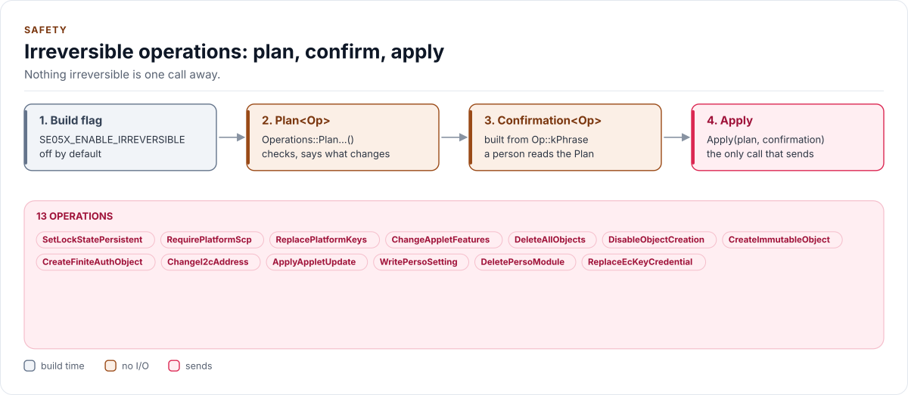

# Irreversible operations

!!! danger "These operations can make a chip unusable for good"
    A locked chip, a required channel whose keys you lost, an I2C address your board does not use, a deleted module:
    none of them comes back. A chip is cheap; the product it is soldered into is not. Run each operation on a spare
    chip first, keep the keys it depends on in two places, and write down what you did.

<!-- generated: datasheet-refs -->
??? abstract "Datasheet sections this page relies on"

    - SetLockState, DisableObjectCreation, SetPlatformSCPRequest: NXP AN12543 Rev. 4.5, Module management commands, p. 73
    - SetAppletFeatures, TriggerSelfTest, ReadState: NXP AN12543 Rev. 4.5, Module management commands, p. 76
    - DeleteAll: factory reset role, unwrapped reply: NXP AN12543 Rev. 4.5, DeleteAll, p. 154
    - PERSO applet needs no authentication: anyone can change the address: NXP AN13015 Rev. 1.4, Deleting the PERSO applet, p. 19

    All of them, with the driver API for each: [Datasheet map](datasheet.md).
<!-- /generated -->

## The flow

<!-- figure: irreversible-flow -->
<picture>
  <source media="(prefers-color-scheme: dark)" srcset="diagrams/irreversible-flow.dark.svg">
  
</picture>
<!-- /figure -->

1. **Build flag.** The calls exist only when the build defines `SE05X_ENABLE_IRREVERSIBLE` (CMake option or Kconfig;
   off by default). A production build that never needs them never contains them.
2. **Plan.** `irreversible::Operations<P>::Plan...()` checks the device state, the arguments, the chip's capabilities,
   the role the command needs (`ConditionsNotSatisfied`) and that the chip is not already in the requested state
   (`WrongState`), sends nothing, and returns a `Plan<Op>` with the target, a one-line `Effect()` for the operator and
   the arguments it will send.
3. **Confirmation.** A person reads the plan and types the operation's phrase; the code builds `Confirmation<Op>{typed}`
   from what the person typed, never from `Op::kPhrase` itself. A phrase of another operation gives a confirmation
   that is not confirmed.
4. **Apply.** `Apply(plan, confirmation)` is the only call that sends. A plan that was not prepared, a plan prepared
   for another device, or a confirmation that does not match, is refused with `IrreversibleNotConfirmed` before any
   byte goes on the bus; the state, gate and role are checked again.

```cpp
--8<-- "tests/docs/lifecycle.hpp:lifecycle"
```

The snippet is compiled with the flag on and run against the chip model (`tests/test_irreversible.cpp`). A
confirmation is a type per operation: passing a `Confirmation<SetLockStatePersistent>` for a `DeleteAllObjects` plan
does not compile.

`hrot::` never offers these operations. `TriggerSelfTest` is not irreversible but resets the chip without a reply, so
it takes an `irreversible::ResetExpected` acknowledgement instead.

## The operations

| Operation | What it does | Role or precondition | Undo |
| --- | --- | --- | --- |
| `SetLockStatePersistent` | Persistent transport lock: only five commands answered | Transport session | Only from a Transport session; lost key: never |
| `RequirePlatformScp` | Every command needs full platform SCP03 from then on | PlatformScp session | Only over platform SCP03 (`AllowWithoutPlatformSCP`); lost keys: never |
| `ReplacePlatformKeys` | Replaces the platform SCP03 key set. **Not available**: the plan returns `Unsupported`, sends nothing ([Secure channels](secure-channels.md#platform-scp03)) | Platform SCP03 open | Only with the new keys |
| `ChangeAppletFeatures` | Changes the AppletConfig and feature bits | Feature session (NXP-owned credential) | Depends on the chip; features may not come back |
| `DeleteAllObjects` | Deletes every object except provisioned ones; the reply is not wrapped (AN12543 4.20.5, p. 154), so its success is not authenticated: check afterwards, for example that a known object is gone; the session ends and the device selects the applet again | FactoryReset session | Never: the keys are gone |
| `DisableObjectCreation` | No new objects (or none at all) | Restrict session | Persistent form: never |
| `CreateImmutableObject` | A binary object of 1 to 512 bytes written once; the plan refuses a policy that grants `Write` or `Delete` to anyone (that object is not irreversible: use `WriteBinary`) | Its policy | Never |
| `CreateFiniteAuthObject` | A UserID authentication object with 1 to 255 attempts; the plan checks the value length of the generation | Its policy | The object locks when the counter runs out |
| `ChangeI2cAddress` | New 7-bit address after the next reset. **Not available**: no applet command (A7); the plan returns `Unsupported` | SE051 PERSO | Only by a host that uses the new address |
| `ApplyAppletUpdate` | SEMS Lite applet update. **Not available** in this version: the plan returns `Unsupported` | Out of v1 | Anti-rollback: never back |
| `ReplaceEcKeyCredential` | Replaces the ECKey session credential. **Not available**: the update of an authentication object's key is not described in the sources read; the plan returns `Unsupported` | Feature or user session | Only with the new credential |
| `WritePersoSetting` | PERSO tag write (address, I2C parameters, ATR and CIP bytes) on `perso::Perso` | SE051, PERSO selectable | A wrong flavour leaves the chip silent to this host |
| `DeletePersoModule` | Deletes `iot_extended` or `rsakeygen` on `perso::Perso` | SE051 A and C | Never; `iot_base` is never offered |

The two creating operations are the only way to make those objects: outside a plan the device refuses, before
sending, a `WriteBinary` that would create a file whose policy grants neither `Write` nor `Delete`
(`policy::IsImmutable`) and every `WriteUserId` (each UserID object has a finite counter and locks for good when it
runs out), both with `IrreversibleNotConfirmed`. The facade's own keys and counters are permanent too (their
policies forbid delete); that is the facade's documented contract, not one of these operations: plan the slots
before you provision ([Getting started](getting-started.md)).

`Device::ExecuteIrreversible<C, Op>` checks, before it sends anything: the confirmation (`IrreversibleNotConfirmed`),
the state and the gate as `Execute` does, the session role of the table (`ConditionsNotSatisfied`), and that the chip
is not already in the requested state (`WrongState` for a persistent lock that is set or platform SCP03 that is
already required).

Sources: SetLockState, DisableObjectCreation and SetPlatformSCPRequest AN12543 pp. 73-76; DeleteAll p. 154; PERSO
AN13015 pp. 19 and 49; the session preconditions AN13030 pp. 679-682.

## Before you apply

- Read the chip with ReadState and `GetVersion()` and keep the output.
- Check you hold the keys of every role the result will need: the Transport key after a lock, the platform keys after
  requiring SCP03.
- On an SE051, check the PERSO applet is still selectable before a PERSO write and that your host build speaks the
  flavour you are about to select.
- Never run an irreversible operation in a loop or on a schedule.
- Keep the bytes behind a plan's `ByteSpan` (the data of an immutable object, the value of a UserID object)
  unchanged until `Apply()`: a plan copies the arguments, never a secret.
