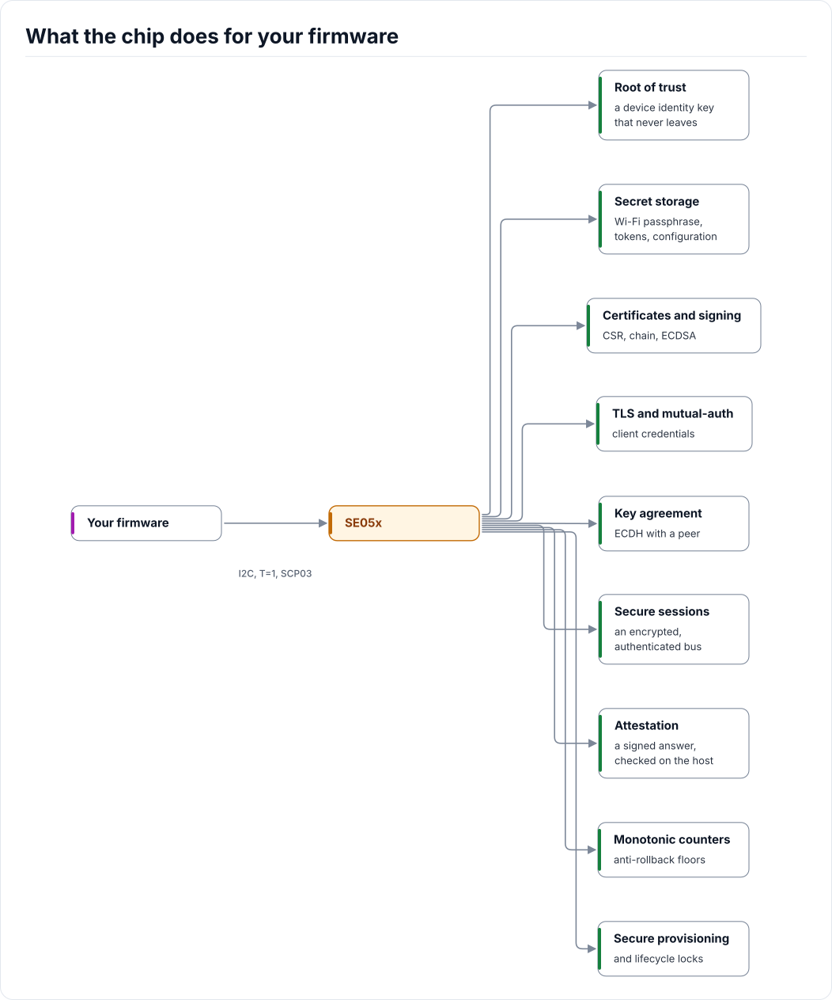

# Choose your job

The SE050, SE051 and SE052 are secure elements: a small chip on the I2C bus that holds keys and secrets your firmware
uses but can never read out, and that signs, agrees keys, counts and attests on its behalf (SE050 data sheet section
3, p. 6; AN12543 section 3, pp. 6-47). Pick what you want the chip to do; each guide has a diagram, compiled code, what
it protects against, what to do when a call fails, and a bench step.

<!-- figure: jobs-map -->
<picture>
  <source media="(prefers-color-scheme: dark)" srcset="diagrams/jobs-map.dark.svg">
  
</picture>
<!-- /figure -->

| You want to | Guide | Driver API |
| --- | --- | --- |
| Keep a Wi-Fi passphrase, a cloud token or a configuration in the chip, read only over an encrypted channel | [Store a secret](tasks/secret-storage.md) | `hrot::Device::Store`, `Load` with `Protection::Secret` |
| Give the device an identity key and sign with it | [Device identity](tasks/device-identity.md) | `Provision<KeyUse::Sign>`, `Sign`, `VerifySignature` |
| Get a certificate for that key and keep the chain | [CSR and certificates](tasks/certificates.md) | `pki::BuildCsr`, `pki::StoreCertificate`, `pki::VerifyChain` |
| Authenticate to a server with TLS client credentials | [Mutual TLS](tasks/mutual-tls.md) | `Provision<KeyUse::TlsClient>`, `TlsSign` |
| Agree a key with a peer and encrypt with it | [ECDH](tasks/ecdh.md) | `Provision<KeyUse::Agree>`, `Agree` |
| Make the bus itself encrypted and authenticated | [Secure channel](tasks/secure-channel.md) | `Device::SetPlatformKeys`, `Open`, `BeginAesKeySession` |
| Refuse firmware older than what already ran | [Anti-rollback](tasks/anti-rollback.md) | `CreateCounter`, `CheckFloor`, `RaiseCounterTo` |
| Check on the host that a key lives in a chip holding an attestation key you trust | [Attested reads](tasks/attestation.md) | `Attest`, `TrustAttestationKey` |
| Set up a device in the factory and lock what must not change | [Provisioning](tasks/provisioning.md) | `irreversible::Operations` |

New to the chip? Start with [the first 15 minutes](first-15-minutes.md), then pick the variant on
[Where to use it](variants.md). The threats each job answers are on the [Security model](security-model.md).

## What every job assumes

- **The bus can be probed.** Open the chip with platform SCP03 at `Full` (or an AESKey session); the facade refuses a
  key, counter or secret call over a bus whose answers are not authenticated, and sends nothing (`PolicyDenied`).
  Until `RequirePlatformScp` has been applied the chip also takes plain commands from anyone on the bus: provision in
  a trusted place and apply it before the device leaves ([Security model](security-model.md)).
- **The chip runs applet 7.x.** The facade runs on the SE050E, SE051 and SE052. On applet 3.x (SE050 A to D and
  F) and 6.x (SE051 on early boards) every facade call returns `Unsupported` and sends nothing once its argument
  checks pass (an invalid key, an off-curve point or an empty buffer is refused first with `InvalidArgument`); use
  `se05x::Device` there ([Choosing a variant](variants.md)).
- **Slots are planned.** A facade key or counter can never be deleted; only a factory reset removes it. Plan the
  slots before the first `Provision` ([Getting started by job](getting-started.md)).
- **Nothing here is verified on hardware yet.** Every guide gives the bench step that confirms it on a dev kit.
