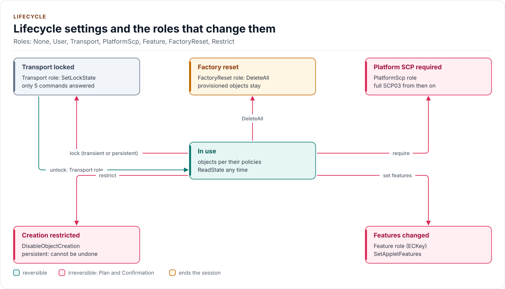

# Lifecycle and roles

The chip-wide settings of the IoT applet, the command that changes each one, and the reserved authentication object
whose session the chip demands for it.

<!-- generated: datasheet-refs -->
??? abstract "Datasheet sections this page relies on"

    - Reserved object identifiers: NXP AN12543 Rev. 4.5, Table 5, p. 10
    - SetLockState, DisableObjectCreation, SetPlatformSCPRequest: NXP AN12543 Rev. 4.5, Module management commands, p. 73
    - SetAppletFeatures, TriggerSelfTest, ReadState: NXP AN12543 Rev. 4.5, Module management commands, p. 76
    - DeleteSecureObject; provisioned objects stay: NXP AN12543 Rev. 4.5, DeleteSecureObject, p. 96
    - DeleteAll: factory reset role, unwrapped reply: NXP AN12543 Rev. 4.5, DeleteAll, p. 154
    - Lifecycle commands and their session preconditions: NXP AN13030 Rev. 2.7, SetLockState, SetPlatformSCPRequest, SetAppletFeatures, p. 679

    All of them, with the driver API for each: [Datasheet map](datasheet.md).
<!-- /generated -->

<!-- figure: lifecycle -->
<picture>
  <source media="(prefers-color-scheme: dark)" srcset="diagrams/lifecycle.dark.svg">
  
</picture>
<!-- /figure -->

## Roles

`AuthRole` (in `inc/se05x_lifecycle.hpp`) names what an open session is authenticated as. `RequiredRole(Command)`
says which role a command needs and `RoleOf(ObjectId)` which role a credential gives. The device checks the role
before it sends anything, so a refusal costs no round trip and no APDU of the throughput budget.

| Role | Reserved object | Commands |
| --- | --- | --- |
| `Transport` | `0x7FFF0200` | SetLockState |
| `PlatformScp` | `0x7FFF0207` | SetPlatformSCPRequest |
| `Feature` | `0x7FFF0204` | SetAppletFeatures (NXP-owned credential, AN12543 3.2.4.1.1.4) |
| `FactoryReset` | `0x7FFF0205` | DeleteAll |
| `Restrict` | `0x7FFF020A` | DisableObjectCreation (AN12543 3.2.4.1.1.9, 4.6.3) |
| `User` | any user authentication object | the commands its policies allow |

Reserved identifiers: AN12543 Table 5, p. 10. A lifecycle command in a session with another role is refused with
`ConditionsNotSatisfied` and nothing is sent; with the right role it runs only through
`Device::ExecuteIrreversible` (build flag and confirmation, [Irreversible operations](irreversible.md)). Two typed
state checks refuse a request the chip is already in (`WrongState`): a persistent lock that is set, and platform
SCP03 that is already required; both are read with ReadState when the device opens (applet 7.x).

## Settings

- **Transport lock.** SetLockState (AN12543 p. 73), transient or persistent. While locked the chip answers only
  GetVersion, ReadState, the read of the unique id, GetRandom and CreateSession. The Transport credential unlocks it
  in any state.
- **Platform SCP required.** SetPlatformSCPRequest (p. 75). From then on the chip accepts only full platform SCP03
  (C-MAC, C-ENC, R-MAC, R-ENC).
- **Restricted object creation.** DisableObjectCreation (p. 74): no new objects, or none at all; the persistent form
  cannot be undone.
- **Applet features.** SetAppletFeatures (p. 76) writes the AppletConfig, and on 7.x the 30 extended feature bytes.
- **Factory reset.** DeleteAll (p. 154) deletes every object, curve and crypto object except the provisioned ones.
  Inside a secure-messaging session its reply is not wrapped and the session dies; the device drops the session and
  selects the applet again. Under an AESKey or ECKey session the unwrapped reply cannot be authenticated, so the
  call may report `SecureChannelError` although the chip ran it: check the result with `ObjectExists()`.
- **Self-test.** TriggerSelfTest (p. 77) may reset the chip with no reply; the driver asks for `ResetExpected`.

ReadState (p. 79) returns the lock state, the restriction and the SCP requirement and is answered in every state.

Which of these the driver treats as irreversible, and how it guards them: [Irreversible operations](irreversible.md).
