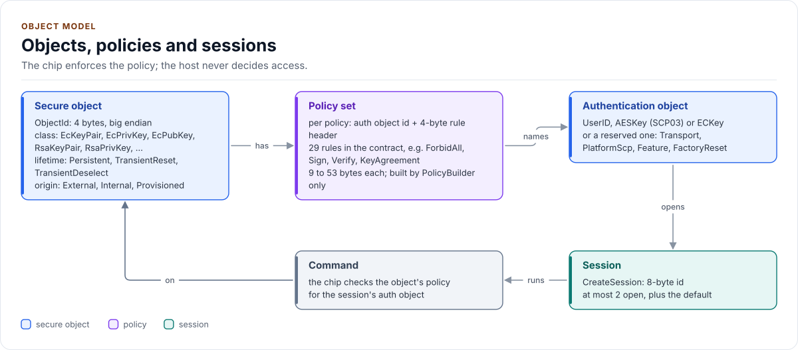

# Objects and policies

Everything the chip keeps is a secure object with an identifier, a class and a policy set. The chip checks the policy
on every command; the host never decides access.

<!-- generated: datasheet-refs -->
??? abstract "Datasheet sections this page relies on"

    - APDU buffer 270 bytes, internal buffer 1024 bytes: NXP AN12543 Rev. 4.5, APDU buffer sizes, p. 3
    - Reserved object identifiers: NXP AN12543 Rev. 4.5, Table 5, p. 10
    - Authentication object 0 is the default session only: NXP AN12543 Rev. 4.5, 3.7.1.2 Policy, p. 36
    - Session policy and object policy headers: NXP AN12543 Rev. 4.5, Tables 62 and 63, p. 66
    - WriteBinary, WriteUserID, WriteCounter: NXP AN12543 Rev. 4.5, WriteBinary, WriteUserID, WriteCounter, p. 84
    - DeleteSecureObject; provisioned objects stay: NXP AN12543 Rev. 4.5, DeleteSecureObject, p. 96
    - Pre-provisioned attestation keys: NXP AN12436 Rev. 2.4, Tables 8 and 9, p. 10
    - Object identifier ranges: NXP AN13904 Rev. 1.0, Object identifier ranges, p. 7
    - Policy flag layouts per applet generation: NXP AN13030 Rev. 2.7, Policy table for 3.x, 6.x and 7.x, p. 53

    All of them, with the driver API for each: [Datasheet map](datasheet.md).
<!-- /generated -->

<!-- figure: object-policy -->
<picture>
  <source media="(prefers-color-scheme: dark)" srcset="diagrams/object-policy.dark.svg">
  
</picture>
<!-- /figure -->

## Identifiers

An `ObjectId` is 4 bytes, big endian on the wire. The ranges (AN13904 p. 7, AN12543 Table 5):

| Range | Owner | The driver |
| --- | --- | --- |
| `0x00000000` to `0x7BFFFFFF` | Your objects | `MakeUserObject()` accepts them |
| `0x7C000000` to `0x7DFFFFFF` | Android key master, demos | refused for writes |
| `0x7FFF0000` to `0x7FFFFFFF` | The applet's reserved objects | `ReservedId`; never written |
| `0x80000000` to `0xFFFFFFFF` | The vendor (provisioned keys and certificates) | read only |

Reserved objects the driver names include the transport lock (`0x7FFF0200`), the ECKey session key (`0x7FFF0201`),
external import (`0x7FFF0202`), feature (`0x7FFF0204`), factory reset (`0x7FFF0205`), unique id (`0x7FFF0206`), platform
SCP (`0x7FFF0207`), I2C controller access (`0x7FFF0208`) and restrict (`0x7FFF020A`).

## Classes, lifetime and origin

Keys (EC, RSA, AES, DES, HMAC), binary files, UserIDs, counters and PCRs. A transient object keeps its descriptor in
flash and its content in RAM: the content is lost at reset or deselect. Every object records its origin (generated
inside, written from outside, provisioned by the vendor), and an attestation reports it.

## Policies

A policy set is a list of policies. Each names one authentication object and a 4-byte header of allowed operations.
Authentication object 0 (`PolicyBuilder::ForAllOthers()`) is the default session only, the one without an applet
session: an AESKey, ECKey or UserID session does not inherit it (AN12543 3.7.1.2, p. 36), so a policy meant for a
session names its credential with `For()` ([Ambiguities](ambiguities.md), A20). Some rules carry extensions; one policy
is 9 to 53 bytes (AN12543 Table 63, pp. 66-67). Rules include sign, verify, key agreement, encrypt, decrypt, KDF,
unwrap, read, write, generate, delete, require secure messaging, require a PCR value, attestation, import and export,
and forbid derived output.

The rules differ by applet generation (AN13030 p. 53): 7.x adds read and write to the common rules and moves several
symmetric-key rules. `PolicyBuilder<Generation, Class>` builds only the rules valid for the class and the generation;
a rule that does not exist there does not compile. The facade builds with the strict profile only: no private-key
read, no write or delete by others, secure messaging where the bus is exposed. The open profile needs a named reason.

## Sizes

The applet's APDU buffer is 270 bytes and its internal buffer 1024 (AN12543 p. 3). An AEAD one-shot carries at most
888 bytes, a binary object up to 0x7FFF bytes, a counter 1 to 8 bytes. `FreeMemory()` reports 2 bytes on the SE050 and
SE051 (0x7FFF means at least 32768) and 4 bytes on the SE052 (AN12543 p. 153).

## Deleting

DeleteSecureObject needs the delete rule; a provisioned object cannot be deleted (AN12543 p. 96). DeleteAll is a
lifecycle operation ([Lifecycle](lifecycle.md)).
