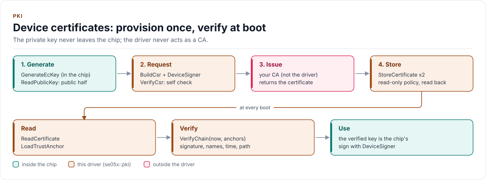

# Certificates (PKI)

`se05x::pki` is an optional layer for the device side of a public key infrastructure: it asks for a certificate for a
key that lives in the chip, stores the certificate the CA issues so nobody can change it, and checks a certificate
chain up to a trust anchor you choose. It allocates nothing, throws nothing, and works only in buffers you pass in.

It is opt-in: `#include "se05x_pki.hpp"`. The umbrella header `se05x.hpp` does not include it, and nothing else in the
driver depends on it.

<!-- figure: pki-provisioning -->
<picture>
  <source media="(prefers-color-scheme: dark)" srcset="diagrams/pki-provisioning.dark.svg">
  
</picture>
<!-- /figure -->

## What it does and what it does not do

| It does | It does not |
| --- | --- |
| Write and read DER strictly (`der::Writer`, `der::Reader`) | Accept BER: indefinite lengths, long forms for short lengths, multi-byte tags |
| Build PKCS#10 requests (RFC 2986) signed by a chip key (`DeviceSigner`) or a crypto-port key (`PortSigner`) | Generate or hold a private key on the host |
| Parse X.509 v3 certificates with ECDSA P-256 / P-384 keys and Ed25519 keys | Parse RSA, other curves, v1 or v2 certificates |
| Verify a chain to your trust anchors: signatures, names, time, basic constraints, key usage, path length | Check revocation (CRL, OCSP), certificate policies, name constraints or extended key usage |
| Store certificates and trust anchors in binary objects with read-only policies, and read them back | Act as a CA, run a TLS stack, or talk to a cloud service |

Anything outside the profile is refused with a reason, never skipped: an unknown critical extension, a GeneralizedTime
before 2050, a duplicate extension, a parameter where RFC 5758 says none, a compressed point.

## Provisioning recipe

The four steps below are compiled for a board and run against the chip model in the tests
(`tests/docs/pki_recipes.hpp`, `tests/test_pki_recipes.cpp`). Run them with platform SCP03 open
([HRoT cookbook](hrot-cookbook.md)): the key policy requires secure messaging.

### 1. Generate the key in the chip

```cpp
--8<-- "tests/docs/pki_recipes.hpp:generate"
```

### 2. Ask for a certificate

The chip signs the SHA-256 digest of the request info. `VerifyCsr()` then checks the request with the public key in
it: a key id that does not belong to that public key is caught here, before the request reaches a CA.

```cpp
--8<-- "tests/docs/pki_recipes.hpp:csr"
```

Text values are UTF-8 bytes: the layer never converts characters. `Name::AddHex()` writes bytes (the chip's unique
id) as upper-case hex. countryName and serialNumber are PrintableString (X.520), every other attribute UTF8String
(RFC 5280 4.1.2.6). Ask for a subjectAltName with `AltNames` (DNS name, URI, e-mail, IP address).

### 3. Store the certificate and the trust anchor

```cpp
--8<-- "tests/docs/pki_recipes.hpp:import"
```

`StoreCertificate()` follows four rules, and refuses before sending anything when one fails:

- the certificate must parse;
- the policy must not grant Write to anyone, nor Delete to everybody (`PolicyAllowsWrite`): a policy is fixed when the
  object is created, so a read-only policy locks the content;
- the certificate must fit one WriteBinary command, because a read-only object cannot take a second write: at most
  `MaxStoredCertificate(policy)` bytes, 999 with `CertificatePolicy()` and 990 with an administrator
  (`ObjectTooLarge`);
- an existing object is never overwritten (`ObjectExists`).

It then reads the object back and compares it (`ReadBackMismatch`). To rotate a certificate, give
`CertificatePolicy()` an administrator: that session may delete the object, and a new one is stored.

### 4. Check the chain at every boot

```cpp
--8<-- "tests/docs/pki_recipes.hpp:check"
```

The time is yours: Unix seconds from a clock you trust. A time of 0 is refused (`NoTime`); the check is never skipped.
A device that has no trustworthy time yet must get one first: a wrong clock makes an expired certificate look valid.

## Chain verification

`VerifyChain(chain, anchors, options, verifier, hasher)` takes the chain end entity first, without the anchor, at most
`kMaxChain` (6) certificates, and up to `kMaxAnchors` (8) anchors. From the anchor down it checks (RFC 5280 6.1):

| Check | Reason when it fails |
| --- | --- |
| Each certificate parses under the profile | the parser's reason |
| The issuer is the subject above, byte for byte | `NameMismatch` |
| The signature verifies with the key above; P-256 with ecdsa-with-SHA256, P-384 with ecdsa-with-SHA384 | `SignatureInvalid`, `AlgorithmMismatch` |
| `now` is within notBefore and notAfter, both included | `NotYetValid`, `Expired` |
| Every issuing certificate has cA TRUE, and keyCertSign when it has a keyUsage | `NotCa`, `KeyCertSignMissing` |
| No more intermediates than any pathLenConstraint above (and the anchor's) allows | `PathLengthExceeded` |
| The end entity has `options.required_key_usage` and is no CA unless `allow_ca_leaf` | `LeafKeyUsageMissing`, `LeafIsCa` |

Every intermediate counts toward the path length, self-issued or not: stricter than RFC 5280 6.1.4 (l). Names are
compared byte for byte, which a chain from one CA meets; a CA that re-encodes names is refused (`NameMismatch`).

The verifier is a port: `SignatureVerifier` verifies a fixed-width `r || s` over a digest. `PortVerifier<C>` adapts
any crypto port and verifies P-256 (the port's `EcdsaP256Verify`); a P-384 chain needs a verifier that supports P-384,
or it is refused (`CurveNotSupported`). The digest comes from the crypto port's `Hash`. Ed25519 signatures are not
verified by this layer (`UnsupportedAlgorithm`).

## Errors

Every call returns a `Result`. When the PKI layer refuses, `Detail::layer` is `Layer::Pki` and `pki::ReasonOf(detail)`
names the rule; `pki::ToString(reason)` gives its name. The coarse `Error` is:

| `Error` | Reasons |
| --- | --- |
| `InvalidArgument` | malformed DER, a field outside the profile, a bad builder argument, `NoTime` |
| `Unsupported` | a version, algorithm, curve or critical extension the layer does not handle; `CurveNotSupported` |
| `AttestationInvalid` | a chain check failed: `NameMismatch` to `LeafIsCa` |
| `BufferTooSmall` | `BufferTooSmall`, `ObjectTooLarge` |
| `CryptoFailure` | the crypto port or a signer failed |

A failure of the device (the bus, a status word, the capability gate) keeps the device's own `Error` and `Detail`.

## Keys and algorithms

| Key | Request (CSR) | Certificate parse | Chain verify |
| --- | --- | --- | --- |
| P-256 | chip (`DeviceSigner`) or crypto port (`PortSigner`) | yes | `PortVerifier` or your verifier |
| P-384 | chip | yes | your verifier |
| Ed25519 | chip, EdDSASign over the request (not on SE052F; at most 940 bytes, 919 in a UserID session: AN12543 pp. 103-104) | yes (key) | no |

## Limits

| Limit | Value |
| --- | --- |
| Nesting depth of the reader and writer | `der::kMaxDepth` = 10 |
| Length of one DER element | `der::kMaxLength` = 65535 bytes |
| Certificates in a chain, anchors per call | 6, 8 |
| Name attributes, alternative names in a request | 8, 8 |
| Extensions of one certificate | 16 |
| Stored certificate | `MaxStoredCertificate(policy)` |

## Not verified on hardware

The chip model of the tests stores binary objects and P-256 keys only. On a real chip, still to be run on a bench:

1. P-384: `GenerateEcKey(id, policy, EcCurve::NistP384)`, `ReadPublicKey(..., KeyType::EcP384, ...)` returns 97 bytes,
   a `DeviceSigner` request verifies with `openssl req -verify`.
2. Ed25519: the same with `EcCurve::Ed25519` and `KeyType::Ed25519` on SE050E or SE051; check that the public key read
   back and reversed (AN12543 7.1) is the one in the request, and `openssl req -verify` accepts it.
3. A certificate of about 990 bytes stored with `CertificatePolicy()` reads back equal; a write to it is refused by the
   chip (`PolicyDenied`).

## How it is tested

The vectors in `tests/vectors/pki_vectors.hpp` were made with OpenSSL from keys generated for that run and deleted;
the requests use the published RFC 6979 and RFC 8032 test keys. The tests compare the request info byte for byte with
OpenSSL's, build the Ed25519 request byte for byte, verify OpenSSL's chains, and check every refusal on an edited copy
of a vector. Two libFuzzer targets (`fuzz_pki_der`, `fuzz_pki_x509`) check that the reader re-encodes every element it
accepts to the same bytes and that the parser and the chain walk never accept what they should refuse. Each guard has a
one-edit mutant in `tools/mutants/pki.txt` that the tests kill.
