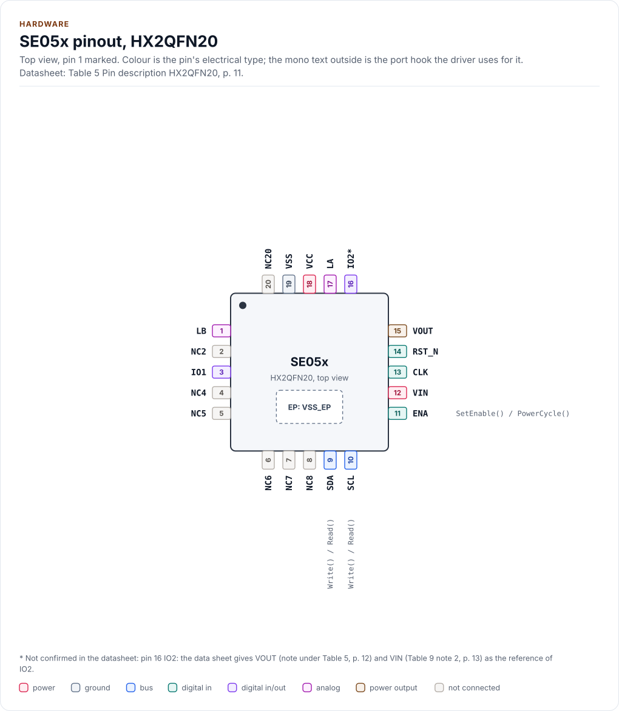
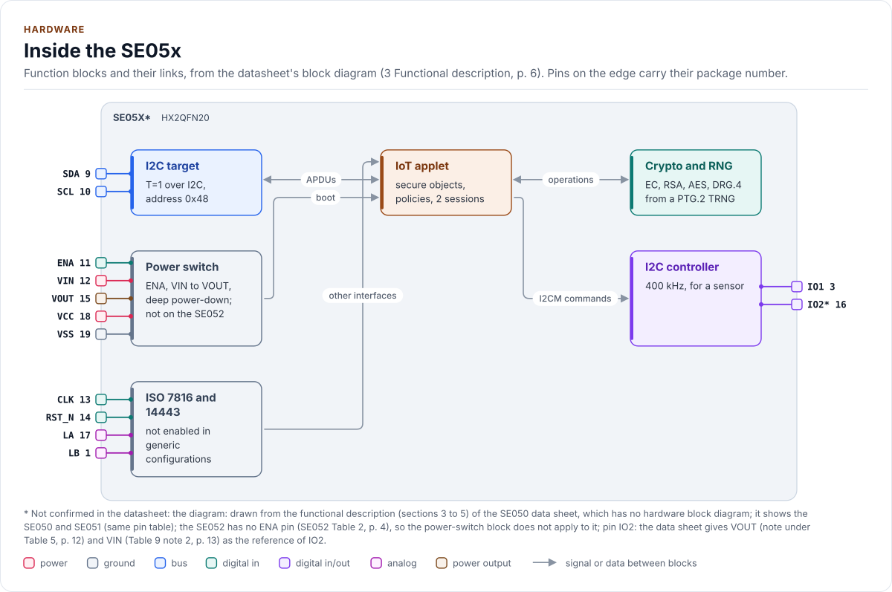
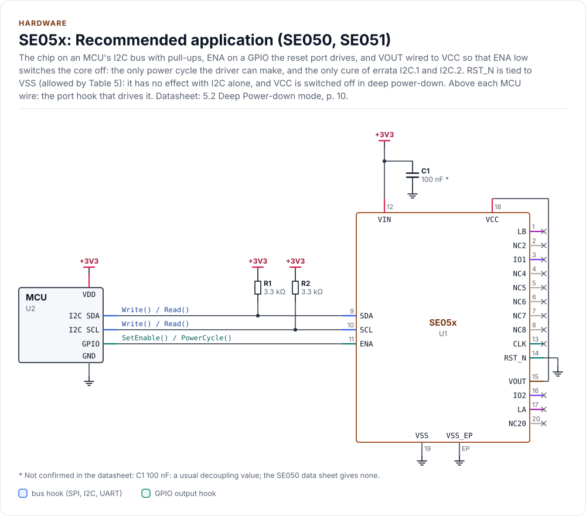
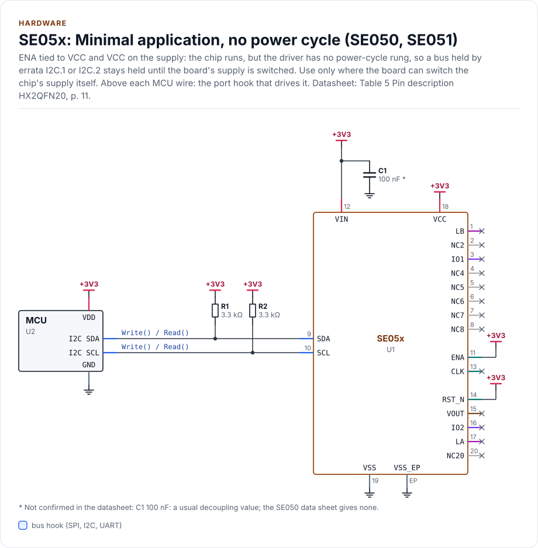

# SE050 guide

The SE050 in HX2QFN20: pins, wiring, power, reset and what differs between its configurations. Shared with the
SE051, which has the same package and pin table.

<!-- generated: datasheet-refs -->
??? abstract "Datasheet sections this page relies on"

    - Start-up: the interface is chosen by the line levels at boot: NXP SE050-DATASHEET Rev. 3.8, 3.4 Startup behavior, p. 8
    - I2C clock and clock stretching per variant: NXP SE050-DATASHEET Rev. 3.8, 4.1.1 Supported I2C frequencies, p. 9
    - RST_N has no effect when only I2C is enabled: NXP SE050-DATASHEET Rev. 3.8, 4.2 ISO7816 and ISO14443 interface, p. 9
    - Power-down and deep power-down modes: NXP SE050-DATASHEET Rev. 3.8, 5 Power-saving modes, p. 9
    - Deep power-down supply: VIN, VOUT to VCC: NXP SE050-DATASHEET Rev. 3.8, 5.2 Deep Power-down mode, p. 10
    - SE050 ordering and variants: NXP SE050-DATASHEET Rev. 3.8, Table 3 Ordering information, p. 10
    - Pin table of the HX2QFN20 package (SE050): NXP SE050-DATASHEET Rev. 3.8, Table 5 Pin description, p. 11
    - Supply range and pin reference voltages: NXP SE050-DATASHEET Rev. 3.8, Table 9 Recommended operating conditions, p. 13
    - ENA low time and glitches: NXP SE050-DATASHEET Rev. 3.8, Table 14 AC characteristics, p. 18
    - Errata list and affected variants: NXP SE050_Erratasheet Rev. 1.0, Table of functional problems, p. 6
    - SE050 variant identifiers: NXP AN12436 Rev. 2.4, Table 2 Variant identifiers, p. 8

    All of them, with the driver API for each: [Datasheet map](datasheet.md).
<!-- /generated -->

## Pinout

<!-- figure: chip-pinout -->
<picture>
  <source media="(prefers-color-scheme: dark)" srcset="diagrams/chip-pinout.dark.svg">
  
</picture>
<!-- /figure -->

The driver uses SDA and SCL for the bus and ENA through the reset port. Every pin, with its function and what to do
when unused, is on [Hardware](hardware.md#pins-hx2qfn20).

## Inside

<!-- figure: chip-blocks -->
<picture>
  <source media="(prefers-color-scheme: dark)" srcset="diagrams/chip-blocks.dark.svg">
  
</picture>
<!-- /figure -->

## Wiring

<!-- figure: chip-circuit-typical -->
<picture>
  <source media="(prefers-color-scheme: dark)" srcset="diagrams/chip-circuit-typical.dark.svg">
  
</picture>
<!-- /figure -->

- **Pull-ups** on SDA and SCL to the bus supply; the vendor's development kit fits 3.3 kΩ for standard mode
  (AN13539 p. 15). Both lines must be high when the chip boots, or it will not choose I2C (section 3.4, p. 8).
- **ENA on a GPIO, VOUT to VCC.** ENA low (tENalt, 2 us typical; no minimum is printed, so the ESP-IDF
  port holds it 10 us) enters deep power-down and switches VOUT off; ENA high
  boots the chip again (section 5.2, p. 10; Table 14, p. 18). This is the driver's power cycle and the only cure of a
  bus held by errata I2C.1 or I2C.2. A glitch below 0.4 V on ENA longer than 30 ns also counts (Table 14 note 6).
- **RST_N tied to VSS.** It is the ISO 7816 reset and has no effect when only I2C is enabled (section 4.2,
  p. 9); Table 5 allows VCC or VSS, and VSS stays valid while VCC is switched off in deep power-down.
- **Supply** 1.62 V to 3.6 V on VIN and VCC (Table 9, p. 13).

A board that cannot spare a GPIO can tie ENA to VCC, at the cost of the power-cycle rung:

<!-- figure: chip-circuit-minimal -->
<picture>
  <source media="(prefers-color-scheme: dark)" srcset="diagrams/chip-circuit-minimal.dark.svg">
  
</picture>
<!-- /figure -->

## Configurations

| Configuration | Applet | Algorithms | Clock stretching | Notes |
| --- | --- | --- | --- | --- |
| A1, A2 | 3.x | ECC | on (stretches above 600 kHz) | |
| B1, B2 | 3.x | RSA | on | |
| C1, C2 | 3.x | ECC and RSA | on | more pre-provisioned cloud keys |
| D2 | 3.x | ECC, MIFARE DESFire | on | |
| E2 | 7.2 | adds AES-GCM, CCM and GMAC, Curve448 (AN13014) | off: up to 1 MHz | |
| F2 | 3.6.0 | FIPS 140-2 subset | on | platform SCP03 mandatory |

Clock stretching: up to 3.4 MHz with stretching, 1 MHz without; the A to D and F configurations stretch above
600 kHz, so a controller that cannot stretch needs the E configuration or 400 kHz (section 4.1.1, p. 9). Variant
identifiers (OEF ids): AN12436 Table 2 (p. 8).

The HRoT facade (`hrot::Device`) needs applet 7.x, so of the SE050 only the E configuration runs it. On A to D and
F every facade call returns `Unsupported` and sends nothing once its argument checks pass (an invalid key, an
off-curve point or an empty buffer is refused first with `InvalidArgument`); `se05x::Device` serves them.

## Errata that shape the driver

| Erratum | Effect | The driver |
| --- | --- | --- |
| I2C.1 | A second command before the reply is read: SCL held until a power cycle | One command in flight; ENA power cycle |
| I2C.2 | An address-only frame: SCL held after six more bytes | Never an empty write |
| I2C.3 | A low line at a soft reset: security reset after about 1 s, repeated: permanent lock | Lines high around resets |
| I2C.4 | SCL must change before SDA with a margin | A port requirement |
| APP.1 | Attestation replies above 1024 bytes refused | Size checked before sending |
| APP.2 | CloseSession without a session poisons the applet until reselect | Never sent |
| JOS.1 | An EC key of the wrong length resets the chip | Typed key lengths |
| JOS.2 | SCP03 counter does not advance for a command without data | The channel follows the chip's rule (`jos2_counter_rule`, on by default; A28) instead of adding data |

Errata sheet Rev. 1.0, pp. 6 to 11. Bench status: **not verified on hardware**.
