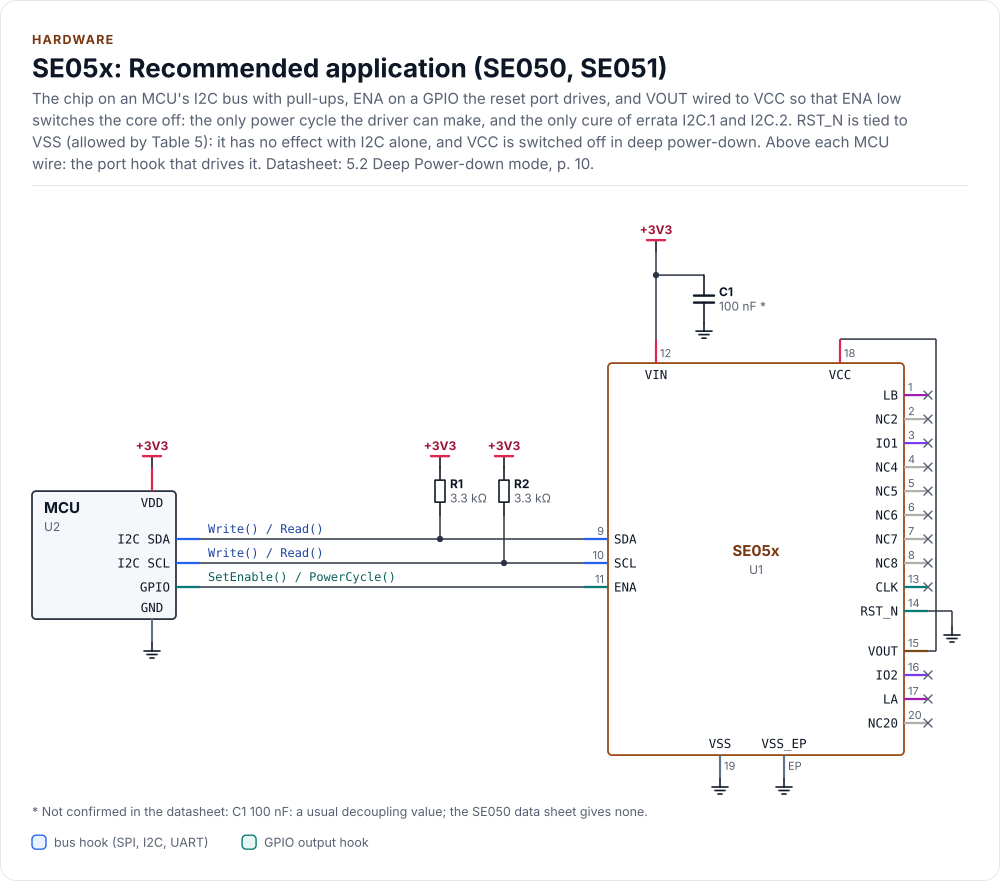

# SE051 guide

The SE051 shares the SE050's HX2QFN20 package and pin table (SE051 Table 3, p. 12), so the
[SE050 guide](se050.md) pinout and wiring apply as they are. This page covers what differs.

<!-- generated: datasheet-refs -->
??? abstract "Datasheet sections this page relies on"

    - SE051 I2C address and clock stretching: NXP SE051 Rev. 2.0, 4.1 I2C interfaces; 4.1.1 Supported I2C frequencies; 4.1.2 Default I2C Communication Parameters, p. 9
    - SE051 RST_N has no effect when only I2C is enabled: NXP SE051 Rev. 2.0, 4.2 ISO7816 and ISO14443 interface, p. 10
    - SE051 ordering and variants: NXP SE051 Rev. 2.0, Table 2 Ordering information, p. 11
    - SE051 power-saving modes: NXP SE051 Rev. 2.0, 5 Power-saving modes, p. 11
    - Pin table (SE051): NXP SE051 Rev. 2.0, Table 3 Pin description, p. 12
    - SE051 OEF identifiers per variant: NXP AN12973 Rev. 2.0, Table 4, p. 4
    - Applet generations of the SE051: NXP AN12907 Rev. 1.2, Supported applet versions, p. 13
    - PERSO applet needs no authentication: anyone can change the address: NXP AN13015 Rev. 1.4, Deleting the PERSO applet, p. 19
    - PERSO I2C_PARAMS bits and ATR/CIP interface bytes: NXP AN13015 Rev. 1.4, I2C_PARAMS, ATR and CIP bytes, p. 49
    - PERSO applet and chip-side I2C settings: NXP AN13030 Rev. 2.7, Perso module notes, p. 260

    All of them, with the driver API for each: [Datasheet map](datasheet.md).
<!-- /generated -->

## Wiring

<!-- figure: chip-circuit-typical -->
<picture>
  <source media="(prefers-color-scheme: dark)" srcset="diagrams/chip-circuit-typical.dark.svg">
  
</picture>
<!-- /figure -->

Same rules as the SE050: pull-ups, both lines high at boot, ENA on a GPIO with VOUT wired to VCC for the power cycle,
RST_N tied to VSS because it has no effect with I2C alone (section 4.2, p. 10). Clock stretching is off by default:
up to 1 MHz (sections 4.1.1 and 4.1.2, p. 9).

## Configurations

| Configuration | Applet | Adds |
| --- | --- | --- |
| A2, C2 | 6.0 on early boards, 7.2 since early 2022, 7.3 by update | SEMS Lite applet update, PERSO applet |
| H2 | 7.x | NFC commissioning (T4T applet, Matter PAKE) |
| W2 | 7.x | UWB applets |
| P2 | customer applet | no IoT applet: not for this driver |

Ordering: SE051 Table 2 (p. 11). Applet generations: AN12907 p. 13. OEF ids per configuration: AN12973 Table 4
(p. 4). The 6.0 generation has no vendor middleware oracle any more, so the model profile `se051_v6` rests on the
documents alone.

The HRoT facade (`hrot::Device`) needs applet 7.x: on a 6.0 board every facade call returns `Unsupported` and
sends nothing once its argument checks pass (an invalid key, an off-curve point or an empty buffer is refused
first with `InvalidArgument`); `se05x::Device` serves it.

## The PERSO applet

!!! warning "Anyone on the bus can change the chip's address and protocol"
    The SE051 PERSO applet needs no authentication: until it is deleted, any bus participant can change the I2C
    address, the T=1 flavour and the clock-stretching setting, or delete applet modules (AN13015 p. 19). Settings
    take effect after the next reset, and a host that speaks the old flavour then hears nothing.

The driver reads PERSO settings (`perso::Perso`, read only by default) and `Probe()` reports a selectable PERSO
applet as a security finding. Writes and module deletes are [irreversible operations](irreversible.md). I2C_PARAMS
(tag 0x800E, AN13015 p. 49): bit 0 clock stretching, bit 1 power saving after the end of an APDU session, bit 2 the
flavour when bit 4 selects manual (0 UM11225, 1 GP), bit 3 blocking mode, bits 7 to 5 an interface detection delay in
units of 100 us.

## Power

Power-down (state kept) is off by default; with the PERSO applet it can be enabled. Deep power-down is ENA low, with
VIN supplied and VCC fed from VOUT (section 5, p. 11).

## Throughput limit

The vendor middleware documents SW 0x66A6 for the SE051 and SE052; AN13904 states the figure for the SE052F only.
Treat it as possible on the SE051: the driver's `ApduBudget` applies when the capabilities say so.

Bench status: **not verified on hardware**.
