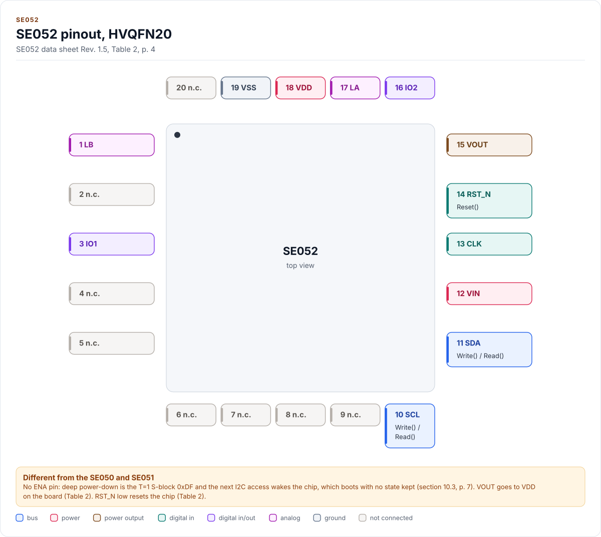
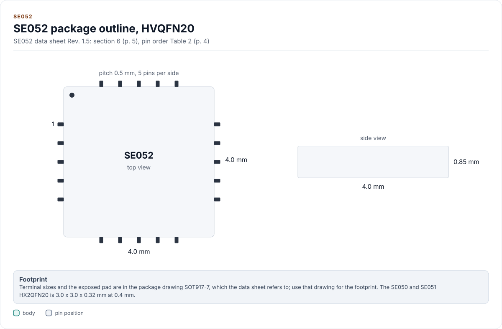
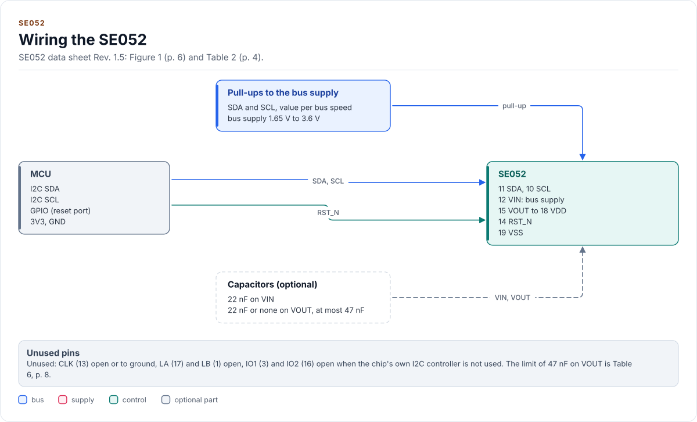

# SE052 guide

The SE052F is a different package with a different pin table: no ENA pin, SDA and SCL on other pins, a VDD that
accepts up to 5.5 V. Do not reuse an SE050 footprint.

<!-- generated: datasheet-refs -->
??? abstract "Datasheet sections this page relies on"

    - Pin table of the HVQFN20 package (SE052): NXP SE052 Rev. 1.5, Table 2 Pin description, p. 4
    - SE052 package HVQFN20 (SOT917-7): NXP SE052 Rev. 1.5, 6 Package, p. 5
    - SE052 system integration: pull-ups, VIN and VOUT capacitors: NXP SE052 Rev. 1.5, Figure 1 SE052 using I2C, p. 6
    - SE052 power-down by RELEASE and deep power-down by S-block 0xDF: NXP SE052 Rev. 1.5, 10 Power-saving modes, p. 7
    - SE052 ATR bytes: NXP SE052 Rev. 1.5, Table 12 Configuration parameters, p. 16
    - SE052 CIP bytes in the configuration: NXP SE052 Rev. 1.5, Table 12 Configuration parameters, p. 17
    - SE052 supplies: VDD 1.62 V to 5.5 V, VIN 1.65 V to 3.6 V: NXP SE052 Rev. 1.5, Table 13 IC supply current, p. 18
    - SE052 I2C parameters, flavour and address in the configuration: NXP SE052 Rev. 1.5, Table 12 I2C_SPI_PARAMS, I2C_SLAVE_ADDRESS, p. 18
    - SE052 RST_N reset pulse width: NXP SE052 Rev. 1.5, Table 14 AC characteristics, p. 20
    - NXP flavour ATR: NXP UM11225 Rev. 1.2, Tables 11 to 13, p. 9
    - Limits of FIPS 140-3 mode: NXP AN12543 Rev. 4.5, 3.13.2 FIPS 140-3 mode, p. 45
    - SE052F configuration: applet 7.2.22, AppletConfig 0x26F2, OEF B501: NXP AN14277 Rev. 1.0, SE052F configuration, p. 2
    - WTX host timeout at least 4 s; NXP mode is the default: NXP AN13904 Rev. 1.0, WTX and T=1 mode, p. 27
    - APDU throughput limit on the SE052F: NXP AN13904 Rev. 1.0, APDU throughput limit, p. 28

    All of them, with the driver API for each: [Datasheet map](datasheet.md).
<!-- /generated -->

## Pinout

<!-- figure: se052-pinout -->
<picture>
  <source media="(prefers-color-scheme: dark)" srcset="diagrams/se052-pinout.dark.svg">
  
</picture>
<!-- /figure -->

<!-- figure: se052-outline -->
<picture>
  <source media="(prefers-color-scheme: dark)" srcset="diagrams/se052-outline.dark.svg">
  
</picture>
<!-- /figure -->

HVQFN20, 4 x 4 x 0.85 mm, 0.5 mm pitch. The data sheet names the outline SOT917-7 (section 6, p. 5) and AN14028
names SOT917-6: check the package data sheet before the footprint (ambiguity A2).

## Wiring

<!-- figure: se052-wiring -->
<picture>
  <source media="(prefers-color-scheme: dark)" srcset="diagrams/se052-wiring.dark.svg">
  
</picture>
<!-- /figure -->

- **Supplies.** VIN 1.65 V to 3.6 V feeds the I2C pads; VDD takes 1.62 V to 5.5 V in three classes (Table 13,
  p. 18). VOUT is wired to VDD on the board (Table 2), so deep power-down can switch the core off.
- **RST_N** low resets the chip (Table 2); a pulse of at least 40 us (Table 14, p. 20). The reset port drives it;
  without one the ladder ends at the chip-reset S-block.
- **No ENA.** Deep power-down is the T=1 S-block `0xDF`; the next I2C access to the address wakes and boots the chip,
  with nothing kept (section 10.3, p. 7).
- **Pull-ups** to the bus supply (Figure 1, p. 6); the data sheet gives no value.

## Configuration

The SE052F runs applet 7.2.22 with AppletConfig 0x26F2 and OEF B501 (AN14277 p. 2). Its configuration table
(Table 12, pp. 17-18) sets the I2C address 0x48, clock stretching off (up to 1 MHz), power saving after the end of an
APDU session, and lists the CIP bytes: BWT 1000 ms, IFSC 254, MPOT 1 ms, power wake-up 5 ms. The same table names
the GP 0.39 flavour while AN13904 p. 27 calls the NXP mode the default; `TransportFlavour::Auto` settles it on the
wire. The FIPS 140-3 mode leaves out EdDSA, Montgomery curves, DES, MIFARE DESFire and PAKE (AN12543 3.13.2, p. 45); the
capability gate refuses them before sending.

## Throughput limit

More than one million APDUs within 34 days and the SE052F answers SW 0x66A6 to everything until it is reset (AN13904
p. 28). The driver resets the chip once (`ThroughputLimited`, then `Resynced`) and counts APDUs in `ApduBudget`; a
design that talks to the chip once per second exceeds the limit in under two weeks.

## Self-test

In FIPS mode, run the self-tests from the default session before AES-GCM, GMAC, PBKDF2 and the TLS KDF (AN13030
p. 817). TriggerSelfTest may reset the chip with no reply; the driver asks for `ResetExpected`.

Bench status: **not verified on hardware**.
