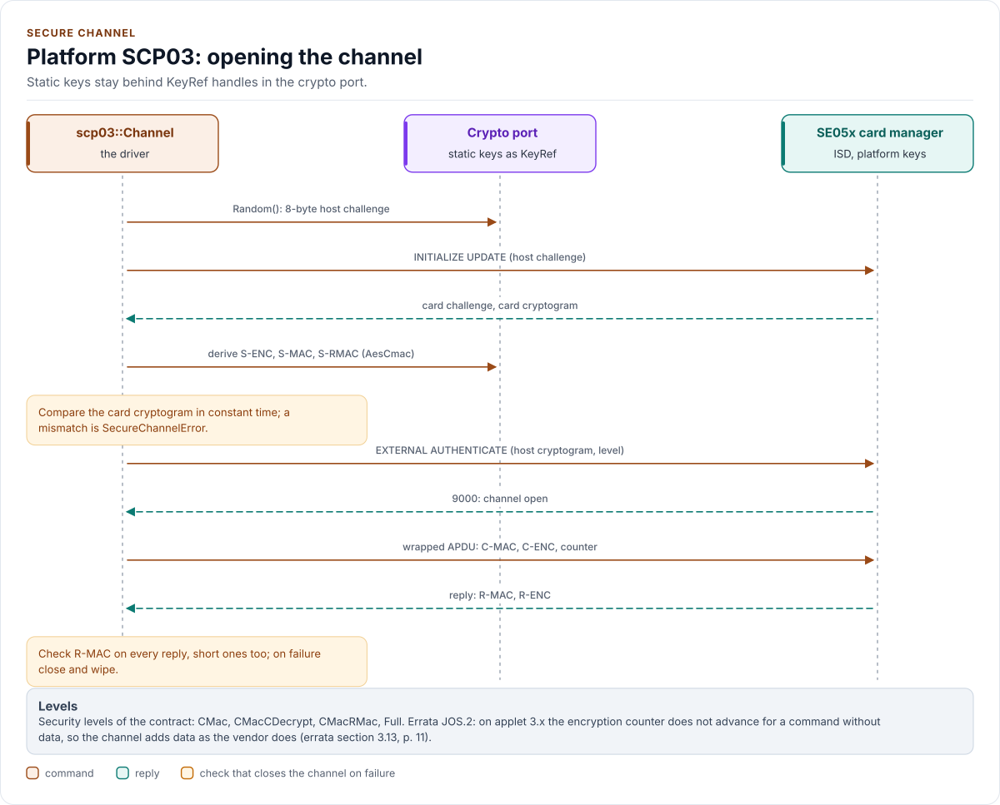
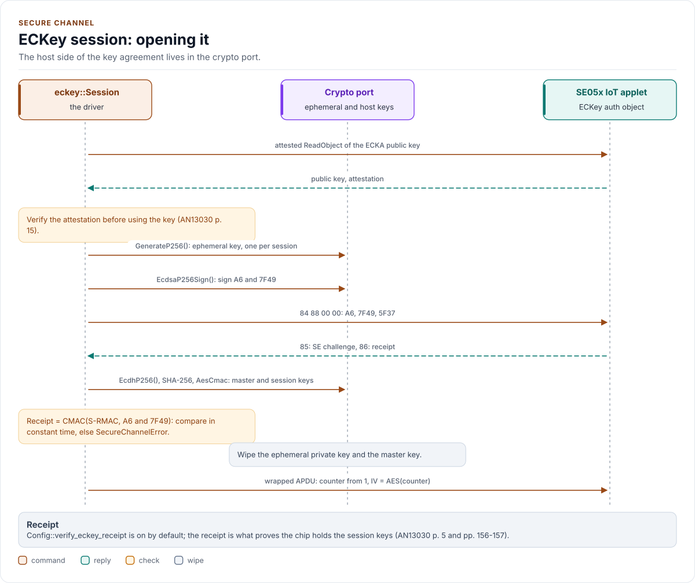

# Secure channels

Four ways to talk to the IoT applet, from no protection to full encryption. Which to use is a question of who can
reach the bus ([Security model](security-model.md)).

<!-- generated: datasheet-refs -->
??? abstract "Datasheet sections this page relies on"

    - JOS.1 wrong EC key length resets the chip, JOS.2 SCP03 counter: NXP SE050_Erratasheet Rev. 1.0, 3.12, 3.13, p. 11
    - ECKey session: master key, session keys, receipt: NXP AN12543 Rev. 4.5, ECKey session, p. 22
    - Session commands: CreateSession to ECKeySessionInternalAuthenticate: NXP AN12543 Rev. 4.5, Session management commands, p. 68
    - Platform SCP03 with AES-128 and AES-256; keys in plain files are insecure: NXP AN13030 Rev. 2.7, Platform SCP03, p. 152
    - ECKey session flow and receipt: NXP AN13030 Rev. 2.7, ECKey session, p. 156

    All of them, with the driver API for each: [Datasheet map](datasheet.md).
<!-- /generated -->

| Channel | Authenticates | Protects the bus | Keys on the host | Layer |
| --- | --- | --- | --- | --- |
| None (default session) | nobody | no | none | `Device` |
| UserID session | a 4 to 16 byte value | no secure messaging | the UserID | `Device::BeginUserIdSession()` |
| Platform SCP03 | the host to the card manager | C-MAC, C-ENC, R-MAC, R-ENC | static ENC, MAC, DEK as `KeyRef` | `scp03::Channel` |
| AESKey session | the host to an AES authentication object | SCP03 at the applet | one AES key as `KeyRef` | `Device::BeginAesKeySession()` |
| ECKey session | the host's key pair to an EC authentication object | yes, with a receipt | host private key and an ephemeral key in the crypto port | `eckey::Session` |

At most two applet sessions are open at once, besides the default session (AN12543 p. 50). One authentication object
cannot open two sessions.

## Platform SCP03

<!-- figure: scp03-session -->
<picture>
  <source media="(prefers-color-scheme: dark)" srcset="diagrams/scp03-session.dark.svg">
  
</picture>
<!-- /figure -->

Platform SCP03 runs on the card manager underneath the applet, with AES-128 or AES-256 keys (AN13030 p. 152). The
driver never holds the static keys as bytes: your crypto port resolves a `KeyRef` and does the CMAC and CBC itself, so
the keys can sit in a hardware key store. `Config::scp_policy` decides when it is opened; when the chip requires it
(SetPlatformSCPRequest) every command must carry the full security level.

The vendor publishes default platform keys for each configuration. They are not in this repository, and a product
must replace them before it leaves the factory; keys kept in a plain file are insecure (AN13030 p. 152). The driver
cannot replace them yet: PUT KEY needs the new keys encrypted under the DEK, which the crypto port cannot do without
exposing them, so `gp::CardManager::PutKeys` (the `ReplacePlatformKeys` [irreversible operation](irreversible.md))
returns `Unsupported` and sends nothing, even with a valid confirmation.

## ECKey session

<!-- figure: eckey-session -->
<picture>
  <source media="(prefers-color-scheme: dark)" srcset="diagrams/eckey-session.dark.svg">
  
</picture>
<!-- /figure -->

The ECKey session binds a host key pair to the chip: the chip holds the host's public key as an authentication
object, and every session uses a fresh ephemeral key, made and wiped in the crypto port. The chip's receipt proves it
derived the same keys; the driver checks it (`Config::verify_eckey_receipt`, on by default). The derivation is printed
in AN12543 pp. 22-23 and 72-73 but has no test vector yet, so the session is **off by default**: without the build flag
`SE05X_ENABLE_ECKEY_SESSION=1`, `eckey::Session::Open()` returns `Unsupported` and sends nothing. Turn it on only
after checking the handshake against your chip.

## UserID session

A UserID session has no secure messaging: the UserID and every command travel in clear. On the SE051 a UserID
defaults to unlimited attempts (AN13030 p. 155). The driver refuses an unlimited counter, counts attempts on the host
too (`Config::auth_attempt_limit`) and refuses secret operations over a UserID session unless platform SCP03 is open.

## Rules the channels keep

- A failed handshake wipes the session keys at once, but a session that failed after CreateSession cannot be closed:
  the applet closes only a fully set-up session (AN12543 3.6.5, p. 35). The channel sends no CloseSession then and
  sets `NeedsReselect()`; select the applet again (or reset the chip) to drop the half-open session.
- At the levels with R-MAC, every `9000` answer is MAC-checked, short ones too, in constant time. An error status
  word carries no R-MAC and is not authenticated: the channel accepts it only as the two bytes alone and closes on
  anything else. At the levels without R-MAC no answer is authenticated. One exception: a command that ends the
  applet session (`DeleteAll`) is answered without secure messaging (AN12543 4.20.5, p. 154); the session that sent
  it accepts a bare `9000` for that command only, and is then gone.
- The levels are `CMac` (0x01), `CMacCDecrypt` (0x03), `CMacRMac` (0x11) and `Full` (0x33). The facade counts only
  what it needs: authenticated answers (`CMacRMac` or `Full`, `Device::AnswersAuthenticated()`) for keys, counters
  and verification, and encryption both ways (`Full`, `Device::TrafficConfidential()`) for ECDH and secret data.
  `CMac` alone authenticates the commands, not the answers, so the facade refuses those calls over it.
- Counters never rewind; a channel is never resumed after a reset.
- Errata JOS.2 (SE050 errata 3.13, pp. 11-12): inside platform SCP03 the chip does not advance the encryption counter
  for a command without data. The errata's workaround appends data to such commands; the driver does not, it follows
  the chip's rule instead (`scp03::ChannelParams::jos2_counter_rule`, on by default). Applet sessions advance the
  counter on every command.
- A lost frame, a failed MAC check or any recovery rung past a block resend under a session or platform SCP03 ends
  the stack: the call returns the error and the device is `NeedsReopen` until `Device::Recover()` selects the applet
  again and opens platform SCP03 again. Once platform SCP03 was open, no command goes out in the clear before that.
- An applet session inside platform SCP03 is two secure-messaging layers: the session wraps the command, the frame
  goes into ProcessSessionCmd, and platform SCP03 wraps that again. The 940-byte EdDSA input fits both (the wire
  limit `kMaxCommandApdu` is 1108 bytes); a UserID session takes 919 bytes (AN12543 pp. 103-104).
