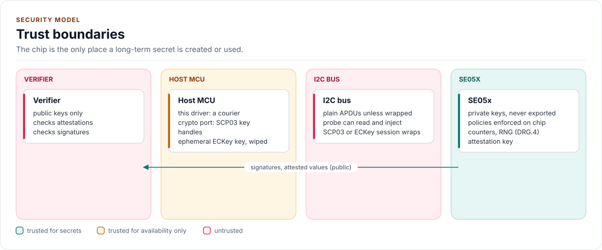

# Security model

What the chip protects, what it does not, where the trust boundaries are and what this driver adds. Read this before
you choose a secure channel or write a provisioning plan.

<!-- generated: datasheet-refs -->
??? abstract "Datasheet sections this page relies on"

    - Common Criteria EAL 6+ for hardware and OS: NXP SE050-DATASHEET Rev. 3.8, 2.2 Key features, p. 3
    - SE051 Common Criteria EAL 6+ for hardware and OS: NXP SE051 Rev. 2.0, 2.2 Key features, p. 3
    - SE052 Common Criteria EAL 6+ for hardware and OS: NXP SE052 Rev. 1.5, 3.1 Product-specific features, p. 3
    - Attestation: hash of the command, no freshness echo (applet 7.x): NXP AN12543 Rev. 4.5, Attestation, p. 19
    - APDU throughput limit on the SE052F: NXP AN13904 Rev. 1.0, APDU throughput limit, p. 28
    - PERSO applet needs no authentication: anyone can change the address: NXP AN13015 Rev. 1.4, Deleting the PERSO applet, p. 19
    - Platform SCP03 with AES-128 and AES-256; keys in plain files are insecure: NXP AN13030 Rev. 2.7, Platform SCP03, p. 152

    All of them, with the driver API for each: [Datasheet map](datasheet.md).
<!-- /generated -->

<!-- figure: trust-boundaries -->
<picture>
  <source media="(prefers-color-scheme: dark)" srcset="diagrams/trust-boundaries.dark.svg">
  
</picture>
<!-- /figure -->

## In plain words

| If someone... | ...can they? | Why not, or what you do |
| --- | --- | --- |
| copies the flash of a stolen device | not the keys or the `Secret` data, if the platform SCP03 keys are in a key store a flash copy cannot read | the keys and secrets live in the chip, which never returns a private key; whoever holds the platform SCP03 keys can open the chip like your firmware ([Store a secret](tasks/secret-storage.md)) |
| clips a probe on SDA and SCL | read or change nothing, once `RequirePlatformScp` has been applied and your firmware opens platform SCP03 at `Full` | every command is encrypted and MACed and every 9000 answer MACed and encrypted; an error status word is not authenticated, so a probe can turn a success into an error; before `RequirePlatformScp` the chip also takes plain commands from the probe (see below) ([Secure channel](tasks/secure-channel.md)) |
| replays an old answer of the chip | not inside an open channel, and not as an attestation | SCP03 MACs chain over the session; attested answers carry a fresh host nonce and a later timestamp. A plain answer outside a channel can be replayed |
| installs an old firmware image | no, if you check the floor at boot | the counter only counts up and cannot be deleted ([Anti-rollback](tasks/anti-rollback.md)) |
| moves your device's identity to another device | no | the private key cannot leave the chip ([Device identity](tasks/device-identity.md)) |
| runs their own code on your MCU | use the chip as your code could, while it runs | keep policies narrow and secrets inside the chip; the chip cannot tell your code from theirs |
| floods the chip with commands (SE052F) | stop it until a reset | count APDUs with the budget ([HRoT cookbook](hrot-cookbook.md)); the facade admits a call only when its worst case fits under the limit |
| changes the chip's lifecycle | only with the session the operation needs | irreversible operations are compiled out by default and need a plan and a typed confirmation ([Provisioning](tasks/provisioning.md)) |

!!! warning "Before the channel is open"
    The chip's default is platform SCP03 not required (AN12543 3.14). Until `RequirePlatformScp` has been applied,
    a probe on the bus can break your firmware's session and send plain commands of its own: read and rewrite
    `Protection::Public` data and certificates, and create objects in the slots of your plan before your firmware
    does. The facade's `Find` and `CreateCounter` refuse objects it did not make with its own exact policy, and
    `Protection::Secret` data and facade keys refuse use without secure messaging, but a planted object still blocks
    its slot. Provision in a trusted place and apply `RequirePlatformScp` before the device leaves it.

## Assets

| Asset | Where it lives | Protected by |
| --- | --- | --- |
| Private and secret keys | Secure objects in the chip | The chip: no command returns a private key; policies decide every use |
| Attestation key | Provisioned by the vendor in the chip | The chip; `ORIGIN_PROVISIONED` objects cannot be deleted |
| Policies | Stored with each object | The chip checks them on every command |
| Counters, PCRs | Secure objects | The chip: increment-only, extend-only |
| Platform SCP03 keys (host copy) | Your crypto port, as `KeyRef` handles | Your platform: a key store, a protected flash, a hardware engine |
| Session keys | The driver's channel object while it is open | Wiped at close, reset, error |
| Data in flight | The I2C bus | Nothing, unless a secure channel wraps it |

## Trust boundaries

1. **Chip and bus.** Everything on SDA and SCL is visible and changeable by anyone with a probe. Plain APDUs reveal
   what you sign and what you read, and can be replayed or altered. Platform SCP03, an AESKey session or an ECKey
   session encrypt and authenticate the commands and replies.
2. **Driver and host.** The driver is a courier: it builds frames, runs the secure channel and checks what comes back.
   It holds no long-term secret except the platform SCP03 keys, and those only as handles your crypto port resolves.
   A compromised host can use the chip as it pleases while it is compromised (an oracle), but it cannot extract a
   key the policies keep inside.
3. **Chip and verifier.** A remote party trusts a value because the chip signed it (attestation) with a key whose
   certificate chains to the vendor. The verifier needs public keys only.

## Threats and answers

| Threat | The chip's answer | The driver's answer |
| --- | --- | --- |
| Read a key off the bus | Keys never leave the chip | No API reads a private key; strict policies forbid it |
| Sniff or alter APDUs | SCP03 and session encryption, MAC | `Config::scp_policy` (`Require` for a root of trust: `Auto` decides from an unauthenticated answer); R-MAC checked on every reply, short ones too, except the bare 9000 of a command that ends the applet session (`DeleteAll`), which the chip sends without secure messaging and which is therefore not authenticated (A22); the facade needs R-MAC for results and encryption both ways for secrets |
| Replay an attestation | Format 1 echoes a nonce; format 2 signs the command (AN12543 p. 19) | A fresh host nonce per request (never the attested chip's RNG), byte-for-byte compare, a timestamp later than the last accepted, across reopens |
| Brute-force a UserID | Attempt counter, if set | No infinite counters; host-side attempt limit (`auth_attempt_limit`) |
| Use a key through a stolen host | Policies tie use to an authentication object | Facade keys require secure messaging and name the default session and the session they were made in (A20); a stricter binding names an authentication object in a policy built with `PolicyBuilder::For()` |
| Lock the chip by flooding it | Throughput limit SW 0x66A6 (AN13904 p. 28) | `ApduBudget` counts commands across reopens and refuses loops |
| Change the I2C address or protocol (SE051) | The PERSO applet has no authentication until it is deleted (AN13015 p. 19) | `perso::Perso::Probe()` warns; writes need a confirmation |
| Brick the chip by mistake | Some lifecycle settings are permanent | Compiled out by default; Plan and Confirmation ([Irreversible operations](irreversible.md)); immutable files and UserID objects only through a plan |
| Roll back an anti-rollback floor | A counter only counts up | The facade's counter policy forbids delete, and the counter is created with its value in one command |
| Default platform keys | The vendor publishes them for each configuration | None in this repository; your keys enter through the crypto port only |

## What the chip does not protect

- **Your host software.** A host that runs an attacker's code can sign anything the policies let it sign.
- **The bus without a channel.** The chip's default is platform SCP03 not required (SetPlatformSCPRequest, AN12543
  p. 75); except in a configuration that requires it, plain commands work until you require it.
- **Availability.** A held I2C bus (errata I2C.1) or the throughput limit stops the chip until a reset or a power
  cycle; plan the reset wiring ([Hardware](hardware.md)).
- **Key backup.** A key generated inside is gone when the chip is gone. Back up by design (a second chip, a
  certificate you can re-issue), not by export.

## Certification is the chip's, not the driver's

The SE050F is certified FIPS 140-2 and the SE052F FIPS 140-3 Level 3 (vendor data sheets and AN14671); the hardware
and OS of each chip are Common Criteria EAL 6+ (SE050 data sheet 2.2 Key features, p. 3; SE051 data sheet 2.2 Key
features, p. 3; SE052 data sheet 3.1 Product-specific features, p. 3). Those certificates cover the chip in its
documented configuration. This driver is not certified; using it does not make a product compliant. The reference
crypto in the driver is for tests and bring-up only and is not hardened against side channels beyond constant-time
comparison.

## Rules the driver enforces

The full rule list (S-01 to S-17: wiping, logging, policies, waits, recovery, channels, attestation, irreversible
operations, the APDU budget) is on [Safety rules](safety.md).
