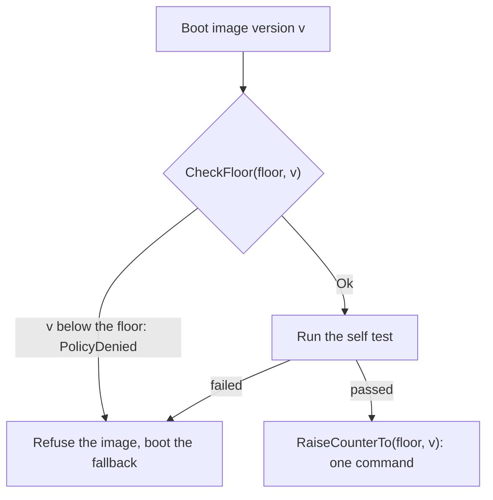

# Monotonic counters for anti-rollback

A counter in the chip only counts up (WriteCounter, AN12543 p. 84). Use it as a floor: at boot refuse an image older
than the floor, and after a new image has booted and passed its self test, raise the floor to its version. An attacker
with full control of the host can neither count down nor delete the floor.



```cpp
--8<-- "tests/docs/jobs.hpp:counters"
```

The facade needs applet 7.x (SE050E, SE051, SE052): on applet 3.x (SE050 A to D and F) and 6.x (SE051 on early
boards), `CreateCounter`, `CheckFloor` and `RaiseCounterTo` return `Unsupported` and send nothing, so a boot pattern
written on them refuses every image. Use `se05x::Device` counters there.

`CreateCounter(slot, initial)` makes the floor in one command with its start value, so a lost power cannot leave a
floor of 0. Its policy grants delete to nobody: only a factory reset removes it.

## What it protects against

| Threat | Answer |
| --- | --- |
| Installing an old image with a known bug | `CheckFloor` refuses a version below the floor (`PolicyDenied`) |
| Lowering the floor | The chip never lowers a counter |
| Deleting the floor and creating it again lower | The counter's policy grants delete to nobody |
| Forging "Ok" on the bus | Counter calls need authenticated answers (R-MAC) |
| Raising the floor too far | Not prevented. The counter's policy grants write, under secure messaging, to the default session and to the applet session the facade opened, because `RaiseCounterTo` and `CounterIncrement` need it. A host holding those keys can raise the floor to 0xFFFFFFFF; every later image is then refused and only a factory reset recovers the chip. This is a denial of service, not a rollback: keep the platform SCP03 keys out of reach of code that should not move the floor |

## When it fails

| Error | Meaning | What to do |
| --- | --- | --- |
| `PolicyDenied` (layer `Hrot`, step 3) | The version is below the floor | Refuse the image |
| `PolicyDenied` (layer `Hrot`, step 1) | The answers are not authenticated | Open platform SCP03 |
| `ObjectExists` from `CreateCounter` | The floor exists; it is now at least the value asked | Nothing: keep booting |
| `FrameError` | The slot does not hold a 4-byte counter | Treat as a rollback: refuse |

**Bench step** (not verified on hardware): create the floor at 3 on a dev kit, check version 4 passes and 2 is refused,
raise to 4, power-cycle, and check 3 is refused.
