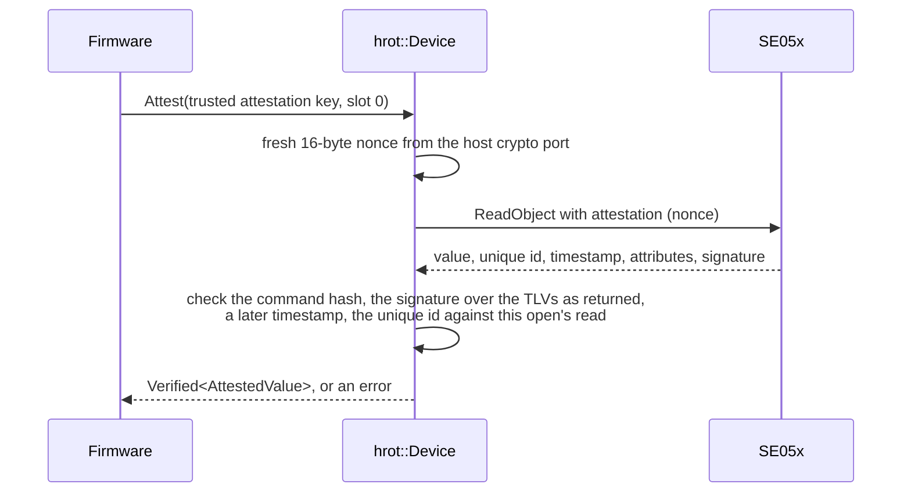

# Attested reads: check a key on the host

An attested read returns an object (here a public key) together with the chip's unique id, a timestamp and a
signature by an attestation key; a format 2 signature covers the hash of the command the chip received and the
returned TLVs (AN12543 3.2.7.2, p. 19). `hrot::Device::Attest` checks that answer **on the host**: your firmware
learns that the value came, unchanged and fresh, from a chip that holds the attestation key you trust.



```cpp
--8<-- "tests/docs/jobs.hpp:attest"
```

## What the facade checks, and what it does not

| Checked by `Attest` | Not checked by `Attest` |
| --- | --- |
| The signature, with the attestation key you pass, over the hash of the command and the TLVs exactly as returned | Whether the attestation key itself is genuine: that is the key you pass, so take it from the vendor certificate after its chain was verified ([CSR and certificates](certificates.md)), never from the same chip |
| The command hash: the answer is for this request | The object's class, origin or policy in the signed attributes: check them yourself when they matter (`Device::ReadAttested` returns the attributes) |
| A nonce from the host's crypto port for every request, and a timestamp later than the last one accepted, across reopens (AN12543 3.9, p. 42) | Anything on a remote server: see below |
| The unique id in the signed answer equals the one read from this chip in this open | That the chip is genuine: a counterfeit chip with its own attestation key passes this check; only a trusted, vendor-chained attestation key defeats it |

`Verified<AttestedValue>` is a local result: it holds the value, the timestamp, the unique id and the object size,
and **no signature**. For a data or certificate slot the value and `object_size` are without the completion marker
of `Store`. The object is read whole in one attested read of at most `kMaxAttestedBytes` (256) bytes, marker
included, so a stored value longer than 255 bytes cannot be attested (`BufferTooSmall`). The result cannot be sent
to a server as proof, and a server cannot verify it.

## Proving the key to a server

A server learns that a key lives in a genuine chip only by verifying the chip's signed answer itself, against the
vendor's attestation certificate chain. The facade does not provide that. To build it, an integrator needs, beyond
this driver:

- a request whose nonce the server chooses (the driver draws the nonce from the host's crypto port, so the server must
  trust the host, or the integration must pass the server's nonce through a crypto port that returns it);
- the signed answer as the chip returned it: `Device::ReadAttested` gives the value, the unique id, the timestamp, the
  signed attributes, the echoed command and the signature, but not the raw TLV bytes the format 2 signature covers;
- a server-side verifier of AN12543 3.2.7.2 with the vendor certificate chain (AN12436 Tables 8 and 9, p. 10).

Until that exists, use attestation to check the chip on the host, and send the server a certificate for the key
([CSR and certificates](certificates.md)) issued at provisioning time, when the factory checked the attestation.

## When it fails

| Error | Meaning | What to do |
| --- | --- | --- |
| `AttestationInvalid` | The signature, the command hash or the timestamp is wrong | Do not trust the value |
| `Counterfeit` | The signed unique id differs from the one read in this open: the answers do not come from one chip | Do not trust the chip |
| `InvalidArgument` | No trusted key was given | Give the verified vendor key |
| `FrameError` | A stored data object has no completion marker, or the value is not the size you expect | Do not use the value |
| `BufferTooSmall` | The stored value is longer than 255 bytes and cannot be attested whole (in the model; a chip may answer an error status instead above the 500-byte attested-read limit, [A36](../ambiguities.md)) | Attest a shorter object, or read it with `Load` |

**Bench step** (not verified on hardware): attest slot 0 on a dev kit with the vendor attestation key from its
certificate (AN12436 Tables 8 and 9, p. 10), then repeat with a wrong trusted key and check `AttestationInvalid`.

**Bench step** (not verified on hardware): `Store` values of 255, 300 and 600 bytes on a dev kit and `Attest` each.
255 bytes must verify; record the error and status word of the other two. The model answers both with the whole value,
which the host refuses as `BufferTooSmall`; above the 500-byte attested-read limit (AN13030 pp. 248-252) the chip may
answer an error status instead ([A36](../ambiguities.md)). Either way no value is returned.
