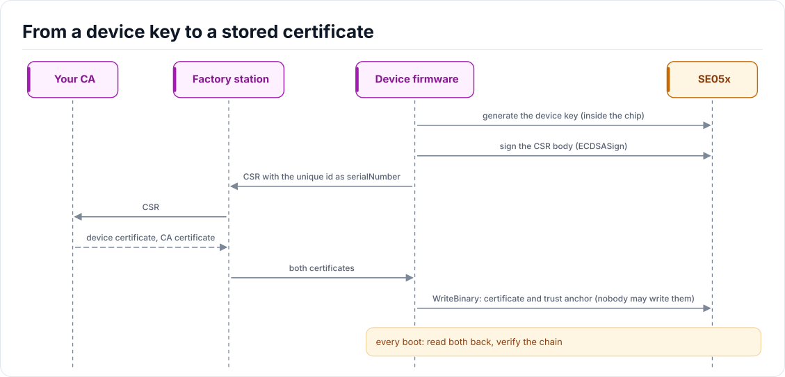

# CSR and certificates: get the key certified and keep the chain

The optional `se05x::pki` layer builds a certification request (PKCS#10, RFC 2986) signed by the key in the chip,
stores the certificate your CA issues and the CA certificate as the trust anchor in binary objects, and verifies the
chain at boot. See [Certificates (PKI)](../pki.md) for the whole layer.

<!-- figure: csr-flow -->
<picture>
  <source media="(prefers-color-scheme: dark)" srcset="../diagrams/csr-flow.dark.svg">
  
</picture>
<!-- /figure -->

```cpp
--8<-- "tests/docs/pki_recipes.hpp:generate"
```

```cpp
--8<-- "tests/docs/pki_recipes.hpp:csr"
```

```cpp
--8<-- "tests/docs/pki_recipes.hpp:import"
```

```cpp
--8<-- "tests/docs/pki_recipes.hpp:check"
```

## What it protects against

| Threat | Answer |
| --- | --- |
| A CSR for a key the device does not hold | The chip signs the CSR; it is checked against its own key before it leaves |
| A swapped certificate in storage | The certificate objects grant write to nobody; the chain is verified at boot against the stored anchor |
| A certificate that is expired or for another key | `VerifyChain` checks the time you give and that the leaf key is the key the chip signs with |

A certificate is public: anyone may read it, so its integrity is its signature, never its storage.

## When it fails

| Error | Meaning | What to do |
| --- | --- | --- |
| `InvalidArgument` (layer `Pki`) | Malformed DER, a field outside the profile, no time | Fix the input; the reason is in `Detail::step` |
| `AttestationInvalid` | A signature in the chain does not verify | Do not trust the device certificate |
| `ObjectExists` | A certificate is already stored | Rotate with the admin authentication object |

**Bench step** (not verified on hardware): run the four recipes on a dev kit against a test CA (OpenSSL), then check
with `openssl verify` that the stored chain verifies and that the leaf public key equals `GetPublicKey` of the slot.
