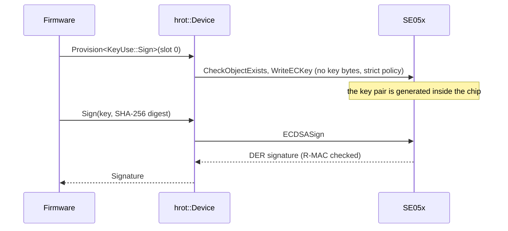

# Device identity: generate a key and sign

Give each device a NIST P-256 key pair generated inside the chip (WriteECKey with no key bytes, AN12543 p. 80). The
private half never exists outside the chip; the device proves who it is by signing (ECDSASign, AN12543 p. 101).



```cpp
--8<-- "tests/docs/jobs.hpp:provision"
```

```cpp
--8<-- "tests/docs/jobs.hpp:sign"
```

The key's policy allows signing and reading the public half under secure messaging, and forbids write, delete and
regeneration for everybody (AN12543 Tables 62 and 63, p. 66). `Find<KeyUse::Sign>(slot)` gives the key back after a
reboot, and only if the slot holds a persistent key pair generated in the chip with the facade's own policy, byte for
byte. A `Sign` key and a `TlsClient` key have the same policy, so `Find` cannot tell them apart: keep them in
different slots.

## What it protects against

| Threat | Answer |
| --- | --- |
| Cloning the device by copying its flash | The private key is not in flash and cannot be read from the chip |
| Replacing the key with one an attacker knows | The policy forbids write, delete and regeneration; `Provision` refuses an occupied slot |
| A forged "signature valid" on the bus | `VerifySignature` needs authenticated answers; over a C-MAC-only channel it is refused |
| Signing with the wrong key type | Each key has a C++ type per use: `Sign()` with an `AgreeKey` does not compile |

## When it fails

| Error | Meaning | What to do |
| --- | --- | --- |
| `ObjectExists` from `Provision` | The slot is in use; nothing changed | `Find<KeyUse::Sign>(slot)` |
| `PolicyDenied` from `Find` | The slot holds an object the facade did not make for this use | Do not use it; pick another slot |
| `PolicyDenied` (layer `Hrot`) | The answers are not authenticated | Open platform SCP03 at `CMacRMac` or `Full` |
| `AttestationInvalid` from `VerifySignature` | The signature does not verify | Reject the message |

**Bench step** (not verified on hardware): provision slot 0 on a dev kit, sign the SHA-256 of "abc", verify the
signature on the host with the public key from `GetPublicKey`, power-cycle and check `Find` returns the same key.
