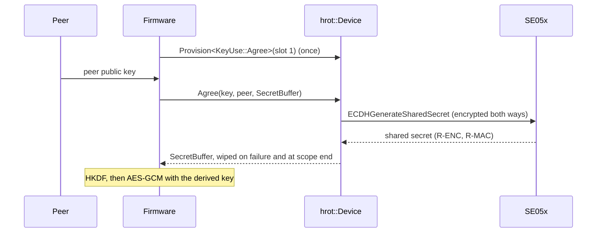

# ECDH key agreement and encryption

Agree a shared secret with a peer: the chip combines its private key with the peer's public key and returns the
32-byte x coordinate of the shared point (ECDHGenerateSharedSecret, AN12543 p. 105). Derive a session key from it
(HKDF on the host) and encrypt with that key; the private half of the agreement key never leaves the chip.



```cpp
--8<-- "tests/docs/jobs.hpp:ecdh"
```

## What it protects against

| Threat | Answer |
| --- | --- |
| Reading the shared secret on the bus | The facade sends ECDH only over traffic encrypted both ways (`Full`) |
| An invalid peer point that leaks key bits | The facade checks the peer before anything is sent: prefix 04, both coordinates below p, on the P-256 curve; AN12543 4.10.3.1 does not say the chip checks it, so the facade does |
| A secret left in RAM after use | `SecretBuffer` wipes itself; a failed call leaves it empty |

A chip whose extended features forbid ECDH (`EXTCFG_CRYPTO_EC_FORBID_ECDH`, AN12543 Table 9, p. 26) refuses with
`Unsupported` before anything is sent. A key whose policy has POLICY_OBJ_FORBID_DERIVED_OUTPUT (AN12543 Table 63)
never returns the secret; the facade's agreement key does not set it, because `Agree` returns the secret.

## When it fails

| Error | Meaning | What to do |
| --- | --- | --- |
| `PolicyDenied` (layer `Hrot`) | The traffic is not encrypted both ways | Open platform SCP03 at `Full` |
| `InvalidArgument` | The peer key is not a point on P-256 (prefix, range or curve equation) | Reject the peer |
| `Unsupported` | The chip's configuration forbids ECDH | Use another variant or configuration |
| `FrameError` | The chip answered a secret of the wrong size | The buffer is wiped; retry once, then report |

**Bench step** (not verified on hardware): agree with a host key on a dev kit and compare the secret with the one
OpenSSL computes from the chip's public key (`GetPublicKey`) and the host private key.
