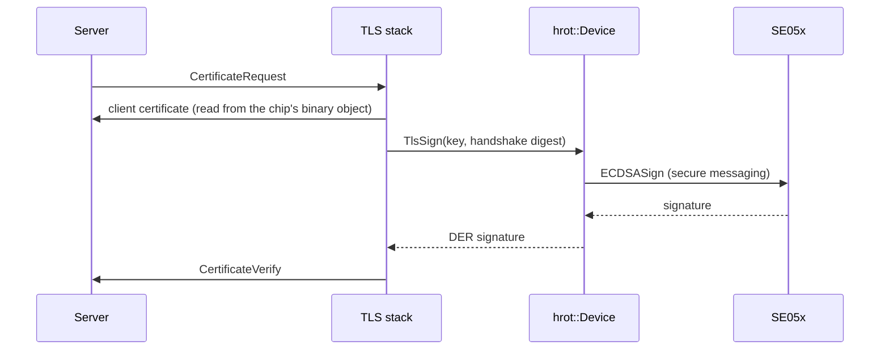

# Mutual TLS: client credentials in the chip

In mutual TLS the device proves its identity with a client certificate and a signature over the handshake. Keep the
client key in the chip as a `TlsKey` and give your TLS stack a private-key callback that calls `TlsSign` (ECDSASign
over the handshake digest, AN12543 p. 101). The certificate is the one from [CSR and certificates](certificates.md).



```cpp
--8<-- "tests/docs/jobs.hpp:tls"
```

Provision the key once with `Provision<hrot::KeyUse::TlsClient>(slot)`, find it once at start-up (three APDUs) and
keep the `TlsKey`: each handshake then costs one APDU. `TlsSign` is an ECDSA signature over the digest you give, like
`Sign`. The chip has no separate TLS signing rule, so a `TlsClient` key has the same policy as a `Sign` key and the
chip would sign any digest with it; what keeps the uses apart is the C++ type (`TlsSign` takes only a `TlsKey`, `Sign`
only a `SignKey`) and your slot plan, not the chip.

## What it protects against

| Threat | Answer |
| --- | --- |
| Stealing the client key to impersonate the device | The key never leaves the chip |
| Using the TLS key for something else in your code | `TlsKey` is its own type: `Sign()` with it does not compile. The chip does not enforce this; code that reaches `se05x::Device` directly can sign anything with it |
| A modified signature on the bus | The answer is authenticated by the R-MAC of the channel |

It does not make the TLS stack itself correct: check the server certificate and the cipher suites in the stack.

## When it fails

| Error | Meaning | What to do |
| --- | --- | --- |
| `ObjectNotFound` from `Find` | The TLS key was not provisioned | Provision it in the factory |
| `PolicyDenied` | The answers are not authenticated, or the slot holds another object | Open platform SCP03; check the slot plan |
| `ThroughputLimited` | The APDU budget is spent (SE052F, AN13904 p. 28) | Reuse TLS sessions; persist the count with `SetWindowCount` |

**Bench step** (not verified on hardware): connect a dev kit to an OpenSSL test server with
`openssl s_server -Verify 1` and the CA of the client certificate; the handshake must complete and the server log must
show the device certificate.
