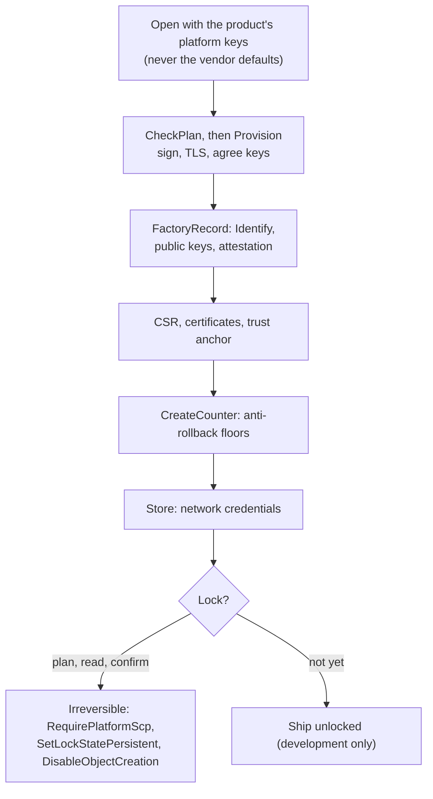

# Provisioning and the irreversible operations

Provisioning gives a new device its identity in the factory: open the chip with your platform keys, generate the device
keys, record the identity, get the certificates, create the floors, and only then lock what must never change. The
locks are irreversible; the driver compiles them only with `SE05X_ENABLE_IRREVERSIBLE=1` and applies each only with a
plan a person read and a typed confirmation ([Irreversible operations](../irreversible.md)).



```cpp
--8<-- "tests/docs/jobs.hpp:identity"
```

```cpp
--8<-- "tests/docs/lifecycle.hpp:lifecycle"
```

## What it protects against

| Threat | Answer |
| --- | --- |
| A device leaving the factory with the vendor's default keys | The driver ships no keys; your crypto port holds your key set |
| Bricking a device by a stray call | Irreversible operations are compiled out by default and need a plan and a typed confirmation |
| Changing the device later in the field | Requiring platform SCP03 and the persistent lock refuse unauthenticated changes (AN12543 3.8, Table 19) |
| Filling slots with objects nobody planned | `DisableObjectCreation` stops new objects after provisioning |

## When it fails

| Error | Meaning | What to do |
| --- | --- | --- |
| `IrreversibleNotConfirmed` | No plan, a plan for another device, or the wrong phrase | Prepare the plan again and confirm it |
| `ConditionsNotSatisfied` | The session role the operation needs is not open | Open the session of the role (Transport, FactoryReset, ...) |
| `ObjectExists` | Provisioning ran before | Use `Find`; do not reprovision |

**Bench step** (not verified on hardware): run the full flow on a sacrificial dev kit except the locks, power-cycle and
check every `Find` and `CheckFloor`; then plan `RequirePlatformScp`, confirm, apply, and check a plain command is
refused.
