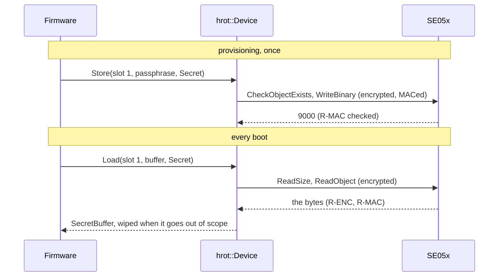

# Store a secret: a Wi-Fi passphrase or a token

Keep the network passphrase, a cloud token or a configuration blob in a binary object of the chip instead of in
flash. The object's policy requires secure messaging for every read, write and delete (AN12543 Table 63, pp. 66-67;
WriteBinary, AN12543 p. 84; ReadObject, p. 89), and the facade sends it only over a channel that encrypts both ways.



```cpp
--8<-- "tests/docs/jobs.hpp:wifi"
```

## What it protects against

| Threat | Answer |
| --- | --- |
| Someone reads the flash of a stolen device | The passphrase is not in flash. This holds only if the platform SCP03 keys are not readable from that flash either (a key store a flash copy cannot read): with the keys, the chip opens for anyone |
| A probe on SDA and SCL reads the bytes as they pass | The bytes cross the bus encrypted, in a channel at `Full` |
| A probe replaces the answer | Every 9000 answer carries an R-MAC the driver checks in constant time; an error status word comes alone and is not authenticated, so a probe can turn a success into an error, never an error into a success |
| A read of a secret with the wrong protection | `Load` takes the protection you pass. `Load(..., Protection::Public)` of a secret object over a channel that does not encrypt answers reads it in clear: always pass the protection the object was stored with |
| Firmware overwrites the slot by mistake | The slot refuses a second `Store` with `ObjectExists`; `Erase` first, on purpose |
| A store cut short | `Store` writes a completion marker after the last data chunk; `Load` refuses an object without it (`FrameError`), so a power loss mid-store never reads back as a value. A store that fails while powered deletes the object, except after SW 0x66A6 (`ThroughputLimited`: the chip refuses work, no delete is sent); after a power loss the object stays, without its marker: `Erase` it and store again (A35) |

!!! warning "Before the channel is open"
    Until `RequirePlatformScp` has been applied ([Provisioning](provisioning.md)), the chip also answers commands
    without secure messaging. A probe on the bus can then break your session and send its own plain commands: delete
    or rewrite `Protection::Public` data and certificates, and create objects in slots you planned. It cannot read
    or write `Protection::Secret` data, whose policy requires secure messaging. Provision in a trusted place, and
    apply `RequirePlatformScp` before the device leaves it.

`Load` and `Attest` read only what `Store` wrote. An object written another way (by `Device` or another tool) has
no completion marker and is `FrameError`; one that happens to end in 0xA5 reads back one byte short. Read such
objects with `Device::ReadObject`.

It does not protect against firmware that is itself compromised while it runs: such firmware can call `Load` like
yours does. Keep secrets in the chip and use them there where you can (sign, agree) rather than read them out.

## When it fails

| Error | Meaning | What to do |
| --- | --- | --- |
| `PolicyDenied` (layer `Hrot`) | The traffic is not encrypted both ways: no platform SCP03 at `Full` and no AESKey session | Open the chip with platform SCP03 at `Full`; nothing was sent |
| `ObjectExists` | The slot already holds a value | Keep the old value, or `Erase()` then `Store()` |
| `ObjectNotFound` | Nothing was stored in the slot | Run provisioning |
| `BufferTooSmall` | The stored value is longer than the buffer | Use a larger `SecretBuffer` |
| `FrameError` | The object has no completion marker (a store cut short) or an impossible size | Treat the value as unavailable; `Erase` and store again |

**Bench step** (not verified on hardware): cut the power of a dev kit during a 700-byte `Store` and check that `Load`
returns `FrameError`. Then, with platform SCP03 open at `Full`, store a 16-byte
passphrase, power-cycle, and load it back; then open without platform SCP03 and check that `Load` returns
`PolicyDenied` and that a logic analyser sees no ReadObject on the bus.
