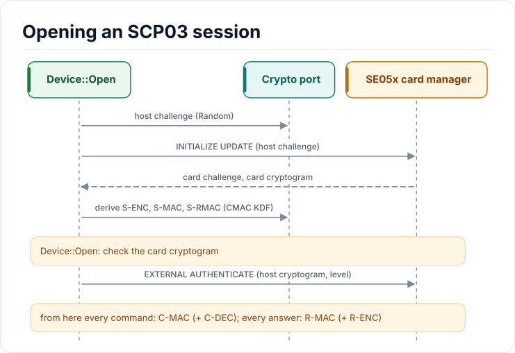

# Secure channel: SCP03 and why

Without a secure channel every command and answer crosses the I2C bus in clear: a probe on SDA and SCL reads what
you store and can rewrite what the chip answers. Platform SCP03 (GlobalPlatform Amendment D, run by the chip's card
manager; AN13030 p. 152) encrypts and MACs both directions with session keys derived from static keys only your
crypto port holds. An AESKey session does the same per applet session (AN12543 3.6, pp. 33-35).

<!-- figure: scp03-open -->
<picture>
  <source media="(prefers-color-scheme: dark)" srcset="../diagrams/scp03-open.dark.svg">
  
</picture>
<!-- /figure -->

```cpp
--8<-- "tests/docs/jobs.hpp:open-secure"
```

```cpp
--8<-- "tests/docs/jobs.hpp:aeskey-session"
```

Choose the level by what you do: keys, counters and verification need authenticated answers (`CMacRMac` or `Full`),
secrets and ECDH need encryption both ways (`Full`). Set `Config::scp_policy = ScpPolicy::Require` for a root of
trust: `Auto` decides from the chip's unauthenticated ReadState answer, which a probe could change.

## What it protects against

| Threat | Answer |
| --- | --- |
| Reading data on the bus | C-DEC and R-ENC encrypt both ways |
| Changing a command or an answer | Every command carries a C-MAC and every 9000 answer an R-MAC, checked in constant time. Two answers carry none: an error status word, which comes alone (a probe can turn a success into an error, never the reverse), and the bare 9000 of a command that ends an applet session (`DeleteAll`, A22) |
| Replaying an old exchange | The MAC chains over the session; the counter never wraps |
| A downgrade to the clear bus | Once platform SCP03 was open, the device sends no applet command in the clear until `Recover()` or `Open()` has opened it again; those two send the card manager's select and handshake in the clear, as SCP03 requires. With `ScpPolicy::Auto`, `Open()` reads the chip's requirement from an unauthenticated answer, so a probe can make it open without SCP03: use `Require` |

!!! warning "Before the channel is open"
    Until `RequirePlatformScp` has been applied, the chip also accepts plain commands, so a probe can send its own
    whatever your firmware does ([Security model](../security-model.md)). Apply it during provisioning.

The static keys are the root of this protection: they live in your crypto port as `KeyRef` handles, never as bytes in
the image, and the vendor's default key sets must be replaced before a product leaves the factory.

## When it fails

| Error | Meaning | What to do |
| --- | --- | --- |
| `AuthFailed` | Wrong key version or keys | Check the key set provisioned for this chip |
| `SecureChannelError` | A MAC or padding check failed | The channel is closed; `Device::Recover()` and open again |
| `WrongState` | The chip requires SCP03 and the policy says Off | Give the keys and use `Require` |

**Bench step** (not verified on hardware): open a dev kit with platform SCP03 at `Full`, trace the bus with a logic
analyser and check that no APDU after EXTERNAL AUTHENTICATE shows plain data; then flip one bit of an answer in a test
harness and check the call fails with `SecureChannelError`.
