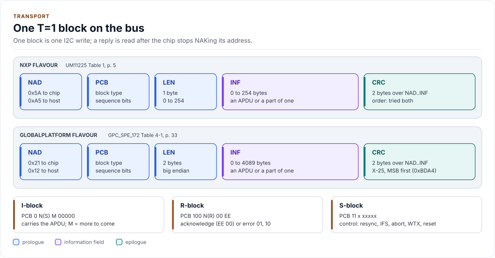
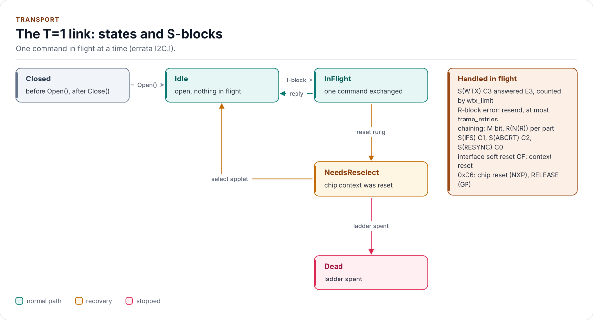
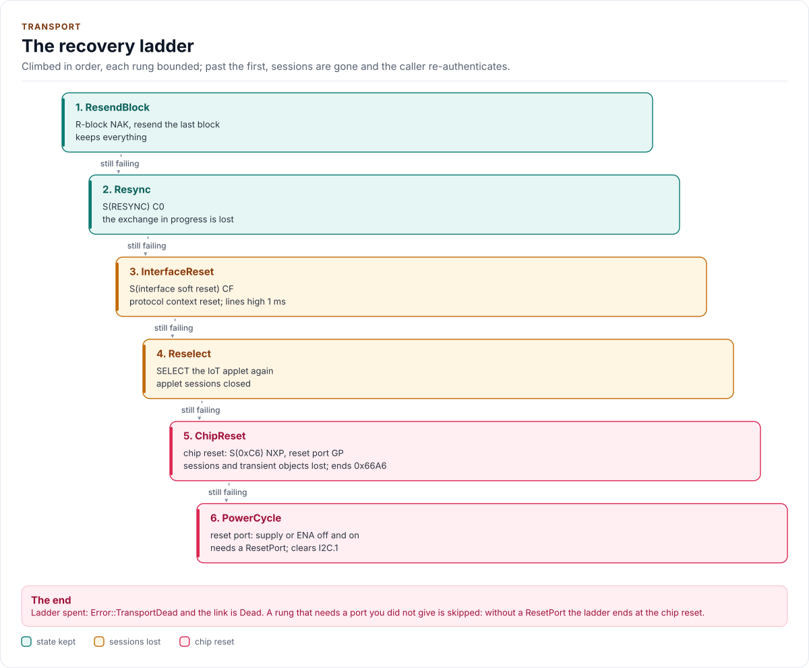

# Transport: T=1 over I2C

How a command reaches the chip: the I2C rules, the block format of both T=1 flavours, the control blocks, the waits
and the recovery ladder. The layer is `se05x::t1::Link`; its numbers are in `inc/se05x_wire.hpp`.

<!-- generated: datasheet-refs -->
??? abstract "Datasheet sections this page relies on"

    - Power-down and deep power-down modes: NXP SE050-DATASHEET Rev. 3.8, 5 Power-saving modes, p. 9
    - Wake-up from power-down may need a retransmission: NXP SE050-DATASHEET Rev. 3.8, Table 14 notes 4 and 5, p. 19
    - SE051 power-saving modes: NXP SE051 Rev. 2.0, 5 Power-saving modes, p. 11
    - SE052 power-down by RELEASE and deep power-down by S-block 0xDF: NXP SE052 Rev. 1.5, 10 Power-saving modes, p. 7
    - SE052 CIP bytes in the configuration: NXP SE052 Rev. 1.5, Table 12 Configuration parameters, p. 17
    - SE052 tDPD: no access for 300 us after a deep power-down: NXP SE052 Rev. 1.5, Table 15 Electrical AC characteristics, tDPD, p. 22
    - I2C.1 lock-up after a second command, I2C.2 no empty frame: NXP SE050_Erratasheet Rev. 1.0, 3.1, 3.2, p. 7
    - NXP flavour block: NAD, PCB, LEN, INF, CRC: NXP UM11225 Rev. 1.2, Table 1, Tables 3 and 4, p. 5
    - NXP flavour I-block and R-block PCB: NXP UM11225 Rev. 1.2, Tables 5 to 7, p. 6
    - NXP flavour S-blocks: NXP UM11225 Rev. 1.2, Table 9, p. 7
    - NXP flavour ATR: NXP UM11225 Rev. 1.2, Tables 11 to 13, p. 9
    - Retransmissions, WTX and soft reset rules: NXP UM11225 Rev. 1.2, Error handling and retransmission, p. 11
    - One block per I2C write, no repeated start: NXP UM11225 Rev. 1.2, I2C framing, p. 13
    - Polling with one-byte reads after MPOT: NXP UM11225 Rev. 1.2, Polling, p. 14
    - Default SEGT, MPOT and power wake-up time: NXP UM11225 Rev. 1.2, Table 14, p. 19
    - GP flavour I2C: polling, guard times, clock stretching: GlobalPlatform GPC_SPE_172 v1.0, I2C physical layer, p. 23
    - GP flavour default IFSC, BWT and power wake time: GlobalPlatform GPC_SPE_172 v1.0, Default values, p. 31
    - GP flavour block, NAD 21/12, two-byte LEN, CRC example BDA4: GlobalPlatform GPC_SPE_172 v1.0, Table 4-1, p. 33
    - GP flavour PCB and S-block codes: GlobalPlatform GPC_SPE_172 v1.0, Table 4-4, p. 34
    - GP flavour CIP: GlobalPlatform GPC_SPE_172 v1.0, Tables 4-6 to 4-9, p. 36
    - WTX host timeout at least 4 s; NXP mode is the default: NXP AN13904 Rev. 1.0, WTX and T=1 mode, p. 27
    - T=1 chip reset and deep power-down: NXP AN13030 Rev. 2.7, 10.16, p. 281

    All of them, with the driver API for each: [Datasheet map](datasheet.md).
<!-- /generated -->

## The block

<!-- figure: t1-frame -->
<picture>
  <source media="(prefers-color-scheme: dark)" srcset="diagrams/t1-frame.dark.svg">
  
</picture>
<!-- /figure -->

Two flavours exist and they do not interoperate:

| | NXP (UM11225) | GlobalPlatform (GPC_SPE_172) |
| --- | --- | --- |
| NAD host to chip, chip to host | `0x5A`, `0xA5` | `0x21`, `0x12` |
| LEN | 1 byte, INF up to 254 | 2 bytes big endian, INF up to 4089 |
| CRC | CRC-16 of ISO 7816-3; byte order not stated | CRC-16/X-25, MSB first; example `BDA4` |
| Identification | ATR (S-block C7, or the reply to a soft reset) | CIP (S-block C4) |
| Power saving | End of APDU session `C5` | Release `C6` |
| Defaults before the ATR or CIP | SEGT 10 us, MPOT 1 ms, power wake 5 ms | IFSC 8, IFSD 64, BWT 300 ms, power wake 25 ms |

Which flavour a chip speaks: the SE051 detects it from the first frame it sees (SE051 data sheet 4.1.2, p. 9) and can
have it fixed by its PERSO setting (AN13015 p. 49); SE052F NXP mode by default per AN13904 p. 27, while its data sheet's
configuration table lists the GP 0.39 flavour (SE052 p. 18); SE050 not stated. So `Config::flavour` defaults to
`TransportFlavour::Auto`: the link tries the NXP form for half of the ATR poll budget (`Config::atr_poll_budget_ms`),
then the GP form for the rest, and keeps the first that checks, CRC byte order included. The NXP form goes first because
a chip that locks onto the first frame would otherwise be locked into GP by the probe, and the vendor middleware speaks
the NXP form. In the GP flavour the link sends NAD 0x21 and accepts 0x12 or the NXP 0xA5 from the chip: GPC_SPE_172
4.2.1 (p. 33) only recommends 0x12, and the middleware's GP mode expects 0xA5 ([Ambiguities](ambiguities.md), A17). A
stale frame an earlier host left unread decides it sooner: `Open()` reads it out first, and the NAD it carries names the
flavour, which is then the only one tried. A flavour mismatch looks like silence or `FrameError`
([Troubleshooting](troubleshooting.md#flavour-mismatch)).

## I2C rules

- One block is one I2C write: start, address, the bytes, stop. No repeated start (`kRepeatedStart` is false).
- Never an empty write: an address-only frame makes an SE050 stretch the clock forever (errata I2C.2). The driver
  never scans the bus; do not scan it yourself.
- One command in flight: a second command before the reply is read can make the SE050 hold SCL low until a power
  cycle (errata I2C.1). The link is single flight and returns `Busy`.
- While the chip works it NAKs its address. The link polls with reads after the minimum polling time (MPOT, 1 ms by
  default), up to the block waiting time; a reply may be read in parts, and bytes read past its end are `0xFF`.
- The guard time (SEGT, or RWGT in GP; at least the default 10 us) holds between any two accesses: before every
  read and every write, the body read after the prologue read included (UM11225 Table 15, p. 20; GPC_SPE_172 3.2.7,
  p. 28). The one exception is the write right after a NACKed probe for an unread answer (errata I2C.1): a wait
  there would let the chip's answer arrive just before the write. After a deep power-down by S-block on the SE052
  nothing touches the bus for tDPD, 300 us (SE052 data sheet Table 15, p. 22). After an interface soft reset or a
  chip reset, SDA and
  SCL stay high (errata I2C.3: a low line there makes the SE050 reset itself after about 1 s, and repeated events
  lock it).
- SCL must change before SDA with the data sheet's margin (errata I2C.4): a port requirement, see [Porting](porting.md).

## States and control blocks

<!-- figure: t1-states -->
<picture>
  <source media="(prefers-color-scheme: dark)" srcset="diagrams/t1-states.dark.svg">
  
</picture>
<!-- /figure -->

Waiting time extension: when the chip needs more than BWT it sends S(WTX request); the link answers S(WTX response)
and waits the multiplier times BWT, but at least 4 s (AN13904 p. 27: the host timeout across WTX is at least 4 s).
A WTX extends the command's own deadline as well, whatever its class: a `Fast` command (2 s) that the SE052F keeps
alive with a WTX every second, as it does during its FIPS self-test, completes instead of timing out with an unknown
outcome (A19). The link never holds
SCL across the wait and counts each WTX against `Config::wtx_limit`. At session open up to 40 WTX requests are allowed
(`kSessionOpenWtxAllowance`), as the vendor middleware answers to flush an earlier transaction (AN13030 p. 9).

## Recovery

<!-- figure: recovery-ladder -->
<picture>
  <source media="(prefers-color-scheme: dark)" srcset="diagrams/recovery-ladder.dark.svg">
  
</picture>
<!-- /figure -->

UM11225 allows at most ten further attempts after an error before an interface soft reset (p. 11);
`Config::frame_retries` is at most that. The chip-reset rung is the S-block `C6` only in the NXP flavour; in the GP
flavour `C6` is RELEASE, so the rung calls the reset port's `Reset()`, which must really reset the chip. The
power-cycle rung calls the reset port's `PowerCycle()`; the driver drives no pin itself. Without a reset port both
port rungs are absent. On the SE050 and SE051 RST_N has no effect when only I2C is enabled (SE050 4.2 p. 9, SE051
p. 10), so a port there implements `Reset()` and `PowerCycle()` with ENA (VOUT wired to VCC) or a supply switch; on
the SE052 `Reset()` can pulse RST_N (SE052 Table 14, p. 20) ([Porting](porting.md)).

## Power saving

- **Power-down** (state kept): entered after the end-of-APDU-session (NXP) or RELEASE (GP) response; a falling edge
  on SDA wakes it. Waking at 400 kHz or 1 MHz without clock stretching can miss the first block; the chip then asks
  for a retransmission with an R-block (SE050 Table 14 notes 4 and 5, p. 19).
- **Deep power-down** (nothing kept): ENA low on the SE050 and SE051; the S-block `0xDF` on the SE052, woken by the
  next I2C access. Sessions and transient objects are gone afterwards. `Device::DeepPowerDown()`.
