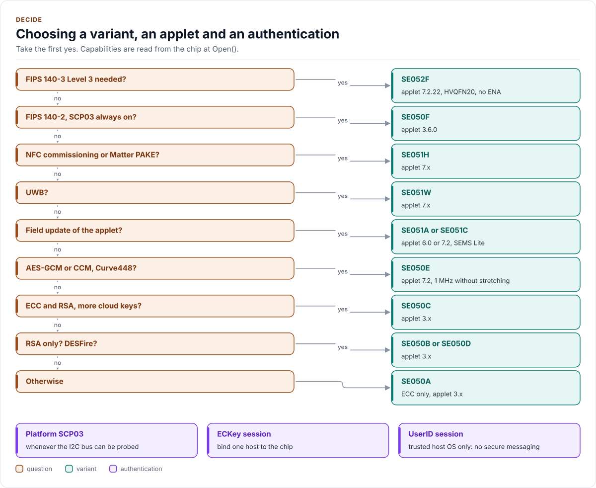
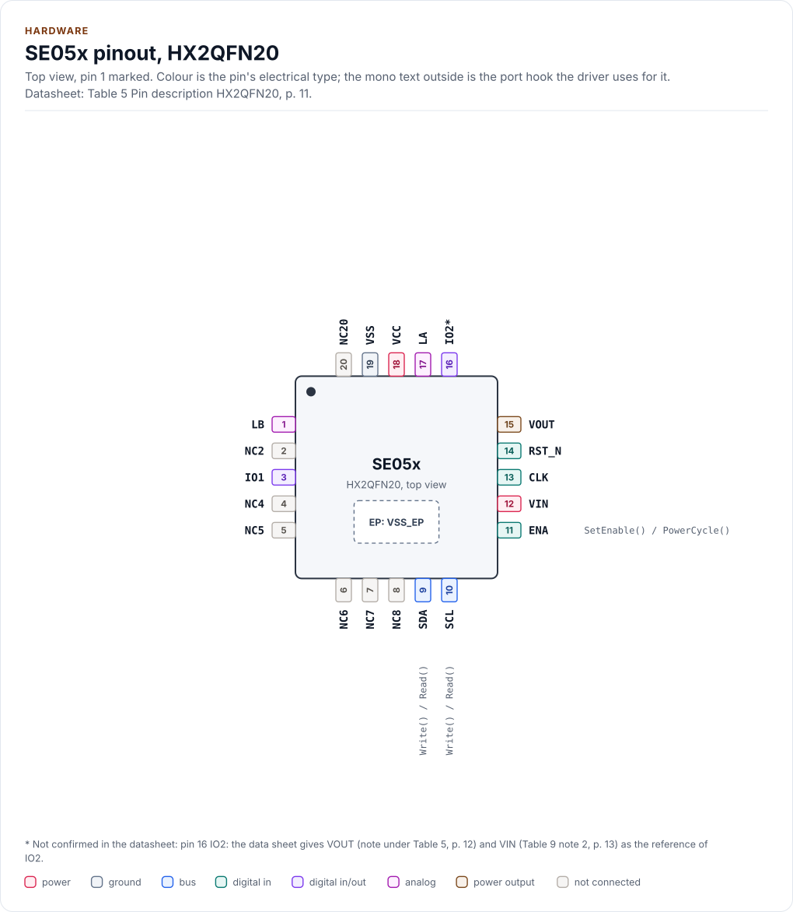
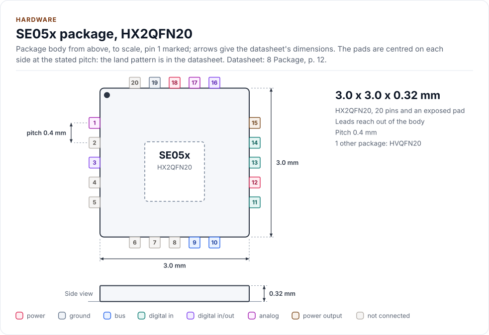
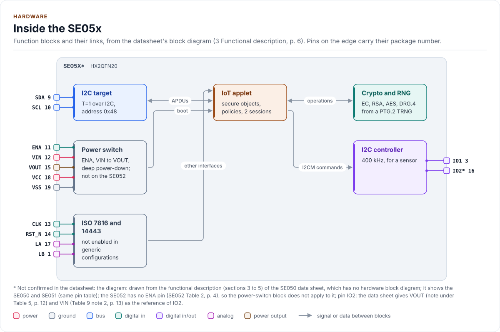
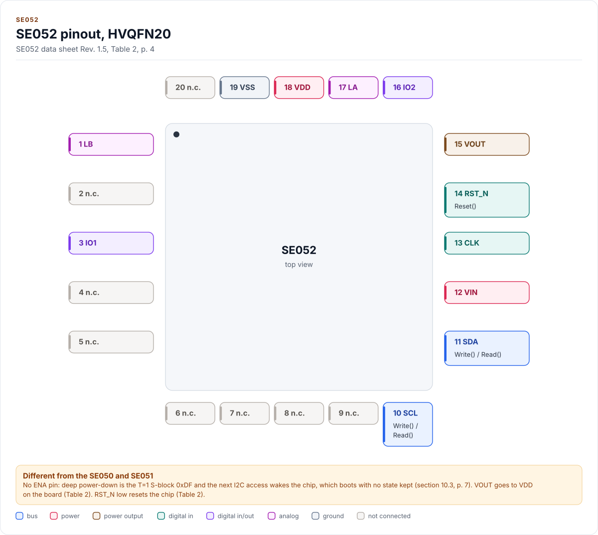
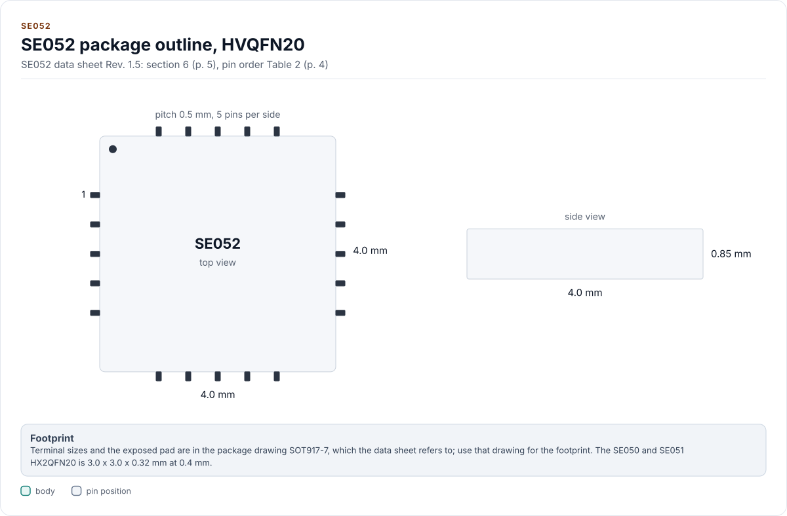
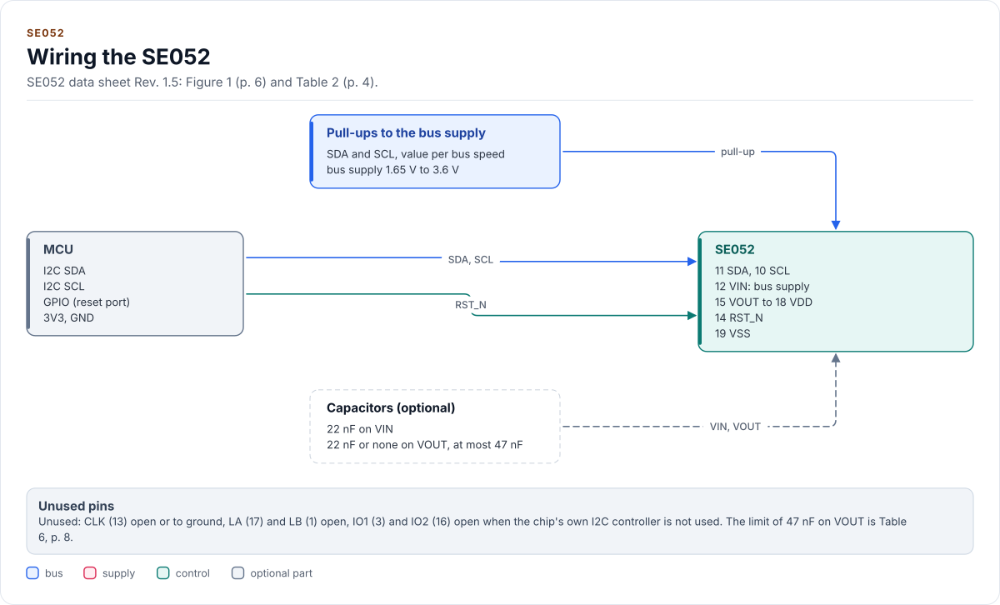

# Where to use it: which variant

The family has three chips, many configurations and two applet generations. This page helps you choose where each
fits and which one to order; the per-chip guides ([SE050](se050.md), [SE051](se051.md), [SE052](se052.md)) cover
wiring and what differs.

<!-- generated: datasheet-refs -->
??? abstract "Datasheet sections this page relies on"

    - I2C clock and clock stretching per variant: NXP SE050-DATASHEET Rev. 3.8, 4.1.1 Supported I2C frequencies, p. 9
    - SE050 ordering and variants: NXP SE050-DATASHEET Rev. 3.8, Table 3 Ordering information, p. 10
    - SE051 ordering and variants: NXP SE051 Rev. 2.0, Table 2 Ordering information, p. 11
    - Feature bits of the extended version: NXP AN12543 Rev. 4.5, Table 9, p. 26
    - Limits of FIPS 140-3 mode: NXP AN12543 Rev. 4.5, 3.13.2 FIPS 140-3 mode, p. 45
    - GetVersion, GetTimestamp, GetFreeMemory, GetRandom: NXP AN12543 Rev. 4.5, Generic management commands, p. 151
    - SE050 variant identifiers: NXP AN12436 Rev. 2.4, Table 2 Variant identifiers, p. 8
    - SE051 OEF identifiers per variant: NXP AN12973 Rev. 2.0, Table 4, p. 4
    - SE052F configuration: applet 7.2.22, AppletConfig 0x26F2, OEF B501: NXP AN14277 Rev. 1.0, SE052F configuration, p. 2
    - GetFreeMemory reply width: NXP AN13030 Rev. 2.7, GetFreeMemory, p. 641

    All of them, with the driver API for each: [Datasheet map](datasheet.md).
<!-- /generated -->

<!-- figure: variant-decision -->
<picture>
  <source media="(prefers-color-scheme: dark)" srcset="diagrams/variant-decision.dark.svg">
  
</picture>
<!-- /figure -->

## The family at a glance

| | SE050 | SE051 | SE052F |
| --- | --- | --- | --- |
| Package | HX2QFN20, 3 x 3 mm | HX2QFN20, 3 x 3 mm | HVQFN20, 4 x 4 mm |
| Configurations | A1, A2, B1, B2, C1, C2, D2, E2, F2 | A2, C2, H2, P2, W2 | F2 |
| IoT applet | 3.x (A to D, F), 7.2 (E) | 6.0 or 7.2, 7.3 by update | 7.2.22 |
| Deep power-down | ENA pin | ENA pin | S-block 0xDF |
| Clock stretching by default | on for A to D and F, off for E | off | off |
| Certification (chip) | F: FIPS 140-2 | IEC 62443-4-2 | FIPS 140-3 Level 3 |

The digit after the letter is the temperature range (1: -25 to 85 C, 2: -40 to 105 C). Sources: SE050 data sheet
Table 3 (p. 10), SE051 Table 2 (p. 11), AN12907 p. 13 for the SE051 applets, AN14277 for the SE052F configuration.

## Where each fits

| Your product | Choose | Why |
| --- | --- | --- |
| A connected device that needs a device identity, TLS client keys and secret storage, no certification | SE050E or SE050C | The IoT applet with ECC (E adds AES-GCM and CCM, applet 7.2); smallest package |
| A product that must use FIPS 140-2 validated key storage | SE050F | FIPS 140-2 certified chip; platform SCP03 always on ([SE050 guide](se050.md)) |
| A product that must use FIPS 140-3 Level 3 validated key storage | SE052F | FIPS 140-3 certified chip; mind the APDU throughput limit (AN13904 p. 28) |
| A device commissioned over NFC or for Matter | SE051H | NFC and PAKE (SE051 data sheet Table 2, p. 11) |
| A device with UWB ranging | SE051W | UWB (SE051 data sheet Table 2, p. 11) |
| A fleet whose applet must be updatable in the field | SE051A or SE051C | SEMS Lite applet update (SE051 data sheet Table 2, p. 11) |

## The chips

The SE050 and SE051 share the HX2QFN20 package and its pinout; the SE052 comes in the larger HVQFN20 with a
different pinout and no ENA pin (SE052 data sheet section 6, p. 5, and Table 2, p. 4).

### SE050 and SE051 (HX2QFN20)

<!-- figure: chip-pinout -->
<picture>
  <source media="(prefers-color-scheme: dark)" srcset="diagrams/chip-pinout.dark.svg">
  
</picture>
<!-- /figure -->

<!-- figure: chip-outline -->
<picture>
  <source media="(prefers-color-scheme: dark)" srcset="diagrams/chip-outline.dark.svg">
  
</picture>
<!-- /figure -->

<!-- figure: chip-blocks -->
<picture>
  <source media="(prefers-color-scheme: dark)" srcset="diagrams/chip-blocks.dark.svg">
  
</picture>
<!-- /figure -->

### SE052 (HVQFN20)

<!-- figure: se052-pinout -->
<picture>
  <source media="(prefers-color-scheme: dark)" srcset="diagrams/se052-pinout.dark.svg">
  
</picture>
<!-- /figure -->

<!-- figure: se052-outline -->
<picture>
  <source media="(prefers-color-scheme: dark)" srcset="diagrams/se052-outline.dark.svg">
  
</picture>
<!-- /figure -->

<!-- figure: se052-wiring -->
<picture>
  <source media="(prefers-color-scheme: dark)" srcset="diagrams/se052-wiring.dark.svg">
  
</picture>
<!-- /figure -->

## What differs by applet

- **3.x** (SE050 A to D, F): attestation format 1 (nonce echo), ECDAA, no AES-GCM or CCM, 2-byte free-memory reply.
  The HRoT facade (`hrot::Device`) does not run here: every facade call returns `Unsupported` before anything is
  sent, after its argument checks (an invalid key, an off-curve point or an empty buffer is refused first with
  `InvalidArgument`). Use `se05x::Device` directly on these chips.
- **6.x** (SE051 A2 and C2 on early boards, OEF A565 and A564): no specification in hand; the policy builder uses
  the 3.x rule table. The HRoT facade does not run here either: every facade call returns `Unsupported` before
  anything is sent, after the same argument checks. Use `se05x::Device`, or update the applet to 7.x.
- **7.x** (SE050E, SE051, SE052): the HRoT facade runs; attestation format 2 (the command is signed), AES-GCM,
  CCM and GMAC, Curve448 on SE050E and SE051, PAKE on parts with the feature bits, ReadState, TriggerSelfTest,
  DisableObjectCreation; the extended version carries 30 feature bytes (AN12543 Table 9).
- **FIPS modes**: the SE050F refuses RSA 1024, plain RSA, 2-key 3DES, SHA-1 signatures and curves under 224 bits; the
  SE052F has no EdDSA, Montgomery curves, DES, MIFARE DESFire or PAKE (AN12543 3.13.2 FIPS 140-3 mode, p. 45).

## The driver reads the chip, not the name

`Open()` reads the applet version and AppletConfig, the extended feature bits on 7.x, the OEF id and the free-memory
width, and fills `Capabilities`. Every command passes the capability gate before it is sent: a command the chip does
not have is `Unsupported` and costs no round trip. The OEF ids per configuration are in AN12436 Table 2 (SE050) and
AN12973 Table 4 (SE051); where two tables of one note disagree, the chip's own value wins.

## Not for this driver

The SE051P runs a customer applet and has no IoT applet. The T4T applet of the SE051H and the SEMS Lite update agent
are outside v1 ([Limitations](limitations.md)).
